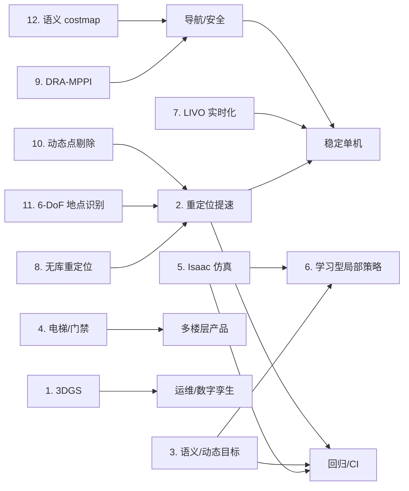

# rosiwit_ws — 室内移动机器人（SLAM / 导航 / 感知 / 仿真）

本仓库是室内移动机器人的整机软件工作区，包含 ROS1（生产）与 ROS2（迁移中）两套栈。

## 当前状态

| 能力 | 现状 |
|---|---|
| 定位 | FAST-LIO2 前端 + GICP 局部匹配 + 9 状态 ESKF；10 Hz 输出；静态抖动 5–6 mm（eskf），单帧最大 21 mm |
| LIVO（激光+惯性+相机） | FAST-LIVO2 已移植进核心（零 ROS），`default.yaml` 里 `frontend: fast_livo2_frontend` 一行切换即可跑；NTU eee_03 离线回放 **ATE 0.237 m**（独立包 0.257）；单目相机也能上色（灰度） |
| 建图 | 关键帧子图 + PCD 地图 + 2D 栅格 + 叠加层（半静态变化沉淀，不重写底图）；地图只产出一个 `map.pcd`，有相机时字段自动带 `rgb`（`x y z intensity rgb`） |
| 回环 / 重定位 | Scan Context 回环；全局重定位改为 **ScanContext 候选级联**：252k 点地图/20 个合成场景 **p95 3.3 s、召回 100%、误锁 0%**（原 FPFH 整图 RANSAC 22–45 s，现仅作无 `.scdb` 兜底） |
| 导航 | Hybrid A* + MPPI + footprint-aware 控制、窄道检测、速度限制、未知区代价 |
| 感知 | ROS2：AVM、地面纹理、QR、相机低矮障碍检测；ROS1：无 3D 语义/跟踪 |
| 仿真 | ROS1 Gazebo classic；ROS2 有 world/models/urdf |
| 平台 | 生产 ROS1 Melodic（2023 EOL）；ROS2 工作区已成型（自研 nav/perception/exploration/coverage/app） |
| 算力 | 8 核 ARM，无 GPU；SLAM 节点 RSS ≈ 1.0–1.2 GB；LIVO 长序列处理约 7.5 帧/s（未实时） |

## 目录

```
ros1_ws/        ROS1 生产栈（rosiwit_slam_ros1 / navigation / simulation / starter）
ros2_ws/        ROS2 迁移栈（slam / navigation / perception / exploration / coverage / app / sim）
src/            与 ROS 无关的核心库（rosiwit_slam / rosiwit_common / rosiwit_navigation）
docs/           设计、规范、学习材料
docker/         容器与构建脚本
```

构建与运行方式见各包 README；ROS1 单测：`catkin_make run_tests_rosiwit_slam_ros1`。

---

# TODO / 技术路线

> 约定：优先级 P0（0–3 月，可靠性/体验）> P1（3–6 月，产品力）> P2（6–12 月，前沿/合规）。
> 每项都给出可验收指标；没有验收指标的方向不进入开发。

| # | 方向 | 目标 | 优先级 | 预估 | 关键依赖 | 状态 |
|---|---|---|---|---|---|---|
| 1 | 3DGS 地图 | 站点级高保真重建，用于运维/数字孪生/地图 QA | P2 | 4–6 周 | GPU 工作站、相机标定、采集路线 | 未开始 |
| 2 | 重定位提速 | p95 < 5 s，召回 > 95%，不误锁 | **P0** | 3–4 周 | 回放数据集、现有 relocalizer 接口 | **已达验收线（合成 20 场景：p95 3.3 s / 召回 100% / 误锁 0%），现场场景库 + 时序确认待做** |
| 3 | 3D 语义/动态目标 | 人/叉车/托盘检测+跟踪+短时预测，接入局部规划 | P1 | 8–12 周 | 数据采集/标注、GPU 或 INT8 优化 | 设计完成，未开工 |
| 4 | 电梯/门禁 | 多楼层自主乘梯与门禁通行 | P1（按产品） | 8–12 周 + 现场 | 电梯厂商接口、现场许可 | 未开始 |
| 5 | Isaac 仿真 | 场景化回归 + sim2real | P2 | 6–8 周 | GPU 服务器、USD 资产 | 未开始 |
| 6 | 学习型局部策略 | 人机混场/窄道博弈优于 MPPI，且不降安全 | P2 | 12–16 周 | 感知、仿真、示教数据 | 未开始 |
| 7 | LIVO 实时化与长序列稳定 | 长序列 10 Hz 不掉帧，精度不退化 | **P1** | 4–6 周 | 地图裁剪/滑窗、现场相机标定 | 核心移植完成（eee_03 ATE 0.234 m），实测 7.5 帧/s，未实时 |
| 8 | 无库全局重定位（KISS-Matcher） | 没有 `.scdb` 时也能 2 s 内给出可信位姿，并给出失败原因 | **P0** | 1–2 周 | KISS-Matcher 上游（MIT-SPARK）、现有 `reloc_bench` | 未开始 |
| 9 | 拥堵场景不冻结（DRA-MPPI） | 拥堵通过率 +20%，急停/碰撞不增加 | **P0** | 1 周 | 现有 MPPI、动态障碍轨迹 | 未开始 |
| 10 | 动态点剔除 | 地图动态残留 -70%，覆盖分不被动态点抬高 | P1 | 1–2 周 | ERASOR 类方法、`pcd_map_manager` | 未开始 |
| 11 | 6-DoF 地点识别（BTC/RE-TRIP） | 反向/大视角回环召回 > 85%，误锁 < 1% | P1 | 2–3 周 | BTC 开源实现、描述子库内存 | 未开始 |
| 12 | 语义 costmap | 小障碍漏检 -50%，图像到代价地图 < 100 ms | P1 | 2–3 周 | 分割模型（SegFormer-B0 / SAM3）、类别定义 | 未开始 |

## 依赖关系



---

## 1. 3DGS 地图（P2，4–6 周）

**目标**：把站点扫成可浏览、可量测的高保真 3DGS 模型，用于运维、验收、数字孪生和地图质量检查。**不进入实时定位/控制环。**

**为什么**：现有 PCD + 2D 栅格只能看几何，现场验收/远程排障缺少“像照片一样”的证据；3DGS 还能暴露建图漂移、遮挡和变化区域。

**工作包**
1. 采集管线：图像 + 激光 + SLAM 位姿同步；曝光/白平衡锁定；输出 MCAP/rosbag + 位姿 + 内参。
2. 位姿初始化：优先用 SLAM 位姿，COLMAP 只做精化；失败帧剔除策略。
3. 训练：gsplat/nerfstudio，站点分块训练；SH 阶数/量化/剪枝压缩。
4. 服务与查看：导出点云/网格给 RViz/Foxglove；Web 查看器；与 PCD 地图同版本号。
5. 质量指标：PSNR/SSIM、几何误差（对 PCD）、覆盖空洞、漂浮物比例；自动报告。
6. 与地图版本绑定：`<site>/<map_version>/gsplat/` + metadata；回滚不依赖 3DGS。

**里程碑**
- M1：单站点 1000 m² 重建跑通，几何误差 < 3 cm。
- M2：压缩后 < 500 MB，工作站加载 < 3 s。
- M3：验收报告模板 + 与地图版本联动。

**验收**：一个真实站点的 3DGS 可在 Web 打开；与 PCD 同坐标系对齐；几何误差 p95 < 3 cm；不影响现有定位链路。

**风险**：光照变化、动态物体、存储；相机标定误差会直接进模型。

**不做**：不用 3DGS 做实时定位（至少本期不做）；不替代 PCD/栅格。

## 2. 重定位提速（P0，3–4 周）

**目标**：冷启动/被搬动/切图后的全局重定位从 22–45 s 降到 **p95 < 5 s**，召回 > 95%，误锁 < 1%。

**为什么**：这是当前最直接的用户体验差距；FPFH 在 110 万点全图上做 RANSAC，代价随地图线性增长。

**工作包**
1. 基线与数据集：收集 ≥ 20 个重定位场景（冷启动、被搬动 1–5 m、光照/堆货变化），统一回放与计时脚本。
2. 粗检索：Scan Context++ / STD 描述子，按关键帧建库；top-k（10–20）候选。
3. 几何验证：候选位姿 → GICP/NDT 精配准 → 多假设打分；保留现有 χ²/健康门控。
4. 时序确认：连续 2–3 帧一致才接受，抑制单帧误锁。
5. 备选：2D 栅格相关（平面站点）+ 3D 精化；学习描述子（AnyLoc/MixVPR）作为 P2 备选。
6. 工程化：描述子预计算与增量更新（叠加层变化后重建）；内存/CPU 预算。

**验收**：20 场景回放，p95 < 5 s、召回 > 95%、误锁 < 1%；单次检索 CPU < 200 ms；失败有明确原因码。

**进展（2026-11，详见 [docs/dev/relocalization-speedup.md](docs/dev/relocalization-speedup.md)）**

- 新增 core 基准工具 `tools/reloc_bench`：地图 + 轨迹 → N 个"冷启动"场景（地图内合成扫描 + 噪声/丢点），
  输出 p50/p95/max、召回、误锁，可复现、无 ROS 依赖。
- 瓶颈定位：`localizeTopK` 给 `3*top_k` 个候选每个都在**整图**上跑 GICP（251k 点地图单次 ~0.7 s）；
  `fpfh_ransac` 还在整图上做 3D 特征 + RANSAC。
- 改动：① 候选处裁局部子图（`reloc_submap_radius`，默认 30 m）；② ScanContext **候选级联**
  （候选位姿先打覆盖分淘汰，只精配前 3 个 + 高置信提前结束）；③ KD-tree 只建一次；
  ④ 管线二级精配同步裁子图；⑤ `fpfh_ransac` 默认迭代/轮数收紧并加 5 s 预算。
- 实测（NTU eee_03 地图 251,878 点 / 20 场景）：

  | localizer | 召回 | 误锁 | p50 | p95 |
  |---|---|---|---|---|
  | `bbs` 整图（基线） | 95% | 0% | 38.2 s | 42.7 s |
  | `scan_context` 整图（基线） | 100% | 0% | 19.6 s | 55.1 s |
  | **`scan_context` 两级/预算版（现状）** | **100%** | **0%** | **0.95 s** | **3.38 s** |

  → 已达到"p95 < 5 s、召回 > 95%、误锁 < 1%"，但场景是"地图内合成扫描"，
  还需现场 20 个真实场景（冷启动/被搬动/堆货变化）复验。

- 未完成：时序确认（连续 2–3 帧一致才接受）、叠加层变化后的 `.scdb` 增量更新、
  结构化失败原因码、110 万点生产地图 / 现场 20 场景复验。

**风险**：地图变化导致描述子失效；需要与叠加层刷新联动。

## 3. 3D 语义 / 动态目标（P1，8–12 周）

> 详细实施方案（前置深度相机、人员位置+速度）：[docs/superpowers/plans/2026-11-01-person-3d-semantics.md](docs/superpowers/plans/2026-11-01-person-3d-semantics.md)

**目标**：识别并跟踪人、叉车、托盘、推车等动态目标，给出 1–2 s 预测，接入局部规划与安全层。

**为什么**：现在只有点级动态过滤和相机低矮障碍，无法预测让行；人机混场是下一步产品化的核心场景。

**工作包**
1. 数据：采集人/叉车/托盘混场片段；标注 2D 框 + 3D 框/轨迹；建立类别与距离分层指标。
2. 检测：相机 2D 检测（YOLO 系）+ 点云抬升；或激光 3D 检测（PointPillars/CenterPoint）；CPU 侧保留现有低矮障碍兜底。
3. 跟踪与预测：ByteTrack/OC-SORT + 匀速/CTRV 预测，输出带不确定性的短时轨迹。
4. 语义层：实例表（类别/速度/置信度/最后观测），短时记忆；不写进静态地图。
5. 规划接入：动态障碍层（预测 footprint）、让行/绕行代价、社会距离；安全层保持独立硬约束。
6. 评测：MOTA/IDF1、分类召回、预测 ADE/FDE、混场导航成功率、误停率。

**验收**：三类目标在 0.5–8 m 的召回 > 90%；预测 1 s ADE < 0.3 m；混场场景成功率 +20%，误停不增加；端到端延迟 < 100 ms。

**风险**：标注成本、遮挡、GPU 预算；ROS1/ROS2 双栈接入顺序（建议 ROS2 先行）。

## 4. 电梯 / 门禁（P1，8–12 周 + 现场）

**目标**：多楼层自主运输：呼梯 → 进梯 → 选层 → 出梯；门禁/闸机通行。

**工作包**
1. 接口层：电梯（Modbus/CAN/HTTP/厂商 SDK）、门禁（Wiegand/OSDP/HTTP）抽象；超时/重试/降级。
2. 状态机：呼梯、等门、进梯（位姿对齐）、选层、出梯、异常退出；每步超时与安全回退。
3. 多楼层地图：楼层 ID + 地图分区/切换；楼层来源（电梯状态/气压/二维码）冗余。
4. 乘客检测：进梯前相机/激光判断是否超载/有人；门遮挡检测。
5. 安全：急停、门夹、超时困人处理、人工接管；与整机安全链路一致。
6. 仿真/HIL：电梯门/轿厢模型 + 接口 mock；现场联调 checklist。

**验收**：连续 100 次乘梯成功率 > 99%；无困人/夹人事件；单次乘梯额外耗时 < 30 s；异常全部可恢复或安全停机。

**风险**：电梯厂商配合、现场许可、消防/法规限制；这是集成项目，不是纯软件。

## 5. Isaac 仿真（P2，6–8 周）

**目标**：GPU 写实仿真 + 场景化自动回归 + sim2real 校准，支撑感知/规划/学习策略。

**工作包**
1. 选型与接入：Isaac Sim / Isaac Lab 版本锁定；ROS2 bridge；URDF → USD；传感器模型（激光、RGB-D、IMU 噪声）。
2. 场景：站点 CAD/点云导入 → 碰撞+视觉；程序化堆货；动态角色（人/叉车）。
3. 场景库：对接、窄道、人横穿、电梯、堆货变化；每个场景有成功判据。
4. 回归：夜间自动跑批，输出成功率/碰撞/耗时；与实车日志对比。
5. sim2real：噪声/延迟/打滑标定；域随机化；关键指标差距 < 10%。
6. 数据：可选合成数据用于感知预训练。

**验收**：10 个场景自动回归；确定性回放；关键指标 sim2real 差距 < 10%；CI 可在 GPU runner 上跑。

**风险**：GPU 成本、资产制作工作量大；不要试图 1:1 复刻现场。

## 6. 学习型局部策略（P2，12–16 周）

**目标**：在人机混场/窄道博弈中超过 MPPI，同时**不降低安全指标**。

**工作包**
1. 数据：记录 MPPI/人工遥操作轨迹 + 局部代价图 + 感知目标；50–100 h；失败案例重采样。
2. 路线 A（优先）：学习型 critic/残差给 MPPI 加权——保留几何可行性与硬约束，风险最低。
3. 路线 B：Diffusion/Flow 策略输出局部轨迹，外套 MPPI/急停安全盾（policy 提议、shield 否决）。
4. 路线 C（探索）：ViNT/NoMaD 类图像目标导航，用于探索而非精确对接。
5. 训练/评测：离线模仿 + 仿真 RL 微调；Isaac 批量评测；实车 A/B。
6. 安全：footprint、速度、E-stop 永远由经典层兜底；策略输出必须可解释/可回放。

**验收**：混场/窄道成功率 +20%；碰撞/急停不增加；Orin 上推理 < 20 ms；关闭策略可一键回退 MPPI。

**风险**：数据与训练成本高；安全责任需要可解释的 shield；不建议直接端到端控车。

## 7. LIVO 实时化与长序列稳定（P1，4–6 周）

**目标**：LiDAR+IMU+相机（FAST-LIVO2）在长序列上保持 **10 Hz 不掉帧**，精度相对离线回放不退化 > 10%。

**为什么**：LIVO 已移植进核心并在 NTU VIRAL `eee_03` 上跑出 ATE 0.234 m（离线回放 0.237 / 独立包 0.257），
但整段 1814 帧要 ~240 s（**7.5 帧/s**）：体素地图与视觉稀疏地图随帧数增长，单帧耗时从 10 ms 涨到 130 ms，
落后时节点会合并位姿（`/lio_odom` 只剩 ~3 Hz）。现场相机标定/曝光不锁定时会更慢。

**工作包**
1. 地图裁剪：开 `map_sliding`（半图尺寸/滑窗阈值），对比 ATE 与内存（当前 RSS 随序列线性增长）。
2. 视觉侧限流：视觉稀疏地图上限、patch 数量上限、按跟踪质量给 VIO 降频。
3. 背压策略：LiDAR/IMU/图像三队列在落后时的取舍（丢最旧 vs 合并位姿 vs 降频处理）要可配置、可观测。
4. 相机工程：曝光锁定、内参/畸变在线校验；单目场景明确提示"仅灰度上色"。
5. 基准：`livo_replay` + 至少 3 段现场包（长走廊/上下坡/长时间静止）建回归基线。

**验收**：3 段 ≥ 3 min 的包，处理速率 ≥ 10 帧/s；ATE 相对离线回放退化 < 10%；RSS < 1.5 GB 且不随序列线性增长；
`/lio_odom` 保持 ≥ 9 Hz、不出现空档 > 200 ms。

**风险**：地图裁剪会改变边界行为（回环/重定位依赖地图完整性），需要与地图版本策略联动。


## 8. 无库全局重定位（KISS-Matcher，P0，1–2 周）

**目标**：没有 `.scdb`（或描述子失效）时，全局重定位也能在 **2 s 内**给出可信位姿，并且**能说清为什么失败**。

**为什么**：现在无库时的兜底是 `fpfh_ransac`（50000 迭代 × 15 轮），
实测同一张 25 万点地图上 **2 个场景 15 min 都没跑完**；`.scdb` 缺失/版本不匹配时重定位实际等于不可用。
KISS-Matcher（MIT-SPARK，ICRA'25）用 Faster-PFH + k-core 图剪枝替代 RANSAC/最大团，
**无初值、纯 C++、无需训练**，20 万点以上比 TEASER++ 快 20x+，并且内点数/k-core 大小天然就是失败原因码。

**工作包**
1. core 新增 `global/kiss_matcher_localizer.cpp`（实现 `IGlobalLocalizer`），复用现有 `cropRadius()` 与覆盖打分。
2. 原因码：对应点数、k-core 大小、内点率、最终 coverage → 结构化输出到 `/slam/reloc_status`。
3. 与描述子检索组合：有 `.scdb` 时只做候选验证；无库时直接全局搜索。
4. 参数随 voxel 缩放（`r_normal=3.5v`、`r_fpfh=5.0v`、k-core ≈3000），在 ARM 上按 0.5–0.8 m 体素实测。

**验收**：`reloc_bench --localizer kiss_matcher`（同地图/20 场景）p95 < 3 s、召回 > 95%、误锁 < 1%；
失败场景 100% 有原因码；ARM 单场景 < 5 s。

**风险**：Faster-PFH 的半径搜索是 ARM 上的瓶颈，可能需要更稀的体素；接入后要重跑现有 SC 路径做回归。

## 9. 拥堵场景不冻结（DRA-MPPI，P0，1 周）

**目标**：人挡在必经路上时不再"停下来等"，拥堵通过率 +20%，而碰撞/急停**不增加**。

**为什么**：现在 MPPI 用**硬距离阈值**处理动态障碍，典型表现就是 freezing robot problem：
走廊里有人迎面走来，机器人干脆停住不绕。

**工作包**
1. 在 `src/rosiwit_navigation/src/algorithms/mppi_controller.cpp` 的采样打分里加"多目标联合碰撞概率"项
   （蒙特卡洛估计，几百条采样），超阈值直接否决该采样。
2. 动态障碍来自 `obstacle_tracker` 的预测轨迹（先匀速，接入目标级跟踪后升级）。
3. `cp_max`（碰撞概率上限）、软硬两种处理（否决 / 加权）可配置。

**验收**：混场仿真 ≥3 个拥堵场景，通过率 +20%、急停次数不增、碰撞 0；单帧规划耗时 < 30 ms（ARM）。

**风险**：碰撞概率依赖动态障碍轨迹质量，预测抖动会让规划抖；需要阈值滞回 + 轨迹平滑。

## 10. 动态点剔除（P1，1–2 周）

**目标**：建图与重定位不被行人/叉车污染；重定位的覆盖分不再被动态点抬高。

**为什么**：现在只有"体素命中数 + 距离离群"两种粗过滤，人走过会被写进 PCD，也会被写进彩色地图
（3.09 M 点的图里人就"糊成一团"）；覆盖分被动态点抬高，会让误锁更难判。

**工作包**
1. 接入 ERASOR/Removert 类可见性比较（当前帧 vs 地图），在 `pcd_map_manager::addSubMap` 之前剔除。
2. 彩色地图同样过滤（`SlamPipeline::accumulateRgbMap` 前置）。
3. 与叠加层策略区分：**半静态**堆货要保留（连续 N 帧观测才入图），**真动态**要丢。

**验收**：有人走动的包上，地图中"人形残留"点数下降 > 70%；含人场景重定位的覆盖率波动 < 10%；建图 ATE 不退化。

**风险**：站着不动的人会被当成静态（需要目标检测辅助）；过滤太狠会丢真实结构。

## 11. 6-DoF 地点识别（BTC / RE-TRIP，P1，2–3 周）

**目标**：反向经过、大视角/大平移时也能闭环与重定位，补上 ScanContext 的短板。

**为什么**：现有重定位提速是在"同向轨迹"的合成场景上验证的；ScanContext 对反向、大旋转基本失效。
BTC（hku-mars，开源）用三角形边长描述子做 **6-DoF 不变**的地点识别，
匹配三角后可直接给出关键点对应与相对位姿；RE-TRIP（ICRA'25）再加反射率，抗几何退化/高相似场景。

**工作包**
1. 接入 BTC 描述子与匹配，作为第二套检索，与 ScanContext 候选**求交/加权**（交集优先，降低误锁）。
2. 三角匹配直接给相对位姿，省掉一次 GICP。
3. 可选 RE-TRIP：长走廊/玻璃等几何退化场景用反射率提升可分性。

**验收**：`reloc_bench` 增补"轨迹反向"场景组（≥20 场景），反向回环召回 > 85%、误锁 < 1%；
与 SC 融合后整体 p95 不劣于现状（< 5 s）。

**风险**：室内稀疏点云上关键点提取要调；描述子库内存与构建时间要纳入预算。

## 12. 语义 costmap（P1，2–3 周）

**目标**：小障碍（线缆/地插/碎片）与"不可通行区域"（湿地/草坡）进入代价地图，减少漏检与误停。

**为什么**：现在只有几何障碍 + 阈值法低矮障碍，语义信息为零；
线缆、地插这类小目标激光常常测不到，湿地/草坡又分不清能不能压。

**工作包**
1. 分割模型：优先 SegFormer-B0 / YOLO-seg（ARM 友好、ONNX），SAM3 作为"有边缘 GPU 时"的选项。
2. 新 costmap 层（`src/rosiwit_navigation/src/algorithms/costmap_layers.cpp`）：语义类别 → 代价/禁行；
   代价层分辨率降到 ~0.1 m，避免 504² 掩膜直接进代价地图。
3. 动态类别（人/叉车）从静态层剔除，转交跟踪/预测链路。
4. 类别表可配（现场换场景只改文本/类别，不重训）。

**验收**：小障碍漏检率下降 > 50%；误停率不增；图像→代价地图端到端 < 100 ms；8 核 ARM 上 CPU 占用 < 60%。

**风险**：类别定义与标注成本；语义误判会直接导致误停，需要置信度门控 + 现场可一键关闭。

## 暂不追的方向

- **端到端 VLA / 基础模型控车**：工业场景的可解释性与安全责任不清晰，短期不进控制环。
- **NeRF/3DGS 用于实时定位**：收益/成本比低，先做地图 QA 与孪生。
- **多机调度/VDA 5050**：若产品定位是单机，这一层不建；要建就按标准设计，不自造协议。
- **人形/足式**：与本产品形态无关。

## 维护约定

- 新增方向必须写清：目标、工作包、验收指标、依赖、优先级；否则不进入 TODO。
- 文档中的图一律使用 Mermaid。
- 计划与设计文档放 `docs/superpowers/{plans,specs}/`，学习材料放 `docs/learn/`。
