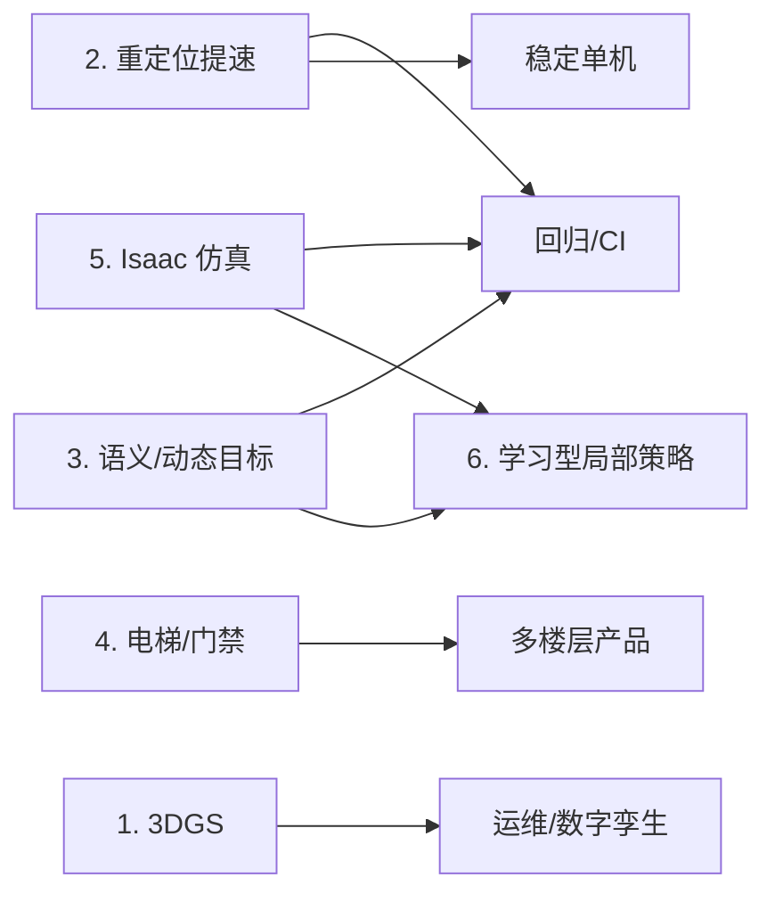

# rosiwit_ws — 室内移动机器人（SLAM / 导航 / 感知 / 仿真）

本仓库是室内移动机器人的整机软件工作区，包含 ROS1（生产）与 ROS2（迁移中）两套栈。

## 当前状态

| 能力 | 现状 |
|---|---|
| 定位 | FAST-LIO2 前端 + GICP 局部匹配 + 9 状态 ESKF；10 Hz 输出；静态抖动 5–6 mm（eskf），单帧最大 21 mm |
| 建图 | 关键帧子图 + PCD 地图 + 2D 栅格 + 叠加层（半静态变化沉淀，不重写底图） |
| 回环 / 重定位 | Scan Context 回环；FPFH 全局重定位，实测 22–45 s |
| 导航 | Hybrid A* + MPPI + footprint-aware 控制、窄道检测、速度限制、未知区代价 |
| 感知 | ROS2：AVM、地面纹理、QR、相机低矮障碍检测；ROS1：无 3D 语义/跟踪 |
| 仿真 | ROS1 Gazebo classic；ROS2 有 world/models/urdf |
| 平台 | 生产 ROS1 Melodic（2023 EOL）；ROS2 工作区已成型（自研 nav/perception/exploration/coverage/app） |
| 算力 | 8 核 ARM，无 GPU；SLAM 节点 RSS ≈ 1.0–1.2 GB |

## 目录

```
ros1_ws/        ROS1 生产栈（rosiwit_slam_ros1 / navigation / simulation / starter）
ros2_ws/        ROS2 迁移栈（slam / navigation / perception / exploration / coverage / app / sim）
src/            与 ROS 无关的核心库（rosiwit_slam / rosiwit_common / rosiwit_navigation）
docs/           设计、规范、学习材料
docker/         容器与构建脚本
```

构建与运行方式见各包 README；ROS1 单测：`catkin_make run_tests_rosiwit_slam_ros1`。

---

# TODO / 技术路线

> 约定：优先级 P0（0–3 月，可靠性/体验）> P1（3–6 月，产品力）> P2（6–12 月，前沿/合规）。
> 每项都给出可验收指标；没有验收指标的方向不进入开发。

| # | 方向 | 目标 | 优先级 | 预估 | 关键依赖 |
|---|---|---|---|---|---|
| 1 | 3DGS 地图 | 站点级高保真重建，用于运维/数字孪生/地图 QA | P2 | 4–6 周 | GPU 工作站、相机标定、采集路线 |
| 2 | 重定位提速 | p95 < 5 s，召回 > 95%，不误锁 | **P0** | 3–4 周 | 回放数据集、现有 relocalizer 接口 |
| 3 | 3D 语义/动态目标 | 人/叉车/托盘检测+跟踪+短时预测，接入局部规划 | P1 | 8–12 周 | 数据采集/标注、GPU 或 INT8 优化 |
| 4 | 电梯/门禁 | 多楼层自主乘梯与门禁通行 | P1（按产品） | 8–12 周 + 现场 | 电梯厂商接口、现场许可 |
| 5 | Isaac 仿真 | 场景化回归 + sim2real | P2 | 6–8 周 | GPU 服务器、USD 资产 |
| 6 | 学习型局部策略 | 人机混场/窄道博弈优于 MPPI，且不降安全 | P2 | 12–16 周 | 感知、仿真、示教数据 |

## 依赖关系



---

## 1. 3DGS 地图（P2，4–6 周）

**目标**：把站点扫成可浏览、可量测的高保真 3DGS 模型，用于运维、验收、数字孪生和地图质量检查。**不进入实时定位/控制环。**

**为什么**：现有 PCD + 2D 栅格只能看几何，现场验收/远程排障缺少“像照片一样”的证据；3DGS 还能暴露建图漂移、遮挡和变化区域。

**工作包**
1. 采集管线：图像 + 激光 + SLAM 位姿同步；曝光/白平衡锁定；输出 MCAP/rosbag + 位姿 + 内参。
2. 位姿初始化：优先用 SLAM 位姿，COLMAP 只做精化；失败帧剔除策略。
3. 训练：gsplat/nerfstudio，站点分块训练；SH 阶数/量化/剪枝压缩。
4. 服务与查看：导出点云/网格给 RViz/Foxglove；Web 查看器；与 PCD 地图同版本号。
5. 质量指标：PSNR/SSIM、几何误差（对 PCD）、覆盖空洞、漂浮物比例；自动报告。
6. 与地图版本绑定：`<site>/<map_version>/gsplat/` + metadata；回滚不依赖 3DGS。

**里程碑**
- M1：单站点 1000 m² 重建跑通，几何误差 < 3 cm。
- M2：压缩后 < 500 MB，工作站加载 < 3 s。
- M3：验收报告模板 + 与地图版本联动。

**验收**：一个真实站点的 3DGS 可在 Web 打开；与 PCD 同坐标系对齐；几何误差 p95 < 3 cm；不影响现有定位链路。

**风险**：光照变化、动态物体、存储；相机标定误差会直接进模型。

**不做**：不用 3DGS 做实时定位（至少本期不做）；不替代 PCD/栅格。

## 2. 重定位提速（P0，3–4 周）

**目标**：冷启动/被搬动/切图后的全局重定位从 22–45 s 降到 **p95 < 5 s**，召回 > 95%，误锁 < 1%。

**为什么**：这是当前最直接的用户体验差距；FPFH 在 110 万点全图上做 RANSAC，代价随地图线性增长。

**工作包**
1. 基线与数据集：收集 ≥ 20 个重定位场景（冷启动、被搬动 1–5 m、光照/堆货变化），统一回放与计时脚本。
2. 粗检索：Scan Context++ / STD 描述子，按关键帧建库；top-k（10–20）候选。
3. 几何验证：候选位姿 → GICP/NDT 精配准 → 多假设打分；保留现有 χ²/健康门控。
4. 时序确认：连续 2–3 帧一致才接受，抑制单帧误锁。
5. 备选：2D 栅格相关（平面站点）+ 3D 精化；学习描述子（AnyLoc/MixVPR）作为 P2 备选。
6. 工程化：描述子预计算与增量更新（叠加层变化后重建）；内存/CPU 预算。

**验收**：20 场景回放，p95 < 5 s、召回 > 95%、误锁 < 1%；单次检索 CPU < 200 ms；失败有明确原因码。

**风险**：地图变化导致描述子失效；需要与叠加层刷新联动。

## 3. 3D 语义 / 动态目标（P1，8–12 周）

> 详细实施方案（前置深度相机、人员位置+速度）：[docs/superpowers/plans/2026-11-01-person-3d-semantics.md](docs/superpowers/plans/2026-11-01-person-3d-semantics.md)

**目标**：识别并跟踪人、叉车、托盘、推车等动态目标，给出 1–2 s 预测，接入局部规划与安全层。

**为什么**：现在只有点级动态过滤和相机低矮障碍，无法预测让行；人机混场是下一步产品化的核心场景。

**工作包**
1. 数据：采集人/叉车/托盘混场片段；标注 2D 框 + 3D 框/轨迹；建立类别与距离分层指标。
2. 检测：相机 2D 检测（YOLO 系）+ 点云抬升；或激光 3D 检测（PointPillars/CenterPoint）；CPU 侧保留现有低矮障碍兜底。
3. 跟踪与预测：ByteTrack/OC-SORT + 匀速/CTRV 预测，输出带不确定性的短时轨迹。
4. 语义层：实例表（类别/速度/置信度/最后观测），短时记忆；不写进静态地图。
5. 规划接入：动态障碍层（预测 footprint）、让行/绕行代价、社会距离；安全层保持独立硬约束。
6. 评测：MOTA/IDF1、分类召回、预测 ADE/FDE、混场导航成功率、误停率。

**验收**：三类目标在 0.5–8 m 的召回 > 90%；预测 1 s ADE < 0.3 m；混场场景成功率 +20%，误停不增加；端到端延迟 < 100 ms。

**风险**：标注成本、遮挡、GPU 预算；ROS1/ROS2 双栈接入顺序（建议 ROS2 先行）。

## 4. 电梯 / 门禁（P1，8–12 周 + 现场）

**目标**：多楼层自主运输：呼梯 → 进梯 → 选层 → 出梯；门禁/闸机通行。

**工作包**
1. 接口层：电梯（Modbus/CAN/HTTP/厂商 SDK）、门禁（Wiegand/OSDP/HTTP）抽象；超时/重试/降级。
2. 状态机：呼梯、等门、进梯（位姿对齐）、选层、出梯、异常退出；每步超时与安全回退。
3. 多楼层地图：楼层 ID + 地图分区/切换；楼层来源（电梯状态/气压/二维码）冗余。
4. 乘客检测：进梯前相机/激光判断是否超载/有人；门遮挡检测。
5. 安全：急停、门夹、超时困人处理、人工接管；与整机安全链路一致。
6. 仿真/HIL：电梯门/轿厢模型 + 接口 mock；现场联调 checklist。

**验收**：连续 100 次乘梯成功率 > 99%；无困人/夹人事件；单次乘梯额外耗时 < 30 s；异常全部可恢复或安全停机。

**风险**：电梯厂商配合、现场许可、消防/法规限制；这是集成项目，不是纯软件。

## 5. Isaac 仿真（P2，6–8 周）

**目标**：GPU 写实仿真 + 场景化自动回归 + sim2real 校准，支撑感知/规划/学习策略。

**工作包**
1. 选型与接入：Isaac Sim / Isaac Lab 版本锁定；ROS2 bridge；URDF → USD；传感器模型（激光、RGB-D、IMU 噪声）。
2. 场景：站点 CAD/点云导入 → 碰撞+视觉；程序化堆货；动态角色（人/叉车）。
3. 场景库：对接、窄道、人横穿、电梯、堆货变化；每个场景有成功判据。
4. 回归：夜间自动跑批，输出成功率/碰撞/耗时；与实车日志对比。
5. sim2real：噪声/延迟/打滑标定；域随机化；关键指标差距 < 10%。
6. 数据：可选合成数据用于感知预训练。

**验收**：10 个场景自动回归；确定性回放；关键指标 sim2real 差距 < 10%；CI 可在 GPU runner 上跑。

**风险**：GPU 成本、资产制作工作量大；不要试图 1:1 复刻现场。

## 6. 学习型局部策略（P2，12–16 周）

**目标**：在人机混场/窄道博弈中超过 MPPI，同时**不降低安全指标**。

**工作包**
1. 数据：记录 MPPI/人工遥操作轨迹 + 局部代价图 + 感知目标；50–100 h；失败案例重采样。
2. 路线 A（优先）：学习型 critic/残差给 MPPI 加权——保留几何可行性与硬约束，风险最低。
3. 路线 B：Diffusion/Flow 策略输出局部轨迹，外套 MPPI/急停安全盾（policy 提议、shield 否决）。
4. 路线 C（探索）：ViNT/NoMaD 类图像目标导航，用于探索而非精确对接。
5. 训练/评测：离线模仿 + 仿真 RL 微调；Isaac 批量评测；实车 A/B。
6. 安全：footprint、速度、E-stop 永远由经典层兜底；策略输出必须可解释/可回放。

**验收**：混场/窄道成功率 +20%；碰撞/急停不增加；Orin 上推理 < 20 ms；关闭策略可一键回退 MPPI。

**风险**：数据与训练成本高；安全责任需要可解释的 shield；不建议直接端到端控车。

---

## 暂不追的方向

- **端到端 VLA / 基础模型控车**：工业场景的可解释性与安全责任不清晰，短期不进控制环。
- **NeRF/3DGS 用于实时定位**：收益/成本比低，先做地图 QA 与孪生。
- **多机调度/VDA 5050**：若产品定位是单机，这一层不建；要建就按标准设计，不自造协议。
- **人形/足式**：与本产品形态无关。

## 维护约定

- 新增方向必须写清：目标、工作包、验收指标、依赖、优先级；否则不进入 TODO。
- 文档中的图一律使用 Mermaid。
- 计划与设计文档放 `docs/superpowers/{plans,specs}/`，学习材料放 `docs/learn/`。
