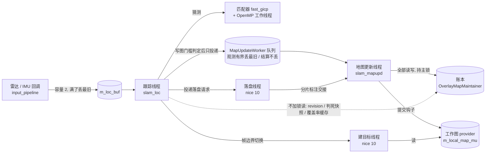

# 交接（2026-11-27）

> 覆盖 11-25 下午 ~ 11-27 晚。上一份是 `HANDOVER_2026-11-25.md`（到 11-25 上午）。
> 本轮的专项文档：`GLOBAL_RELOC_2026-11-26.md`（全局重定位）、`LOCALIZATION_THREADS_2026-11-27.md`（线程模型修订）。

## 0. 一句话状态

**代码侧**：驾驶中丢定位的一批根因已修（位姿可信度由工作图裁决、目标双缓冲、重定位后航向棘轮、
零偏双重防护等）；自更新不再侵蚀底图（w 账本按 ELite 式重写）；工作图落盘不再阻塞跟踪线程；
帧耗时治理一轮（回放单帧 p50 112 → 95 ms）；**账本写入挪出跟踪线程**（独立地图更新线程），
核心队列的丢弃和帧龄进日志。仓库 `master` = `1532aaf`（已推送 origin）；11-28 的"判死点落盘"修复是新增本地提交，
**尚未部署/推送**（§1.6）。

**设备 14003AO7**：运行 `2452d6b` 的构建（20:23 部署，22:05 重启后生效），配置与仓库一致，
**在桩位定位正常，但这个构建还没有经受过实车行驶**。跟踪线程的实时优先级 **已撤回**（见 §7）。

**待决**：① "不丢帧"的剩余部分在求解器（§3 P2）——用户要先对比其它项目再定；② 实时优先级恢复前要先验证（§3 P1）。

---

## 1. 已完成（本轮 11-25 下午 ~ 11-27）

### 1.1 11-25 下午 ~ 11-26：驾驶中丢定位、子图、重定位

工作方式：x64 编译验证后装机（0.2.16 → 0.2.18 一线），细节见各提交说明和 `GLOBAL_RELOC_2026-11-26.md`。

| 主题 | 提交 | 内容 |
|---|---|---|
| 驾驶中丢定位 | `2b5694d` | 根因 = 无界匹配延迟 + 单帧混叠的大跳变被接受 |
| | `c39a36b` | 位姿可信度由**工作图**裁决（桥接自证根因）+ 残差吸附范围 |
| | `4efe8af` | LOST/INIT 禁止用子图做匹配目标（丢定位后只能锚工作图） |
| | `78eb757` | 目标双缓冲 + 后台预建（延迟/评分取舍的架构性解决） |
| 子图 v2（ROLL 式段级临时建图） | `696b3b4` `be84fe0` `45ae386` `9abb9e4` | SessionMap v2、段级出口修正、段级融合 `mergeChunk` + P4 加权锚定；修 `popLeavingKfs` 的 move 空壳悬空（子图必崩根因） |
| 航向 / 零偏 | `f310a70` `e567aeb` `26d991c` `23c790f` | 重定位后 yaw 自转棘轮；注入位姿时间戳为 0；陀螺零偏双重防护；零偏只取重力轴分量（发布航向恒差 11° 的根因） |
| 去畸变 | `9fd310f` | 写图路径从未去畸变（旋转时子图整片糊的根因） |
| 全局重定位 | `4469493` `6e99735` `4ba2729` 等 | 描述子库后台自动建、查询云转车体系、一阶段网格搜索恢复；最终配置 `relocalizer: fpfh_ransac`（`none` 时全局重定位是死代码） |
| 崩溃 | `2dbbe34` `a6c68b1` `9abb9e4` | `OverlayMapMaintainer` 全对象加锁（进入定位瞬间 SIGSEGV）；后台线程异常兜底（detached 线程抛异常 = 整进程 abort） |
| 统一工作图 / w-map | `ef94314` `28afb86` `2a4c9f4` `88bdbcd` | 单一 `map.overlay.pcd`（0.3 + intensity=w）；xzmap/MapData 加载路径接入；miss 与 hit 对称；配准使用 w 权重 |
| 匹配器 | `1b8b889` `9cbca53` | GICP 引擎可替换 + fast_gicp 接入；线程数可配置（`matcher.num_threads`） |
| 反光板 | `b88fe3b` `daba5d9` | 反光板自动标定 + 位姿补偿；写图锚在底图 |

### 1.2 11-27 凌晨：自更新侵蚀底图、整点丢失

- **`133418e` w 账本按 ELite 式 5/6 重写**：占据证据随"观测到地图点的距离"指数衰减（σ_o = voxel·5/6，
  即 1.2σ = inlier_dist），自由证据 σ_f = voxel/6；**占据优先**（同一计票单位内有扫描端点落在附近的体素不叠加自由证据）。
  起因：旧模型沿走廊跑 3 分钟判死 1.06 万个底图点、23 分钟 1.6 万个，fitness 持续下降。
- **度量**：`[maint]` 加 `dead_base=`（每 100 个写入帧）、每次建目标打 `[TargetBuild] pre/removed`；
  `tools/drive_report.py`（一次行驶的侵蚀 / fitness 逐趟 / 帧耗时 / 新息）、`tools/wmap_diff.py`（工作图逐点对比）。
- **`cbdd7fa` 工作图落盘不再阻塞跟踪线程**：每小时整点丢失的根因——快照构建原在帧尾同步执行（满载时一帧 ~4 s，
  IMU 空转积分，恢复后新息超门 → LOST）。改为落盘线程 + 分片标注。
- **`4dcd03e`** 第二次整点落盘时节点 abort（11-27 06:47:52，SIGABRT）：落盘线程的 `unique_lock` 在 unlock 后被继续 wait。

### 1.3 11-27 白天：帧耗时治理

工作方式从这一轮起改为**直接在设备上编译**（`ros1_ws` 下 `catkin_make`，约 5~8 分钟）并直接替换 `/opt` 产物。

| 提交 | 改动 | 实测 |
|---|---|---|
| `8f733dd` | `[FramePerf]` 帧耗时分解（墙钟 / 线程 CPU / 没在运行 / 被抢占 / 阶段）+ `tools/thread_sampler.py` | — |
| `76ea57d` | fast_gicp 收敛判据改在**雷达自身位置**上量步长（原判据绕地图原点，离原点越远越难收敛） | 原实现解在第 6~9 轮已收敛，每帧还空转 3~6 轮 |
| `894ad7a` `4fa0f7d` `43bb64d` `43b57e3` | `planar.lock_roll_pitch` / `planar.tilt_output`：地图倾斜量默认只进交给匹配器的猜测，输出姿态逐位不变；估计按帧信息量定权 | 启用后真实数据回放整帧 157 → 100 ms |
| `ff8cc09` | 换目标不再让跟踪线程卡 200 ms（GICP 目标协方差提前到 `setTarget`）；账本底图索引在 `setBaseMap` 建 | — |
| `e40cc8d` | 目标协方差按点位置复用（`target_cov_reuse`）；建目标省掉重复降采样和 PCL 不用的目标树 | 协方差复用率平均 98.7% |
| `f6b597e` `125e8d4` | 子图↔先验一致性诊断挪到后台线程，周期 300 s | 原先每 30 帧在跟踪线程同步跑，单帧卡 1.2~3.3 s |
| `33036e5` | post 阶段拆成子阶段、按"后台是否在建目标"分组 | — |
| `458d3eb` | `matcher.num_threads` 4 → 2 | 本机 CPU 预算见底，少占一半反而更快 |
| `2ff73d7` | matcher 切到 fast_gicp + 重新打开会话子图 | — |

190 s 实车录包回放，这一轮之前 → 之后：单帧 p50 112 → 95 ms；求解 p50/p90 59(104) → 49(83) ms；
p90 ≥ 200 ms 的百帧窗口 7 → 0~1；最坏非启动帧 467 → 186 ms；LOST 0；成对 fitness 差在噪声内。
16:43 部署（`125e8d4`）。

### 1.4 11-27 傍晚：实车行驶分析（18:16 ~ 18:21，318 s）

- 3184 帧进、2500 帧处理，**684 帧（21%）被跟踪线程的队列丢掉**，且丢弃在日志里看不见
  （`[slam_algo] input 1s` 报的是 ROS 层通道，不是这个队列）。
- 平均帧 126 ms（预算 100 ms）；线程 CPU p50 105 ms；`s2m_ms_ema` p50 115 / p90 180 / 最大 296 ms；fitness 0.898；LOST 0。
- 阶段 p50/p90：求解 45/81 ms，**账本 32.5/40 ms（另有 4 次 400~553 ms 尖峰）**，评估 7/11，cov_base 尖峰 86~196 ms。
- 猜测误差已经很小（新息平移 p50 7 mm / p90 19 mm，航向 p50 0.095° / p90 0.31°）；迭代 p50 4~5、最大 12。
- 整机超订：load 13，CPU 忙 77~79%；`object_detect` 以 nice −19 跑 3 线程；`robot_move_base` 68% CPU；所有核 65~83% 忙。
- 被测量否定的方向：体素网格替代 FLANN 最近邻（FLANN 单次 1.7 µs，朴素网格 162 µs）；glibc malloc 调参（无效）；
  窗口不随陈旧帧重定位的变体（fitness 低 0.014，已回退）。

### 1.5 11-27 晚：账本写入挪出跟踪线程、实时优先级、可见性（`2452d6b` `11ed960`）

设计、数据和注意事项见 **`LOCALIZATION_THREADS_2026-11-27.md`**。要点：

- **地图更新线程** `MapUpdateWorker`（`slam_mapupd`，普通调度 + nice 10）：账本的全部读写（逐帧 `onLocalized`、
  段级 `mergeChunk`、lifelong 刷新、工作图落盘的分片标注）在它上面串行执行。跟踪线程只做写图门槛判定（逻辑不变）并投递，
  永不阻塞；观测任务有界（容量 3，满了丢最旧），结算任务不丢。
- **跟踪线程读账本不再碰主锁**：`revision` / `lastNovel*` 改原子量，判死体素集改写时复制快照，
  覆盖率改每次写入后算好的缓存（持锁的一次写入实测 30~550 ms）。
- 190 s 回放（改动前 → 账本挪出 → 再加 RT）：处理帧 1700 → 1800 → 1800（丢弃 ≈200 → 87 → 95）；单帧 p50 89 → 76 → 66 ms，
  p90 132 → 136 → 92 ms；post 段 p50/p90 3/33 → 1/3 ms；成对 fitness 与轨迹横向偏差都在基线间噪声内。
  **积压是减轻不是消除**：还剩约 5% 的帧被丢（§3 P2）。
- 可见性：`[LocPerf]` 加 `age_ms_ema / drop_total / drop_50`，`[quality]` 加 `mapupd_*`；
  `11ed960` 再加逐帧 `iter= solver_ms= eval_ms=`（**未部署**）。
- 单测 `test_map_update_worker` 11 个通过；`test_working_map_save` 通过；`test_overlay_map_maintainer` 30/32（2 个改动前即失败）。
- 实时优先级：装了 systemd drop-in 让节点自己设的 `SCHED_FIFO 40` 生效，实车核对过；**当晚撤回**（§7）。

### 1.6 11-28：判死点不落盘（w=0 删除失效）修复

**现象**：11-27 22:05 起那次运行（行驶 2.2 km）账本判死 25,592 个体素（1%），但整点落盘
`drop=0`；和行驶前的 `map.overlay.pcd.bak-0226-clean` 逐点对比，2,597,608 个底图点
**一个没删**，文件里也没有任何 `w<=0` 的点。所以每次重启这些点都以 `w=128`（中性）复活，
"删除"只在本会话内存里有效。

**根因（两处，同一类）**：

1. `applyFreeVotes` 判死时把条目从 `m_persistency` 里 `erase`，key 只留在 `m_dead_base`；
   而 `annotateBaseWeightsRange` 只查 `m_persistency` —— 查不到就回落到 `base_voxel_w=128`，
   于是 `compactAnnotated` 没东西可删。
2. 提交点 `addPoint` 会同时写 overlay 分块 (`m_cells`) 和**工作图云** (`m_base_raw`，与管道
   `m_map` 同一指针)。判死时只进 `m_pending_remove`（回收 `m_cells`），工作图云里的那份拷贝
   同样在落盘时按 128 复活 —— 新结构只增不减。

**修复**（不改变"运行中只记 w、落盘时统一删"的设计）：

- `m_dead_base` 改为记录**所有**判死体素（底图 + 已升格提交点）；overlay 仍额外进 `m_pending_remove` 回收分块。
- `annotateBaseWeightsRange` 先查 `m_dead_base`，命中就打 `kAnnotateDrop`，`compactAnnotated` 落盘前丢弃。
- 同一体素重新长出结构时 `addPoint` 撤销判死，避免把新提交的点误删。
- `[working_map] saved` 新增 `drop=N`（本次真正丢弃的点数）。

**验证**：新增 2 个单测（底图点判死、提交点判死）通过；`test_overlay_map_maintainer` 34 个
32 通过（2 个已知失败不变）；`test_map_update_worker` 11/11；`test_working_map_save` 通过。
运行时的匹配目标本来就是对的（`filterDeadBase` 每帧剔除），错的只有导出/落盘。

**注意**：修复生效后，下一次"行驶 + 落盘"会把判死点从文件里**永久删除**（`map.pcd` 原图仍在兜底）。
部署/重启会丢掉当前内存里的 25,592 个判死集合，需要下次行驶重新积累。

### 1.7 11-28：子图动态点剔除、`/scan_f_map` 按 footprint 高度带

**子图里的行人**：v2 原本的"自由票"在 `131ee52` 被移除（它把票投在了**扫描端点**体素上，
静止凝视 3 帧就把全部可见点判死），之后子图**没有任何动态剔除** —— 行人、门、反光会留在
视图里，并随 `popLeavingKfs → mergeChunk` 进 w 账本（先污染再慢慢雕刻）。

- 新增 `session_map.min_kf_hits`（默认 2，yaml 可配）：体素必须被 **N 个不同关键帧**看到
  才进视图/融合。行人等单关键帧瞬态自然淘汰，静态结构沿途重复出现。最新关键帧不过滤
  （保证子图刚开/刚移动时视图不为空），所以瞬态最多滞后约 1 个关键帧（1 m）。
- `popLeavingKfs` 在送融合前同样过滤，避免瞬态点被 `mergeChunk` 当成新结构写进账本。
- 关键帧命中表按机器人距离裁剪（超上限时），长时间运行内存有界；缺记录按"支持"处理，不误删。
- **顺带修掉一个老 bug**：`pruneKfs/popLeavingKfs` 把 `update()` 里用**世界系点**累加出来的
  `centroid` 又乘了一次 `kf.pose`（`c ≈ 2×绝对位置`）。机器人离地图原点超过 `radius×1.2`
  后关键帧会被全部裁掉 —— 子图在远处实际是空的；日志里的 `session_map_size` 是**缓存的视图
  大小**（没重建时不更新），把这一点掩盖了。改为直接使用世界系质心。
  （遗留：`applyExitCorrection` 只改关键帧 pose、不改 `world` 点云，出口修正对视图无效，未处理。）

**`/scan_f_map` 高度带**：旧实现是地图系 `p.z - 地面常量(scan_ground_z_)`，车体俯仰/坡道时
高度带切错（切掉墙面或漏进地面）。现在按机器人**当前 footprint 系**过滤：
`z = R_map_base_footprint.row(2)·p + t.z()`，输出仍是 map 系点云。yaml：

```yaml
scan_f_map:
  z_min: 0.15   # base_footprint 系高度下界 (m)
  z_max: 2.5    # 上界 (m)
```

TF 不可用时回退到旧的"地图系常量地面"路径。验证：`test_session_map` 新增 2 个用例通过
（全套 4/9，5 个旧断言过期不变）；ROS1 库/节点编译通过。**未部署**。

---

## 2. 当前状态

| 项 | 状态 |
|---|---|
| 设备 14003AO7 | 运行 **`2452d6b` 的构建**（`/opt/ros/melodic/lib/` 下库与节点 20:23，`libfast_gicp.so` 17:33）；服务 22:05 重启后生效；在桩位 `matching=1.000`，零丢帧；**未经实车行驶** |
| 设备配置 | `/opt/.../config/default.yaml` 与仓库一致（**11-28 新增的 `scan_f_map.z_min/z_max`、`session_map.min_kf_hits` 尚未部署**）：`matcher: fast_gicp`（`num_threads 2`、`max_iterations 12`、`max_correspondence_dist 1.2`、`transformation_epsilon 0.005`、`target_cov_reuse true`）、`relocalizer: fpfh_ransac`、`map_maintainer: overlay`（`persistency_unit view`、`persist_hits 3`、`base_voxel_w 128`）、`consistency_period_s 300`、`planar.lock_roll_pitch false`、`working_map_save_min 60`、`use_lio_relative false` |
| 实时优先级 | **未启用**：`xzrobot.service` 的 drop-in 已删除，`LimitRTPRIO=0`，跟踪线程普通调度（节点日志如实打 `NOT realtime`） |
| 仓库 | `master` = `1532aaf` = `origin/master`（已推送）；11-28 判死落盘修复是新的本地提交（未推送）。之前贴在聊天里的 PAT 应视为已泄露，未落盘 |
| 未部署 | `11ed960`（仅日志字段）、11-28 判死落盘修复（§1.6）、子图动态点剔除 + `/scan_f_map` footprint 高度带（§1.7） |
| 工作图 | `/opt/xzrobot/maps/1776497516194/map.overlay.pcd`，02:06 落盘（2,619,293 点；25,592 个已判死体素的点被错误写成 128，见 §1.6）；备份 `*.bak-0226-clean` 等在同一目录 |
| 已知测试失败 | 改动前就有：`OverlayWUnits.ViewCountsOnReentry`、`OverlayWUnits.MissConfirmDeletesAfterNthFreeFrame`、`EkfPrior.ChiSquareGateRejectsAbruptJump`；`test_session_map` 5 个断言过期（11-26 子图重写后未更新）；`test_gicp_matcher_guard`、`test_localization_pipeline` 在本工具链上编不过 |
| 11-26 交接的遗留项 | P1 写图锚定判据 → `daba5d9` / `ec007bb` / `c39a36b`（门槛 = 锚定态 + fitness，位姿可信度由工作图裁决）；P4 反光板 → `daba5d9` / `b88fe3b`；P6 的距离加权证据 → `133418e`（overlap 分支 / 目标度 γ 未确认）。P2（`[planar]` 逐帧 z 的系一致）、P3（退化部分更新的平移泄漏）、P5（长走廊实测）本轮未处理 |

---

## 3. 需要做的事（按优先级）

### P0 —— 实车行驶验证（当前构建还没跑过）

跑完用 `python3 tools/drive_report.py <日志> HH:MM:SS`，看四样：

1. `[LocPerf]` 的 `drop_50`（跟踪队列丢弃）和 `age_ms_ema`（帧在队列里等了多久，帧周期 100 ms）；
2. `[quality]` 的 `mapupd_drop / mapupd_fail / mapupd_q`（地图更新线程是否跟得上）；
3. `[maint]` 的 `dead_base` 增长和 `[TargetBuild]` 的 `removed`（账本是否在删真实结构）；
4. 下一个整点的 `[working_map] saved`（分片标注现在在地图更新线程上做）；`drop=` 是本次真正丢弃的点数，
   部署 §1.6 的修复后，行驶过的区域应看到 `drop>0`，且重启后不再复活。

**注意**：账本现在收到的是完整的帧（回放里 190 s 写入 700 帧，改动前 600 帧）。此前在实车上看到的判死/沉淀速度
是在丢帧 10~20% 的条件下观察的，阈值是按那个条件调的；回放里起始区域判死的底图体素 386/369/359（新，3 次）
对 291/299（改动前，2 次），都不在配准目标里。**部署后第一次行驶要专门看 `dead_base` 增长是否合理。**

### P1 —— 实时优先级：恢复前先验证（已撤回，见 §7）

1. 回放时优先级用 **40**（与节点在 `LimitRTPRIO=40` 下自己设的一致），不要用 50；回放期间 `grep "unknown event type 37" /var/log/kern.log`。
2. USB 不报错，再装 drop-in（`ros1_deploy_runbook.md` §4.1）做一次有人盯着的行驶，同时看 `kern.log`。
3. 报错就保持撤回。RT 的收益（回放 p50 76 → 66 ms、p90 136 → 92 ms、帧龄 38 → 16 ms）不值得冒整机重启的风险。

### P2 —— 不丢帧：剩余部分在求解器（**用户决定：暂不动，先对比其它项目**）

已查清的事实：

- RT 回放的 18 个百帧窗口里，**每一个窗口求解器的最大迭代次数都是 12（上限）**；这些帧求解 80~170 ms，
  单帧 110~260 ms。其余阶段单帧最大：评估 7~71 ms，`cov_base` 粗测（每 5 帧一次，多数 < 16 ms）偶发 53~66 ms，预处理 ≤ 10 ms。
- 每轮外层迭代 = 一遍全部扫描点的最近邻搜索 + 逐点协方差合成，约 7~8 ms（2 线程）；内层试探步用已有对应点，很便宜。
- 收敛判据是"雷达位移 < 5 mm 且旋转 < 0.11°"。离线（早上的 13 帧，来自假锁定现场，代表性有限）：
  78 次求解 74 次在 2~5 轮收敛；按这个判据"收敛"时，解离代价函数极小点还差约 1 cm（中位）；
  4 次收不住的全是模糊场景，解沿弱约束方向慢慢滑，迭代到底反而离起点 0.6 m。

候选方案（**都没有实现**，预期值待验证）：

| 方案 | 性质 | 预期 |
|---|---|---|
| 惰性重关联：上一轮确认过最近邻的点，移动距离小于"到第二近邻距离差的一半"时不重复搜索 | 严格等价，结果不变 | 12 轮从约 12 遍搜索降到约 2 遍 |
| 停机准则改"代价不再有实质性下降"（非线性最小二乘的标准做法）；迭代上限保留作最坏情况边界 | 改收敛语义，需用成对 fitness / 位姿差验证 | 中位 2~3 轮 |
| 求解后 3~4 遍独立的单线程最近邻评估合成一趟并行 | 等价 | 评估 7（最大 70）→ 约 2~3 ms |
| `cov_base` 重裁剪挪出跟踪线程 | 改线程归属 | 去掉 66 ms 尖峰 |

全做之后预计单帧中位约 35~40 ms、最坏约 60~70 ms（由迭代上限 × 每轮成本算出）。不抽稀、不改 GICP 代价函数、
不加时间硬截断。下一步需要的数据：**不带 RT** 的回放 + `ROSIWIT_DUMP_SEQ=N`（每 30 帧转储匹配器真实输入），
在正常行驶帧上看跑到 12 轮的帧各轮在改什么、惰性重关联能省多少。

### P3 —— `novel_commits` 不是"地图长了多少"

它计的是候选达到票数的次数，包含没有改变地图的重复提交（回放里每帧几十地涨，而触发建目标的账本版本号不动）。
`tools/drive_report.py` 把它当"新结构提交"展示，会误导。改法：`collectNovel` 里只在 `addPoint` 真正加体素时计数。

### P4 —— 沿用 11-26 交接、本轮未处理

`[planar]` 逐帧 z 约束的系一致（P2）、退化部分更新的平移泄漏（P3）、长走廊实测（P5）。

### P5 —— 工具与环境

- `/tmp` 在这台机器上**开机清空**（`/usr/lib/tmpfiles.d/tmp.conf: D /tmp`）。放 `/tmp` 的脚本、日志、转储会在重启时全部丢失
  （本轮的部署脚本、回放环境、离线测试程序、回放结果都这样丢了）。要留的东西放 `/home` 或仓库。
- ROS 的运行日志在 `/tmp/<uuid>-*/`，同样不持久；`/home/xzrobot/slam_run_logs/` 里有 21:45 重启前后的 syslog/kern.log 和重启后的两份节点日志。
- 回放环境：`tools/replay/run_replay.sh` 是主脚本的原文（依赖的 `clock_stub.py` / `tf_static_pub.py` / `switch_map.py` 已丢失，文件头有说明）；
  回放用的行驶录包要重建，`/opt/xzrobot/bags/` 里 11-27 18:15~18:38 的行驶录包还在（会滚动删除）。
- 部署：直接替换 `/opt/ros/melodic/lib/` 下 `librosiwit_slam.so`、`librosiwit_slam_ros1_lib.so`、`rosiwit_slam_ros1/rosiwit_slam_ros1_node`、
  `libfast_gicp.so`（先拷到暂存目录再 rename，不要原地覆盖正在映射的文件），然后**一次** `systemctl restart xzrobot`
  （不要 stop + start：`debug-bridge.service` 是 `PartOf=xzrobot.service`，分开做会把 debug-bridge 停掉不再拉起）。

---

## 4. 关键机制速查

### 4.1 定位模式的线程



### 4.2 一帧的时间去哪了（190 s 回放，账本已挪出）

p50 一栏是"无 RT / 加 RT"两次回放各自的百帧窗口中位；单帧最大值取加 RT 那次（只有它留有逐阶段最大值）。

| 阶段 | p50（无 RT / RT） | 单帧最大 | 说明 |
|---|---|---|---|
| 预处理（去畸变、降采样、目标切换） | 1~2 / 1~2 ms | 10 ms | |
| 求解 | 48 / 35 ms | 169 ms | 迭代轮数 × 7~8 ms；跑到上限 12 轮的帧是长尾来源 |
| 评估 | 7 / 7 ms | 71 ms | 3~4 遍独立单线程最近邻查询 |
| post（融合、门槛判定、子图） | 1 / 1 ms | 45 ms（其中一次 44 ms 在写图点云准备） | 账本挪出后 p90 3 ms |
| `cov_base` 粗测 | 0 | 66 ms | 每 5 帧一次，偶发 |
| **整帧** | **76 / 66 ms** | p90 的窗口中位 136 / 92 ms | 帧周期 100 ms；队列容量 2 = 200 ms 缓冲 |

### 4.3 排查用的日志

| 行 | 用途 |
|---|---|
| `[LocPerf] frames= s2m_ms_ema= last_ms= queue= age_ms_ema= drop_total= drop_50=` | 跟踪队列的积压与丢弃（每 50 帧） |
| `[FramePerf]`（每 100 帧 4 行） | 墙钟 / 线程 CPU / 没在运行 / 被抢占；阶段；按"后台是否在建目标"分组；post 内 12 个子阶段 |
| `[quality]`（逐帧） | `fitness / inl / cov_base / novel_* / session_map_* / mapupd_*`；`11ed960` 起还有 `iter / solver_ms / eval_ms` |
| `[maint]`（每 100 个写入帧） | 账本分支计数、`dead_base` |
| `[TargetBuild] pre= removed=` | 每次建目标；版本号变化会触发，所以次数也反映地图是否真的在变 |
| `[SlamPipeline] tracking thread scheduling:` | 实时优先级是否真的生效（以它为准） |
| `[working_map]` | 落盘请求 / `annotation done ... on map-update thread` / `saved` |

---

## 5. 关键文件

| 文件 | 内容 |
|---|---|
| `src/rosiwit_slam/src/algorithms/localization/localization_pipeline.cpp` | 跟踪线程主体：目标选择、写图门槛与投递、落盘交接、各探针 |
| `src/rosiwit_slam/include/algorithms/localization/maintainer/map_update_worker.h` `.cpp` | 地图更新线程（队列语义、flush、维护回调节拍） |
| `src/rosiwit_slam/src/algorithms/localization/maintainer/overlay_map_maintainer.cpp` | w 账本：`observeHits` / `rayCarve` / `collectNovel` |
| `src/rosiwit_slam/src/slam_core/slam_pipeline.cpp` | `localizationWorker`（实时优先级）、`m_loc_buf`、`[LocPerf]` |
| `src/rosiwit_slam/src/algorithms/localization/matcher/gicp_matcher.cpp` | fast_gicp 封装、评估、`ROSIWIT_GICP_LM_TRACE` |
| `ros1_ws/src/fast_gicp/include/fast_gicp/gicp/impl/lsq_registration_impl.hpp` | LM 主循环、收敛判据（含本地补丁） |
| `ros1_ws/src/fast_gicp/include/fast_gicp/gicp/impl/fast_gicp_impl.hpp` | 每轮迭代的最近邻搜索与 H/b（含协方差复用补丁） |
| `ros1_ws/src/rosiwit_slam_ros1/config/default.yaml` | 设备与仓库已同步 |
| `ros1_ws/src/rosiwit_slam_ros1/systemd/xzrobot.service.d/10-slam-rt.conf` | 实时优先级 drop-in（**暂不安装**） |
| `src/rosiwit_slam/test/test_map_update_worker.cpp` | 队列契约 + 账本读视图不加锁 |
| `tools/drive_report.py` `tools/thread_sampler.py` `tools/wmap_diff.py` `tools/replay/` `tools/bench/` | 行驶报告、线程采样、工作图对比、回放分析、离线基准 |

---

## 6. 版本历史（设备部署线，11-27）

设备从这一轮起不再用 0.2.x 的 deb 版本号，按提交识别。

| 时刻 | 构建 | 说明 |
|---|---|---|
| 11-27 16:43 | `125e8d4` | 帧耗时治理一轮后首次部署 |
| 11-27 20:18 | `2452d6b` | 账本挪出跟踪线程 + 实时优先级 drop-in（`LimitRTPRIO=40`），服务重启 |
| 11-27 20:23 | `2452d6b` | 仅注释变更，重新同步 `/opt`（未重启） |
| 11-27 21:45 | — | 整机硬重启（§7），服务自行恢复 |
| 11-27 22:05 | `2452d6b` | 删除 drop-in（`LimitRTPRIO=0`），服务重启。**当前在跑** |

更早的版本见 `HANDOVER_2026-11-25.md` §6 和 `ros1_deploy_runbook.md`。

---

## 7. 事故记录

### 7.1 11-27 21:45 整机硬重启（原因未完全查明）

- 经过：21:42 起做诊断回放（跟踪线程及工作线程 `SCHED_FIFO 50`，开了逐帧转储）。21:44:22 起 USB 主机控制器连续报
  `xhci-hcd ... ERROR unknown event type 37`，21:44:27 起全机"没跟上更新周期"（50~330 ms）、2D 雷达丢包，
  21:44:45 日志戛然而止（没有任何关机记录），21:45:05 重新开机。服务自行恢复，车在桩位。
- 已知：这个 USB 报错（xHCI 规范里 37 = 主机控制器事件，常见诱因是中断处理线程没被及时调度、事件环写满）当天只出现在
  **带实时优先级的回放**期间（11:26~11:30、19:57~20:04、21:43~21:44），不带 RT 的回放没有。回放用的优先级 50 与内核中断线程同级。
- 排除：温度（空闲 50~55 °C，保护点 115 °C）；软件看门狗（systemd 的没开，没有进程持有 `/dev/watchdog*`）；内存（可用 4.7 GB）。
- 未确认：50 是不是充要条件；40（部署值，低于中断线程）是否安全；重启是 USB 故障的后果还是独立的电源问题。
  11-26 21:01 也有一次没有关机记录的硬重启，那时没有 RT。
- 处置：22:05 撤回实时优先级（§3 P1）。
- 损失：`/tmp` 下全部工具与回放结果、各次运行的节点日志目录（随开机清理消失）。

### 7.2 其它（均已修复）

- 11-27 06:47 第二次整点落盘 SIGABRT（`4dcd03e`）；每小时整点丢失（`cbdd7fa`）；
  11-26 进入定位瞬间 SIGSEGV（`2dbbe34`）；自更新侵蚀底图（`133418e`、`d3442e8`、`74cf0e5`）。

---

## 8. 操作教训（本轮踩过的）

- **不要用 `pkill -f` / `ps | grep` 选进程**：模式一旦出现在调用者自己的命令行里就会杀掉调用者的会话（发生过两次）。按 PID 文件或 `ps -C <进程名>`。
- **跑基准/测试前先 `source ros1_ws/devel/setup.bash`**：会话的 `LD_LIBRARY_PATH` 预设了 `/opt/ros/melodic/lib`，否则加载的是 `/opt` 里的旧库（表现为符号找不到或结果不对）。
- **`catkin_make` 之后核对产物时间**：有一次重新构建没有触发，产物比源码旧。
- 回放前先确认车静止、停掉机器人上的 SLAM 节点（内存），回放后 **`systemctl restart xzrobot`** 恢复——中断时要先查这一步有没有做。
- `catkin_make` 默认目标不编测试；测试可执行文件要在源的类布局变了之后重新编（否则是旧 ABI）。
