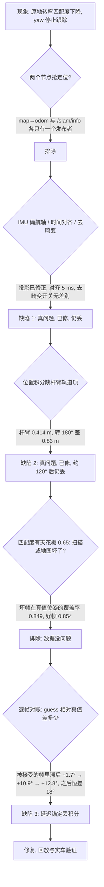
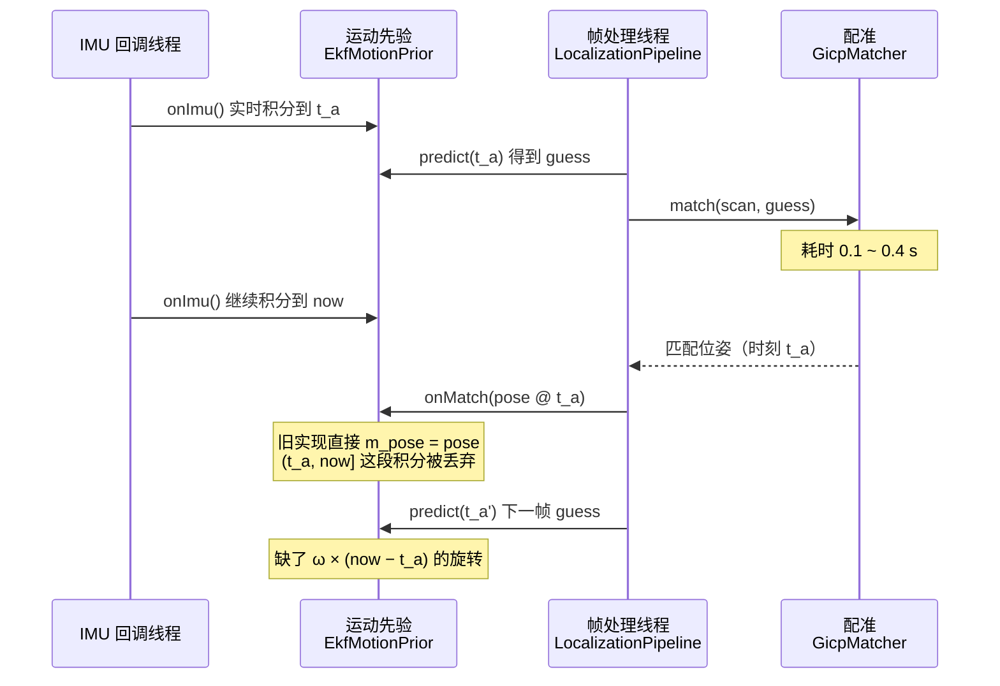

# 原地转弯丢定位排查复盘 (2026-11-23)

> **现象**：机器人原地一转弯，匹配度立刻下降、yaw 停止跟踪、界面在"丢失 ↔ 恢复"之间来回跳；静止和直线正常。
> **根因**：运动先验"延迟锚定"时丢掉了一段陀螺积分，滞后 = **转速 × 单帧处理时间**。转得越快、机器越卡，越容易丢。
> **结果**：实车 169° @ 38°/s、343° @ 92°/s 两次原地转弯，匹配度最低 0.876，全程保持锁定。
> **提交**：`f3f1006`（代码修复）、`c33cccd`（配置）。

## 1. 结论速览

同一个现象背后叠了三个缺陷。前两个是真缺陷、必须修，但单独修任何一个都不够：

| # | 缺陷 | 误差公式 | 本机量级 | 单独修复后的效果 |
|---|---|---|---|---|
| 1 | 偏航角速度直接取 `gyro.z` | 少报 1−cos(安装倾角) | 雷达俯装 39.4°，少报 22%（`gyro.z` 积分 −140.5°，投影积分 −179.7°） | 必要，但仍丢 |
| 2 | 位置积分缺杆臂轨道项 | 2·ρ·sin(θ/2) | ρ = 0.414 m，转 180° 位置差 0.83 m | 转弯前半段不再立刻掉（0.39 → 0.91），转到约 120° 仍丢 |
| 3 | **延迟锚定丢积分**（触发器） | **ω × (now − t_a)** | 35°/s × 0.3 s ≈ 10°/帧，累计到约 13° 后配准器吞不下 | **全程锁定** |

## 2. 现象与环境

**现象的四个特征**（后来都对应到了根因）：

1. 静止、直线正常，只有转弯出问题；
2. 转得越快越严重；
3. 一旦丢就回不来，yaw 冻结在一个值上；
4. 节点日志里位姿在"丢失"和"重锚"之间横跳。

**平台事实**（排查中逐一量过，全部有数值依据）：

| 项 | 值 | 来源 |
|---|---|---|
| 雷达安装（footprint ← lidar） | (0.414, 0.019, 0.984) m，roll 39.4° / pitch 1.2° / yaw 89.9° | 实车 TF；高度用扫描地面平面拟合复核为 0.976 m |
| 雷达到转轴的水平距离 ρ | 0.414 m | 由外参换算 |
| 雷达帧率 / IMU 频率 | 10 Hz / 200 Hz | 节点日志 `input 1s: imu+200 lidar+10` |
| 回放节点实际处理帧率 | 2.5 ~ 3.3 Hz（单帧 0.2 ~ 0.5 s） | 逐帧探针 |
| 机器负载 | 常态 9 ~ 13 | `uptime` |
| 地图 | 599 万点、1607 关键帧，**建图时已裁掉地面**；近地点稀疏（0.15 ~ 0.9 m 每层 129 ~ 239 点），2 m 以上稠密（覆盖率 95% ~ 99.8%） | 子图分层统计 |
| 轮式 odom 原地转 | 比 IMU/激光**少报约 4.6%**（−171.6° vs −179.2°） | bag 内三路对账 |

**相关参数**（`ros1_ws/src/rosiwit_slam_ros1/config/default.yaml`）：

| 参数 | 值 | 单位 | 说明 |
|---|---|---|---|
| `matcher.max_iterations` | 12 | 次 | GICP 迭代上限 |
| `matcher.max_correspondence_dist` | 1.2 | m | 超过则本轮不建对应，决定初值误差的容忍范围 |
| `matcher.inlier_dist` | 0.3 | m | 覆盖率统计阈值 |
| `matcher.match_z_min` | 0.15 | m | footprint 系离地下界，低于它的点不参与配准 |
| `accept.min_coverage` | 0.7 | — | 接受线 |
| `accept.credible_fitness` | 0.85 | — | 健康线 |

## 3. 排查路径

| 假设 | 怎么验证 | 证据 | 结论 |
|---|---|---|---|
| 两个进程抢定位 | 数 `map→odom`、`/slam/info` 的发布者 | 各只有 `/xz_3d_slam` 一个 | 排除 |
| IMU 偏航轴 | bag 内 `gyro.z` 积分 vs 投影到重力轴的积分 | −140.5° vs −179.7° | 缺陷 1，已修 |
| 会话地图 / 叠加层干扰 | 分别关闭后回放 | yaw 跟踪 49% → 77%，有改善但非根因 | 排除（根因修复后是否恢复待定） |
| 杆臂 | 按几何算：雷达绕 base 划弧 | ρ = 0.414 m，180° 差 0.83 m | 缺陷 2，已修 |
| 去畸变不足 | 帧内相对旋转改用陀螺自由积分 | 探针显示已生效，天花板不变 | 不是原因（改动保留，本身更合理） |
| 扫描或地图损坏 | 低分帧现场转储，离线在 odom 真值位姿算覆盖率 | 真值处 0.849，与好帧相同 | 排除 |
| **先验预测滞后** | **逐帧表：帧时间 + guess/结果/匹配度** | **见第 5 节** | **根因** |

## 4. 根因机制

IMU 从 ROS 回调线程**实时**积分进运动先验；点云帧在另一个线程处理，一帧要 0.1 ~ 0.4 s。处理完调用 `onMatch`，把先验**锚回这帧的结束时刻 t_a**——但此时 IMU 早已积分到"现在"。

于是形成死亡螺旋：

1. 每帧 guess 落后"转速 × 处理延迟"，配准器初值误差变大；
2. 误差在容忍范围内时配准器还能拉回来（结果滞后只有 −0.3°），匹配度仍 0.95，**看不出问题**；
3. 累计超过约 13° 后配准器拉不动，匹配度跌破 0.7 被拒；
4. 被拒就不再重新锚定，已积累的滞后变成**恒差**（18°），之后每帧都拒；
5. 其他补救逻辑（重锚到旧位姿）又把姿态拉回旧值，yaw 彻底冻结。

静态时 ω = 0，所以完全不受影响——这就是"只有转弯出问题"的原因。

## 5. 决定性证据：逐帧对账表

此前的日志每 2 s 一条状态行，完全掩盖了上述动态。改成**逐帧**打印帧时间、guess、配准结果、匹配度，再按帧时间从 bag 取 odom 真值，滞后才显形（修复前，回放）：

| 帧 | 真值 yaw | guess | guess 滞后 | 匹配度 | 结果 |
|---|---|---|---|---|---|
| 49 | 18.3° | 18.1° | −0.2° | 0.95 | 接受（静止） |
| 51 | 15.2° | 16.9° | +1.7° | 0.95 | 接受 |
| 52 | 9.4° | 14.0° | +4.6° | 0.95 | 接受 |
| 53 | −0.6° | 10.3° | **+10.9°** | 0.95 | 接受，配准器硬拉回 |
| 54 | −9.6° | 3.2° | +12.8° | 0.84 | 接受 |
| 55 | −20.8° | −6.8° | +14.0° | 0.60 | **拒绝** |
| 56 起 | 一路转到 −153° | 恒差 **+17° ~ +24°** | | 0.45 ~ 0.53 | 全拒 |

两个特征直接指向机制：

- **滞后只在被接受的帧里产生**：每次配准结果都几乎准确（滞后 −0.3°），可下一帧 guess 又落后 10° 以上。一个 0.3 s 的步长里真值转了 −9°，guess 却转了 +3°。
- **滞后 ≈ 转速 × 0.3 ~ 0.4 s**：起步 8°/s 时差 2°，33°/s 时差 10.9°（0.33 s × 33°/s = 10.9°），正好等于回放节点处理一帧的时间。

同一张表还排除了数据侧：坏帧在**真值位姿**的覆盖率是 0.849，好帧是 0.854。扫描、地图、去畸变都没问题，唯独 guess 落后。

## 6. 修复

原则是延迟观测的标准处理：**相对运动与锚点无关**。

| 位置 | 修改 |
|---|---|
| `EkfMotionPrior::onMatch` | 新增 `reanchorHistory()`：把旧历史链上 (t_a, now] 的相对运动整体接到新锚点，历史尾部同步重锚 |
| `EkfMotionPrior::predict` | 对未来时刻补上姿态外推（原来只外推平移）；历史插值抽成 `histAt()` |
| `EkfMotionPrior::onMatch` | 陀螺零偏在线微调的新息改为与 **t_a 时刻**的历史位姿比较（原来混进 ω × 延迟，会把真实转速记成零偏） |
| `EkfPoseFusion::onMatch` | 同类缺陷：退回 t_a 算新息并修正，再把相对运动接回；历史尾部重锚 |
| `EkfPoseFusion::predict` | 过去时刻走历史插值，发布位姿严格对应帧末时间戳 |
| `GicpMatcher::match` | 地面裁剪补上雷达安装高度：`(R·p + t).z > 0.15`（原来漏了 t，实际裁到离地 0.99 m） |

杆臂轨道项、外参单源注入（URDF/TF 运行时注入，不写死"正装"）等缺陷 1、2 的修复见提交 `f3f1006`。

## 7. 验证

**回放**（同一段 bag，172° 原地转弯）：

| 指标 | 修复前 | 修复后 |
|---|---|---|
| 转弯中匹配度 | 0.95 → 0.84 → 0.60 → 0.45 ~ 0.53 | **0.92 ~ 0.98** |
| 拒帧 | 第 55 帧起全拒 | **0** |
| guess 相对真值 | 落后 18°，恒差 | 不落后 |
| 发布 yaw 总转角 | 卡在 62% | −179.2°，与配准结果一致 |

修复后 guess 仍显示"超前"最多 8°，它随**累计转角**线性增长（172° × 4.6% = 7.9°），是轮式 odom 的尺度误差，不是滞后。

**实车**（负载 13.5）：

| 原地转弯 | 最高转速 | 匹配度最低 | 状态 | xy 抖动 |
|---|---|---|---|---|
| 169° | 38°/s | 0.906 | 全程锁定 | 0.125 m |
| 343° | 92°/s | 0.876 | 全程锁定 | 0.032 m |

节点日志 440 条状态探针全部为已定位，零拒帧。

**如何复现这套验证**（结论必须能被日志复现）：

- 逐帧探针默认静默。给节点设环境变量 `ROSIWIT_LOC_PROBE=1` 后，日志里每帧一条 `[LocProbe] t= vis= used= inl= ok= conv= fit= gx= gy= gz= gyaw= rx= ry= rz= ryaw=`。
- 回放环境：独立 roscore（如端口 11399）+ 用实车 `rosrun tf tf_echo` 读出的静态 TF + 带初始位姿调 `/switch_map` + `rosbag play` 原始点云、IMU、odom 三个话题。节点用独立名字（如 `slam_replay`），跑完清理干净。
- 对账：按帧时间从 bag 取 odom，锚定在 bag 开头的静止位姿上，算每帧 guess 与配准结果的 yaw 差。

## 8. 经验

1. **先找"误差和什么成正比"，再找机制。** 与累计转角成正比 → 几何问题（杆臂、尺度）；与转速 × 时间成正比 → 时序问题（延迟、丢积分）。本例两种都有，分清楚之后各自只剩一两个候选。
2. **逐帧看，不看汇总。** 2 s 一条的状态行里"匹配度 0.95"一切正常，逐帧才看到 guess 每帧落后 10° 被配准器悄悄拉回。探针必须带**帧时间**，否则没法和真值对齐。
3. **先在真值位姿上给数据"体检"。** 把低分帧现场转储，离线放到 odom 真值位姿上算覆盖率：高 → 数据没问题，是估计器的问题；低 → 扫描或地图的问题。这一步能砍掉一半假设。
4. **离线复算必须复刻线上指标的每一个步骤**（降采样、裁剪、阈值）。本例第一版离线算了全部点，得出"天花板 0.65"，而线上分母根本不含地面点——一个不存在的天花板引出了两轮无效修复。
5. **真值分三级使用。** 激光匹配（匹配度 0.9+）> IMU 积分（尺度准，有零偏）> 轮式 odom（原地转少报 4.6%）。odom 只能当**相对**真值，它的累计误差会伪装成估计器的"超前"。
6. **修复是否生效要看数值，不看日志有没有报错。** 杆臂修复一度在回放里毫无效果，是因为回放环境缺一条 TF，外参根本没注入。之后每次都先核对 `mount injected` 行里的数值量级（杆臂水平距离应等于物理半径 0.414 m）。
7. **回放环境的外参必须从实车导出。** 静态 TF 凭记忆写，高度写矮了 13 cm，靠扫描拟合地面才量出来。
8. **延迟观测的通用处理：退回 → 修正 → 接回。** 只要把"过去的测量"用在"现在的状态"上，就会把这段时间的真实运动当成误差。先验和融合层有同一个毛病，修完先验后要回头检查下游。
9. **一次只改一个变量，改完看同一张表。** 多个缺陷叠加时，每修一个都要重新确认"还剩什么现象"，否则会把"必要不充分"误判为"不是原因"。
10. **诊断代码用环境变量门控，实车验证通过再删。** 默认静默不刷屏不写盘，需要时不用重编就能打开。
11. **部署细节会制造假象。** 残留的回放节点会往同一个日志里交错写入、并抢 CPU 抬高处理延迟；覆盖正在运行的 `.so` 要用"写临时文件再 `mv`"的原子替换；重启整机服务前先确认用户自己的进程挂在哪个 cgroup 下（本机 `xzrobot_record` 在 `xzrobot.service` 下，`debug_bridge` 在独立服务下）。
12. **"匹配度高"不等于"预测对"。** 本例匹配度 0.95 的时候 guess 已经落后 10°，全靠配准器兜底。健康判据要同时看"初值到结果的修正量"，它持续增大就是预测跟不上。

## 9. 走过的弯路

| 弯路 | 代价 | 教训 |
|---|---|---|
| 回放环境只有一条静态 TF，外参注入一直失败 | 杆臂修复的几轮回放全部无效 | 先确认"要测的东西真的生效了" |
| 离线覆盖率没复刻地面裁剪 | 得出不存在的"天花板 0.65"，引出去畸变方向的修复 | 复刻线上指标的每一步 |
| 方位角直方图以地图原点为中心 | 误以为地图有 120° 空洞，其实是远处机器人的视差 | 以机器人为中心统计 |
| 把 odom 当绝对真值 | 修复后"超前 8°"差点被当成新 bug | odom 只作相对真值 |
| 只看 2 s 一条的状态日志 | 根因在眼皮底下藏了大半天 | 逐帧 + 帧时间 |
| 回放脚本不复位、节点残留 | 日志交错、CPU 被占 | 脚本退出时清理自己拉起的进程 |
| `systemctl restart` 前没查波及面 | 差点连用户的记录进程一起重启 | 先看 cgroup |

## 10. 下次遇到"转弯就丢"的排查顺序

1. 确认只有一个节点在发布定位；
2. 逐帧表：guess 相对真值的滞后，在被接受的帧里是否已经在涨；
3. 滞后与转速 × 帧处理时间成正比 → 查延迟锚定、IMU 是否实时积分、`predict` 是否外推姿态；
4. 滞后与累计转角成正比 → 查杆臂、IMU 偏航轴投影、odom 尺度；
5. 低分帧在真值位姿的覆盖率（复刻裁剪）→ 区分数据侧与估计侧；
6. 核对外参注入的数值量级，而不是只看有没有报错。

## 11. 遗留

- `map_maintainer: overlay` 与 `session_map` 在排查期间关闭，根因已在代码侧修复，是否恢复待定（恢复前先回放验证）。
- 诊断探针（`[FitSweep]`、`[DeskewDiag]`、`[DumpFrame]`）目前靠环境变量门控，实车验证已通过，可以择机删除。
- 轮式 odom 原地转少报约 4.6%，若下游有依赖 odom 累计转角的逻辑需要知晓。
