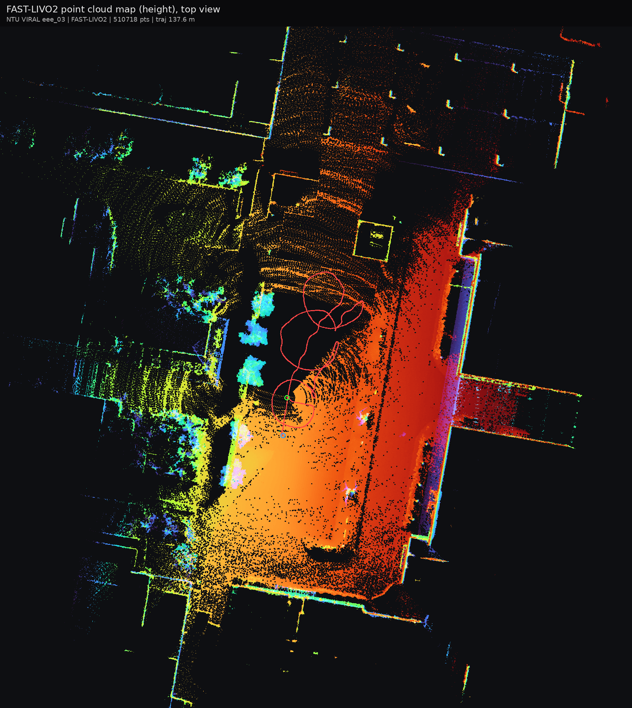
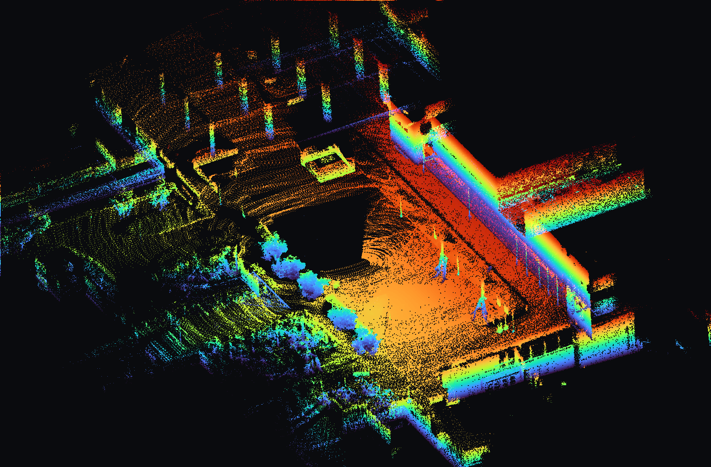
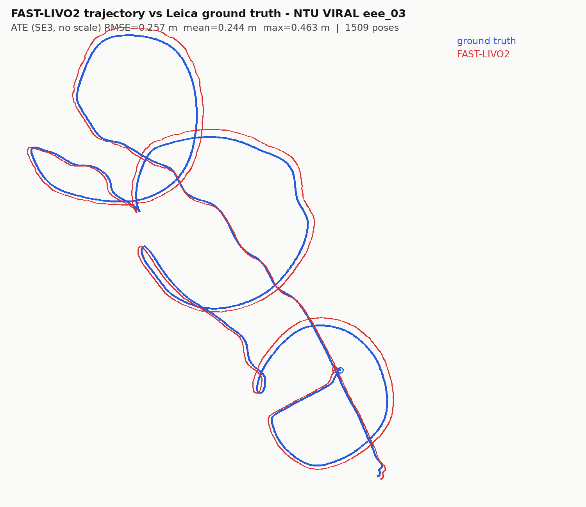
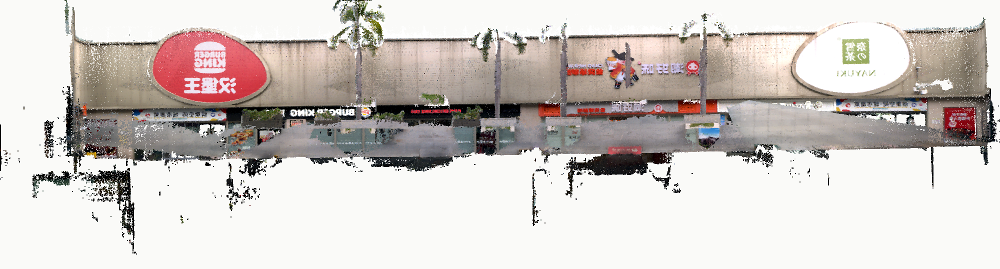
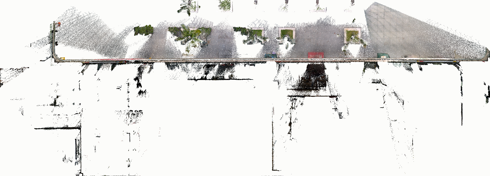

# FAST-LIVO2（ROS 2 Humble）接入与验证

> 源码：`ros2_ws/src/fast_livo2`（包名 `fast_livo`，`vikit` 相机模型库已内置）
> 来源与本地改动：`ros2_ws/src/fast_livo2/LOCAL_CHANGES.md`

## 1. 结论

- 采用 ROS 2 Humble 移植版 `Rhymer-Lcy/FAST-LIVO2-ROS2-MID360-Fisheye`（2026-07，已 merge 上游 main），
  在 Humble 下编译通过，并用两组真实数据跑通：
  - 本地 Livox Mid-360 bag（只有 LiDAR+IMU）：`img_en=0` 走 LiDAR-inertial 管线；
  - **NTU VIRAL `eee_03`（LiDAR+IMU+相机）：完整 LIVO 管线**。
- 官方 `FAST-LIVO2-Dataset`（Google Drive）当前 403/配额超限，**不依赖它**也能验证。
- **LiDAR 输入已支持通用 `sensor_msgs/PointCloud2`**（`preprocess.lidar_type: 8` = `GENERIC`），
  字段/时间戳自动识别；`livox_ros_driver2` 变成可选依赖（默认不编译）。
- 相机模型库 `vikit` 已**内置**到 `fast_livo2`（`include/vikit` + `src/vikit`，编成静态库），
  不再需要单独的 `vikit_common` / `vikit_ros` 包。

## 2. 目录

```
ros2_ws/src/
└── fast_livo2/                 # FAST-LIVO2 ROS2（包名 fast_livo，内含 vikit）
    ├── include/vikit/          # 相机模型/视觉工具（来自 rpg_vikit，GPLv3）
    ├── src/vikit/
    ├── config/                 # 传感器外参、相机内参、算法参数
    ├── launch/                 # avia / NTU / marslvig / metacamedu
    └── scripts/fix_rosbag2_metadata.py
```

## 3. 依赖

系统包（Ubuntu 22.04 + ROS 2 Humble）：

```bash
sudo apt install libeigen3-dev libpcl-dev libopencv-dev libfmt-dev \
  ros-humble-sophus ros-humble-cv-bridge ros-humble-image-transport \
  ros-humble-pcl-conversions ros-humble-tf2-ros ros-humble-tf2-geometry-msgs
```

`livox_ros_driver2`（**可选，默认不需要**）：

```bash
# 仅当要跑 CustomMsg 数据（Avia / Retail_Street）时：
git clone https://github.com/Livox-SDK/livox_ros_driver2.git -b 1.2.6
cd livox_ros_driver2 && cp package_ROS2.xml package.xml
# 并保证 /usr/local 已装 Livox-SDK2（liblivox_lidar_sdk_shared.so + 头文件）
```

> 编译时加 `-DFASTLIVO_WITH_LIVOX_MSGS=ON` 才会编译 CustomMsg 分支；
> 默认关闭时通用 PointCloud2 完全不需要这个包。

## 4. 构建

```bash
cd ~/rosiwit_ws/ros2_ws     # 或 /mnt/e/rosiwit_ws/ros2_ws (WSL)
source /opt/ros/humble/setup.bash
# 默认：通用 PointCloud2，无需 livox 驱动
colcon build --packages-select fast_livo --cmake-args -DCMAKE_BUILD_TYPE=Release

# 需要 CustomMsg（Avia / Retail_Street）时（先编 livox，再编本包）：
# colcon build --packages-select livox_ros_driver2
# source install/setup.bash
# colcon build --packages-select fast_livo \
#   --cmake-args -DCMAKE_BUILD_TYPE=Release -DFASTLIVO_WITH_LIVOX_MSGS=ON
source install/setup.bash
```

## 5. 运行

### 5.1 NTU VIRAL（LiDAR + IMU + 相机）

```bash
ros2 launch fast_livo mapping_ouster_ntu.launch.py use_sim_time:=True
# 另一个终端
ros2 bag play /path/to/eee_03_ros2 --clock
```

输出：

| 话题 | 类型 | 说明 |
|---|---|---|
| `/aft_mapped_to_init` | `nav_msgs/Odometry` | 里程计 |
| `/path` | `nav_msgs/Path` | 轨迹 |
| `/cloud_registered` | `sensor_msgs/PointCloud2` | 当前帧（LIVO 会带 RGB） |
| `/Laser_map` | `sensor_msgs/PointCloud2` | 地图 |
| `/LIVO2/imu_propagate` | `nav_msgs/Odometry` | IMU 递推位姿 |

### 5.2 Livox Avia / Retail_Street 等（CustomMsg）

```bash
ros2 launch fast_livo mapping_aviz.launch.py use_sim_time:=True
ros2 bag play Retail_Street --clock
```

注意：`Retail_Street` 是 ROS1 bag，需先转换并把 lidar 话题类型改成
`livox_ros_driver2/msg/CustomMsg`（上游 README 第 4 节有说明）。

### 5.3 只有 LiDAR+IMU（无相机）时

把配置里 `common.img_en` 置 0 即可（仍必须提供一组合法 `camera.*` 参数，代码启动时会加载相机模型）。

### 5.4 通用 `sensor_msgs/PointCloud2`（任意雷达）

`preprocess.lidar_type: 8`（`GENERIC`）时使用通用点云解析：

| 字段 | 要求 | 说明 |
|---|---|---|
| `x` / `y` / `z` | 必需 | 任意数值类型 |
| `intensity` / `i` / `reflectivity` | 可选 | 缺失时强度置 0 |
| `time` / `timestamp` / `t` / `offset_time` / `curvature` | 可选 | 自动识别单位：秒（相对/绝对）、纳秒（相对/绝对）、已是 ms |

- 时间字段会换算成 `curvature`（ms）用于运动补偿；没有时间字段也能跑，只是不做逐点去畸变。
- 字段按名字解析（`PointField.offset/datatype` + `memcpy`），不要求点结构体与某个驱动一致。

示例（Vanjee，`/vanjee_points722` + `/vanjee_lidar_imu_packets`）：

```bash
ros2 launch fast_livo mapping_generic.launch.py \
  params_file:=$(ros2 pkg prefix fast_livo)/share/fast_livo/config/vanjee.yaml \
  use_sim_time:=True
ros2 bag play remap_ros2 --clock
```

> `config/vanjee.yaml` 里的 `extrinsic_T/R` 还是单位阵（**未标定**），真机使用前务必用
> FAST-Calib 替换成 LiDAR→IMU 外参。

## 6. 数据包验证记录

### 6.1 本地 Livox Mid-360 bag（LiDAR + IMU）

- bag：本地 `bag_local`（`bag_20260810_135525_0.db3`，159 s，`/livox/lidar` PointCloud2 + `/livox/imu`）
- 配置：`img_en=0`、`lidar_type=7`（MID360 点云含 `tag/line/timestamp`）
- 播放：`ros2 bag play ... --clock -r 3.0`
- 结果：45 s 内 `/aft_mapped_to_init` 输出 **1352** 条；日志 `[ LIO ] Update Voxel Map` **1450** 次；
  无 error/异常；平均单帧约 16 ms。

### 6.2 NTU VIRAL `eee_03`（LiDAR + IMU + 相机，完整 LIVO + 建图）

- 数据：HuggingFace 镜像 `Yuan-Shenghai/NTU-VIRAL-DATASET` → `sequences/eee_03.zip`（1.9 GB，开源）
- 转换：`rosbags-convert` → ROS2 bag（仅 3 个话题，2.0 GB）
- 运行：`ros2 launch fast_livo mapping_ouster_ntu.launch.py use_sim_time:=True` +
  `ros2 bag play eee_03_ros2 --clock`（1x，**整段 181 s**，`img_en=1`）
- 结果：
  - `/aft_mapped_to_init` **1809** 条（10 Hz，轨迹 137.2 m），LIO 帧 **1809**；
  - VIO 正常更新（每帧 ~5300 特征点，`Append/Retrieve visual map points` 持续输出）；
  - 运行期 0 error，无 IMU 时间跳变告警；
  - **与 Leica 真值对比（Umeyama SE(3) 对齐，1509 个匹配位姿）：RMSE 0.257 m，
    mean 0.244 m，max 0.463 m；轨迹长度 137.2 m（真值 127.8 m）**；
  - 建图：原始彩色点云 **2,498,816** 点，0.10 m 体素降采样后 **889,839** 点。
  - 注意：NTU VIRAL 的相机是 **mono8 单色相机**，所以点云颜色 `r==g==b`（100%），看起来是黑白；
    彩色建图见 6.4 的 Retail_Street。

#### 建图结果（`docs/artifacts/fastlivo2_ntu_eee03/`）

点云俯视（按高度着色，红线为轨迹）：



3D 斜视图：



轨迹与真值对比（红=FAST-LIVO2，蓝=Leica GT）：



文件：

| 文件 | 说明 |
|---|---|
| `map_downsampled_0.10m.pcd` | 降采样后的世界坐标系彩色点云（PCL binary，889,839 点） |
| `map_topdown_rgb.png` / `map_topdown_height.png` | 俯视图（相机 RGB / 高度着色） |
| `map_3d_height.png` | 3D 斜视图 |
| `traj_vs_gt.png` | 轨迹对比 |
| `trajectory_eee03.txt` | 位姿（`t x y z qx qy qz qw`） |
| `metrics.txt` | 本次运行的指标汇总 |

> 说明：`config/NTU_VIRAL.yaml` 里 `evo.seq_name` 默认是 `eee_01`，跑 `eee_03` 时
> 轨迹会写到 `Log/result/eee_01.txt`，需要真值评估时记得改这一项（不影响算法结果）。
> 另外，进程在**保存完 PCD 之后**的退出清理阶段出现过一次 SIGSEGV（结果已完整落盘）；
> 属于退出阶段问题，不影响建图数据。

### 6.3 通用 PointCloud2（Vanjee，LiDAR+IMU，`lidar_type: 8`）

- 数据：`remap_20260908.bag`（ROS1）→ ROS2，仅 `/vanjee_points722` + `/vanjee_lidar_imu_packets`（3.2 GB）
- 点云字段：`x, y, z, intensity, ring(uint16), timestamp(float64, 秒，扫描内相对时间 0~0.1 s)`
- IMU：`/vanjee_lidar_imu_packets`，200 Hz
- 配置：`config/vanjee.yaml`（`lidar_type: 8`、`img_en: 0`；外参暂为单位阵）
- 结果（1x 播放 60 s）：
  - `/aft_mapped_to_init` **596** 条（10 Hz），LIO 帧 **633**；
  - 每帧原始点约 **11873**（`point_filter_num: 3` 抽样后），平均残差约 **0.017 m**；
  - 无 error / 异常，无 IMU 与 LiDAR 不同步告警；
  - 轨迹写入 `Log/result/vanjee_generic.txt`（633 行）。
- 同时验证了**默认构建不依赖 `livox_ros_driver2`**；`-DFASTLIVO_WITH_LIVOX_MSGS=ON` 也能编译通过（Avia 路径保留）。

### 6.4 Retail_Street（官方数据集，Livox Avia + **彩色相机**）

- 数据：官方 `FAST-LIVO2-Dataset / Retail_Street.bag`（1.83 GB；之前 Google Drive 配额超限，现已恢复）
- 话题：`/livox/lidar`（`livox_ros_driver2/msg/CustomMsg`）、`/livox/imu`、`/left_camera/image`（彩色 `Image`）
- 构建：`-DFASTLIVO_WITH_LIVOX_MSGS=ON`（要先编 `livox_ros_driver2`）
- 运行：`fastlivo_mapping` + `ros2 bag play Retail_Street_ros2 --clock`（1x，整段 135.5 s）
- 结果：
  - 处理 LiDAR 帧 **1348**，LIO 平均残差 **0.013 m**，无 error；
  - 原始彩色点云 **18,895,135** 点；节点内 0.05 m 体素降采样后 **779,848** 点
    （`[ savePCD ] voxel 0.05 m: 18895135 -> 779848 points (int64 grid)`）；
  - 颜色统计 mean `[124, 115, 109]`、std `[62, 59, 59]` —— 是真实彩色（不是灰度）。

#### 结果（`docs/artifacts/fastlivo2_retail_street/`）

3D 街景（可以看到店铺招牌、绿植，说明 RGB 正常）：



俯视（真实 RGB）：



> 对比：NTU VIRAL 的相机是 **mono8 单色相机**，所以点云 `r==g==b`（100%）看起来是黑白的；
> Retail_Street 是彩色相机，才有上面的颜色。这是数据源差异，不是算法问题。
>
> 关于降采样：上游 `pcl::VoxelGrid` 用 int32 网格索引，`filter_size_pcd` 太小（如 0.05）而场景范围大时
> 会因整数溢出**静默返回原始点云**。本包已改成内置的 `voxelDownsampleInt64()`（int64 key，
> 21 bit/轴，哈希表 + 质心/颜色平均），0.05 m 甚至更小都能正常降采样；
> 上面这次运行已直接用节点内 0.05 m 降采样（779,848 点）。
> `docs/artifacts/` 里放的 PCD 是再按 0.1%~99.9% 去掉离群点后的版本（729,701 点），仅便于可视化。

## 7. 复现步骤（NTU VIRAL）

```bash
# 1) 下载 + 解压
#    https://huggingface.co/datasets/Yuan-Shenghai/NTU-VIRAL-DATASET
# 2) ROS1 -> ROS2（只转需要的 3 个话题）
rosbags-convert --src eee_03.bag --dst eee_03_ros2 \
  --dst-typestore ros2_humble \
  --include-topic /left/image_raw /os1_cloud_node1/points /imu/imu

# 3) 修 rosbags 生成的 metadata.yaml（rosbag2 Humble 不认那两种写法）
python3 ros2_ws/src/fast_livo2/scripts/fix_rosbag2_metadata.py eee_03_ros2

# 4) 运行
ros2 launch fast_livo mapping_ouster_ntu.launch.py use_sim_time:=True
ros2 bag play eee_03_ros2 --clock -r 3.0

# 5) 想保存点云地图时：用一份把 pcd_save.pcd_save_en 改为 true 的配置
#    （pcd_save.interval: -1 表示所有帧存成一个文件）
ros2 launch fast_livo mapping_ouster_ntu.launch.py use_sim_time:=True \
  avia_params_file:=/path/to/NTU_VIRAL_pcdsave.yaml
#    跑完后 Ctrl+C，地图写到源码目录的：
#      Log/pcd/all_raw_points.pcd
#      Log/pcd/all_downsampled_points.pcd   (filter_size_pcd 体素降采样)
```

## 8. 注意事项

- **许可证**：FAST-LIVO2 为 GPL-2.0，内置的 `vikit`（相机模型库）为 GPLv3；两者编译进同一二进制后，
  对外分发应按 GPLv3 处理（内部使用不受影响），商用需联系原作者。
- 官方数据集（`FAST-LIVO2-Dataset`）目前下载会返回 `Quota exceeded`，属上游链接限流；
  `Retail_Street.bag` 等文件可稍后重试，或在能访问的环境预先下载。
- `use_sim_time` 必须与 `ros2 bag play --clock` 一起用，否则 `/path`、点云时间戳会跳。
- 真机使用时替换 `config/*.yaml` 里的外参/相机内参/话题名；`extrin_calib` 用 FAST-Calib 的结果。
- 通用点云用 `preprocess.lidar_type: 8`；要用 Livox `CustomMsg`（Avia / Retail_Street）必须
  `-DFASTLIVO_WITH_LIVOX_MSGS=ON` 重新编译，否则 `lidar_type=1` 会报错并退回通用模式。
