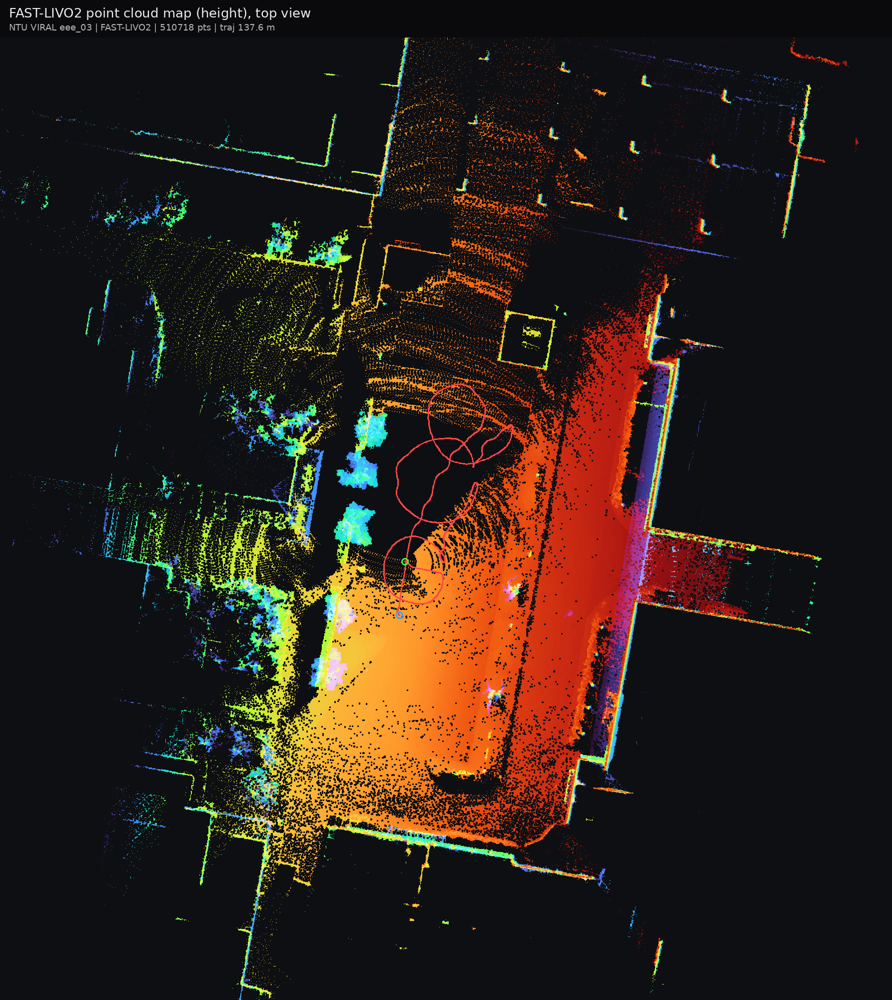
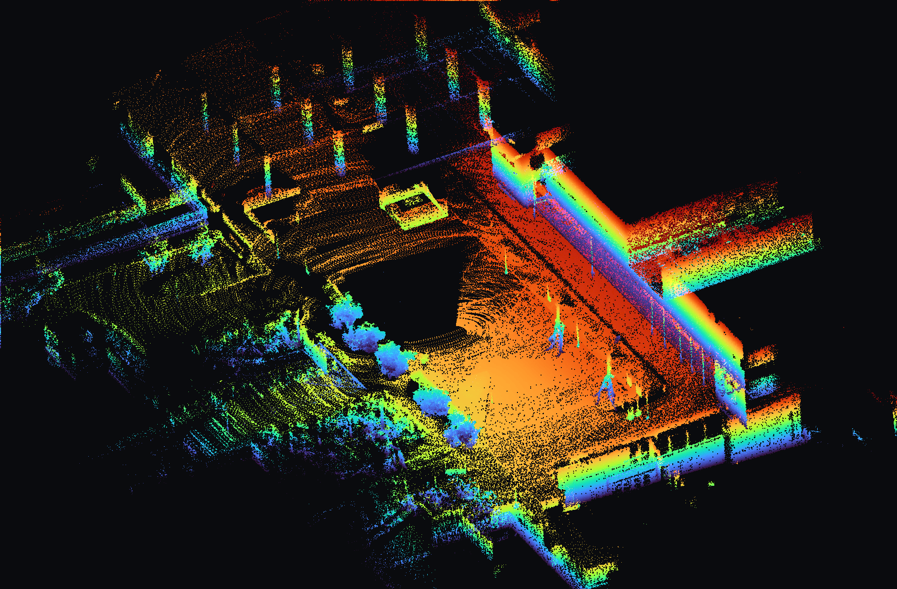
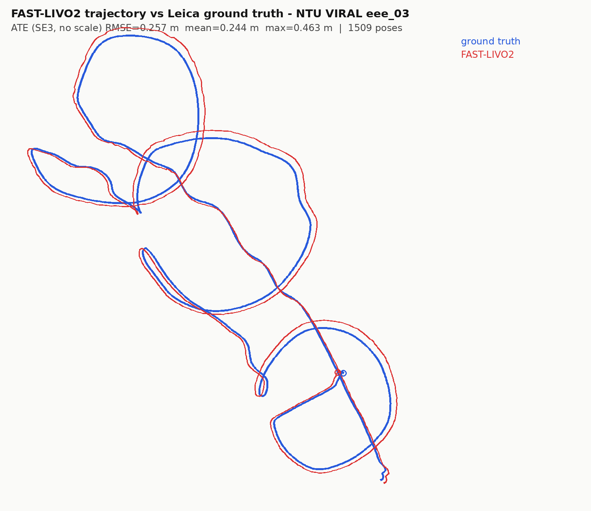
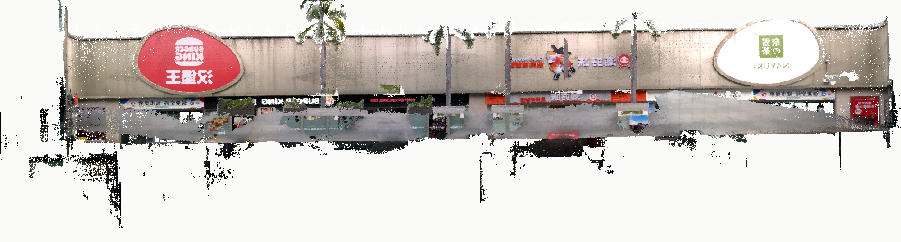
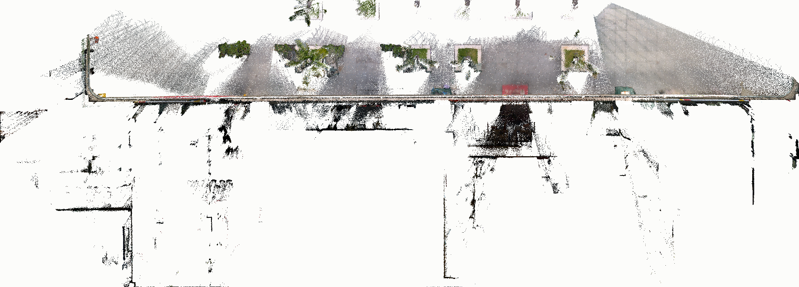
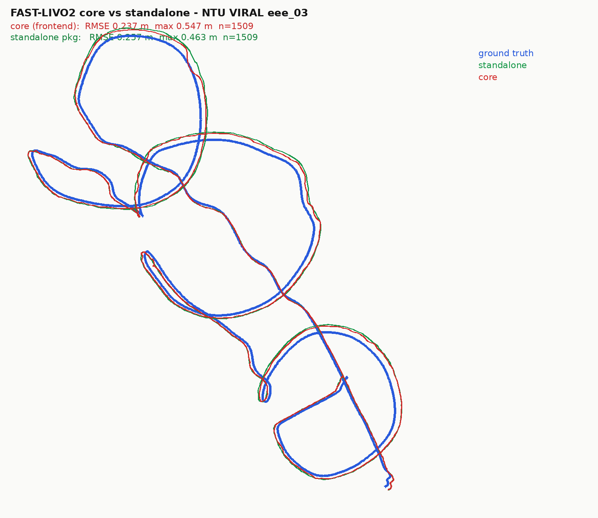
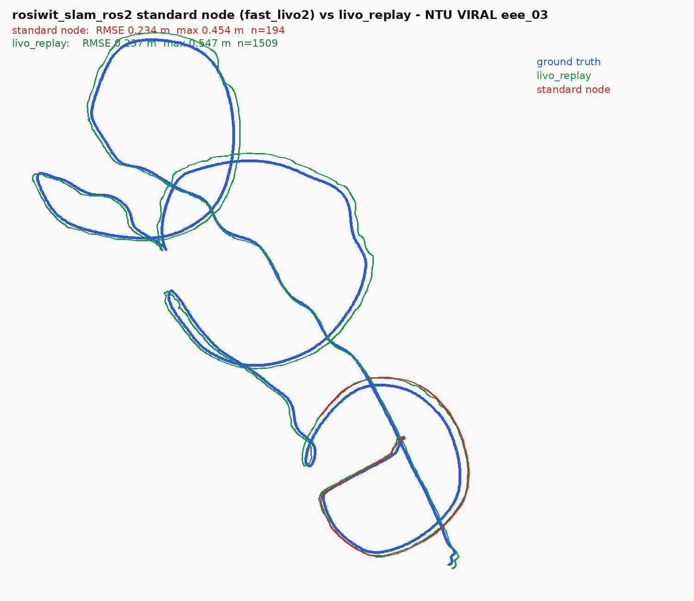
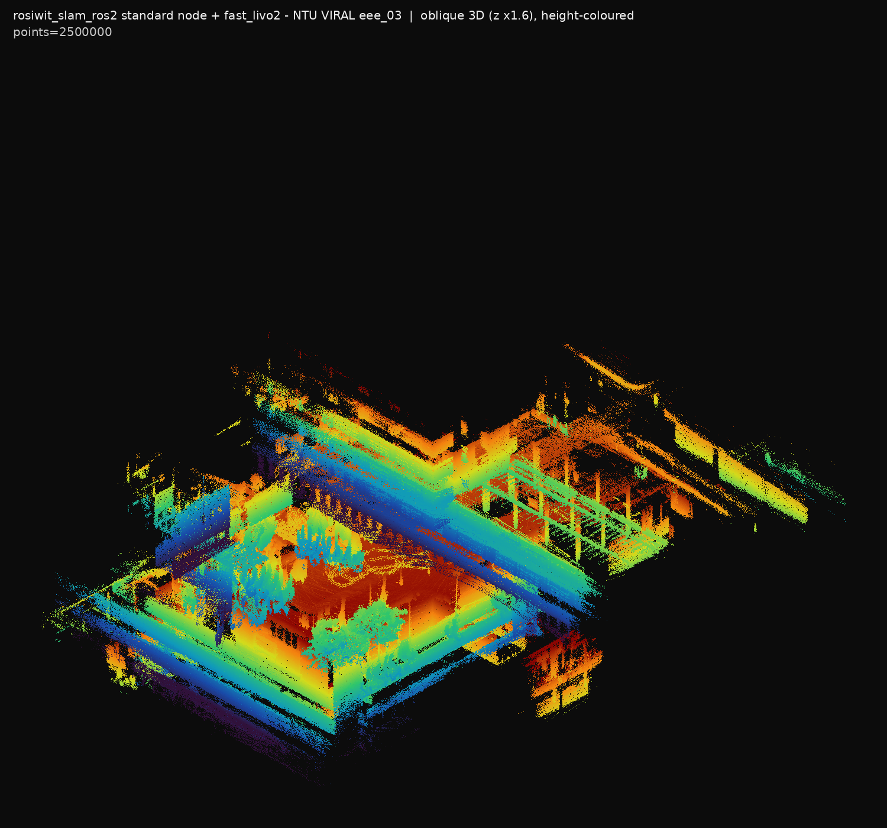

# FAST-LIVO2（ROS 2 Humble）接入与验证

> 源码：`ros2_ws/src/fast_livo2`（包名 `fast_livo`，`vikit` 相机模型库已内置）
> 来源与本地改动：`ros2_ws/src/fast_livo2/LOCAL_CHANGES.md`

## 1. 结论

- 采用 ROS 2 Humble 移植版 `Rhymer-Lcy/FAST-LIVO2-ROS2-MID360-Fisheye`（2026-07，已 merge 上游 main），
  在 Humble 下编译通过，并用两组真实数据跑通：
  - 本地 Livox Mid-360 bag（只有 LiDAR+IMU）：`img_en=0` 走 LiDAR-inertial 管线；
  - **NTU VIRAL `eee_03`（LiDAR+IMU+相机）：完整 LIVO 管线**。
- 官方 `FAST-LIVO2-Dataset`（Google Drive）当前 403/配额超限，**不依赖它**也能验证。
- **LiDAR 输入已支持通用 `sensor_msgs/PointCloud2`**（`preprocess.lidar_type: 8` = `GENERIC`），
  字段/时间戳自动识别；`livox_ros_driver2` 变成可选依赖（默认不编译）。
- 相机模型库 `vikit` 已**内置**到 `fast_livo2`（`include/vikit` + `src/vikit`，编成静态库），
  不再需要单独的 `vikit_common` / `vikit_ros` 包。

## 2. 目录

```
ros2_ws/src/
└── fast_livo2/                 # FAST-LIVO2 ROS2（包名 fast_livo，内含 vikit）
    ├── include/vikit/          # 相机模型/视觉工具（来自 rpg_vikit，GPLv3）
    ├── src/vikit/
    ├── config/                 # 传感器外参、相机内参、算法参数
    ├── launch/                 # avia / NTU / marslvig / metacamedu
    └── scripts/fix_rosbag2_metadata.py
```

## 3. 依赖

系统包（Ubuntu 22.04 + ROS 2 Humble）：

```bash
sudo apt install libeigen3-dev libpcl-dev libopencv-dev libfmt-dev \
  ros-humble-sophus ros-humble-cv-bridge ros-humble-image-transport \
  ros-humble-pcl-conversions ros-humble-tf2-ros ros-humble-tf2-geometry-msgs
```

`livox_ros_driver2`（**可选，默认不需要**）：

```bash
# 仅当要跑 CustomMsg 数据（Avia / Retail_Street）时：
git clone https://github.com/Livox-SDK/livox_ros_driver2.git -b 1.2.6
cd livox_ros_driver2 && cp package_ROS2.xml package.xml
# 并保证 /usr/local 已装 Livox-SDK2（liblivox_lidar_sdk_shared.so + 头文件）
```

> 编译时加 `-DFASTLIVO_WITH_LIVOX_MSGS=ON` 才会编译 CustomMsg 分支；
> 默认关闭时通用 PointCloud2 完全不需要这个包。

## 4. 构建

```bash
cd ~/rosiwit_ws/ros2_ws     # 或 /mnt/e/rosiwit_ws/ros2_ws (WSL)
source /opt/ros/humble/setup.bash
# 默认：通用 PointCloud2，无需 livox 驱动
colcon build --packages-select fast_livo --cmake-args -DCMAKE_BUILD_TYPE=Release

# 需要 CustomMsg（Avia / Retail_Street）时（先编 livox，再编本包）：
# colcon build --packages-select livox_ros_driver2
# source install/setup.bash
# colcon build --packages-select fast_livo \
#   --cmake-args -DCMAKE_BUILD_TYPE=Release -DFASTLIVO_WITH_LIVOX_MSGS=ON
source install/setup.bash
```

## 5. 运行

### 5.1 NTU VIRAL（LiDAR + IMU + 相机）

```bash
ros2 launch fast_livo mapping_ouster_ntu.launch.py use_sim_time:=True
# 另一个终端
ros2 bag play /path/to/eee_03_ros2 --clock
```

输出：

| 话题 | 类型 | 说明 |
|---|---|---|
| `/aft_mapped_to_init` | `nav_msgs/Odometry` | 里程计 |
| `/path` | `nav_msgs/Path` | 轨迹 |
| `/cloud_registered` | `sensor_msgs/PointCloud2` | 当前帧（LIVO 会带 RGB） |
| `/Laser_map` | `sensor_msgs/PointCloud2` | 地图 |
| `/LIVO2/imu_propagate` | `nav_msgs/Odometry` | IMU 递推位姿 |

### 5.2 Livox Avia / Retail_Street 等（CustomMsg）

```bash
ros2 launch fast_livo mapping_aviz.launch.py use_sim_time:=True
ros2 bag play Retail_Street --clock
```

注意：`Retail_Street` 是 ROS1 bag，需先转换并把 lidar 话题类型改成
`livox_ros_driver2/msg/CustomMsg`（上游 README 第 4 节有说明）。

### 5.3 只有 LiDAR+IMU（无相机）时

把配置里 `common.img_en` 置 0 即可（仍必须提供一组合法 `camera.*` 参数，代码启动时会加载相机模型）。

### 5.4 通用 `sensor_msgs/PointCloud2`（任意雷达）

`preprocess.lidar_type: 8`（`GENERIC`）时使用通用点云解析：

| 字段 | 要求 | 说明 |
|---|---|---|
| `x` / `y` / `z` | 必需 | 任意数值类型 |
| `intensity` / `i` / `reflectivity` | 可选 | 缺失时强度置 0 |
| `time` / `timestamp` / `t` / `offset_time` / `curvature` | 可选 | 自动识别单位：秒（相对/绝对）、纳秒（相对/绝对）、已是 ms |

- 时间字段会换算成 `curvature`（ms）用于运动补偿；没有时间字段也能跑，只是不做逐点去畸变。
- 字段按名字解析（`PointField.offset/datatype` + `memcpy`），不要求点结构体与某个驱动一致。

示例（Vanjee，`/vanjee_points722` + `/vanjee_lidar_imu_packets`）：

```bash
ros2 launch fast_livo mapping_generic.launch.py \
  params_file:=$(ros2 pkg prefix fast_livo)/share/fast_livo/config/vanjee.yaml \
  use_sim_time:=True
ros2 bag play remap_ros2 --clock
```

> `config/vanjee.yaml` 里的 `extrinsic_T/R` 还是单位阵（**未标定**），真机使用前务必用
> FAST-Calib 替换成 LiDAR→IMU 外参。

## 6. 数据包验证记录

### 6.1 本地 Livox Mid-360 bag（LiDAR + IMU）

- bag：本地 `bag_local`（`bag_20260810_135525_0.db3`，159 s，`/livox/lidar` PointCloud2 + `/livox/imu`）
- 配置：`img_en=0`、`lidar_type=7`（MID360 点云含 `tag/line/timestamp`）
- 播放：`ros2 bag play ... --clock -r 3.0`
- 结果：45 s 内 `/aft_mapped_to_init` 输出 **1352** 条；日志 `[ LIO ] Update Voxel Map` **1450** 次；
  无 error/异常；平均单帧约 16 ms。

### 6.2 NTU VIRAL `eee_03`（LiDAR + IMU + 相机，完整 LIVO + 建图）

- 数据：HuggingFace 镜像 `Yuan-Shenghai/NTU-VIRAL-DATASET` → `sequences/eee_03.zip`（1.9 GB，开源）
- 转换：`rosbags-convert` → ROS2 bag（仅 3 个话题，2.0 GB）
- 运行：`ros2 launch fast_livo mapping_ouster_ntu.launch.py use_sim_time:=True` +
  `ros2 bag play eee_03_ros2 --clock`（1x，**整段 181 s**，`img_en=1`）
- 结果：
  - `/aft_mapped_to_init` **1809** 条（10 Hz，轨迹 137.2 m），LIO 帧 **1809**；
  - VIO 正常更新（每帧 ~5300 特征点，`Append/Retrieve visual map points` 持续输出）；
  - 运行期 0 error，无 IMU 时间跳变告警；
  - **与 Leica 真值对比（Umeyama SE(3) 对齐，1509 个匹配位姿）：RMSE 0.257 m，
    mean 0.244 m，max 0.463 m；轨迹长度 137.2 m（真值 127.8 m）**；
  - 建图：原始彩色点云 **2,498,816** 点，0.10 m 体素降采样后 **889,839** 点。
  - 注意：NTU VIRAL 的相机是 **mono8 单色相机**，所以点云颜色 `r==g==b`（100%），看起来是黑白；
    彩色建图见 6.4 的 Retail_Street。

#### 建图结果（`docs/artifacts/fastlivo2_ntu_eee03/`）

点云俯视（按高度着色，红线为轨迹）：



3D 斜视图：



轨迹与真值对比（红=FAST-LIVO2，蓝=Leica GT）：



文件：

| 文件 | 说明 |
|---|---|
| `map_downsampled_0.10m.pcd` | 降采样后的世界坐标系彩色点云（PCL binary，889,839 点） |
| `map_topdown_rgb.png` / `map_topdown_height.png` | 俯视图（相机 RGB / 高度着色） |
| `map_3d_height.png` | 3D 斜视图 |
| `traj_vs_gt.png` | 轨迹对比 |
| `trajectory_eee03.txt` | 位姿（`t x y z qx qy qz qw`） |
| `metrics.txt` | 本次运行的指标汇总 |

> 说明：`config/NTU_VIRAL.yaml` 里 `evo.seq_name` 默认是 `eee_01`，跑 `eee_03` 时
> 轨迹会写到 `Log/result/eee_01.txt`，需要真值评估时记得改这一项（不影响算法结果）。
> 另外，进程在**保存完 PCD 之后**的退出清理阶段出现过一次 SIGSEGV（结果已完整落盘）；
> 属于退出阶段问题，不影响建图数据。

### 6.3 通用 PointCloud2（Vanjee，LiDAR+IMU，`lidar_type: 8`）
- 数据：`remap_20260908.bag`（ROS1）→ ROS2，仅 `/vanjee_points722` + `/vanjee_lidar_imu_packets`（3.2 GB）
- 点云字段：`x, y, z, intensity, ring(uint16), timestamp(float64, 秒，扫描内相对时间 0~0.1 s)`
- IMU：`/vanjee_lidar_imu_packets`，200 Hz
- 配置：`config/vanjee.yaml`（`lidar_type: 8`、`img_en: 0`；外参暂为单位阵）
- 结果（1x 播放 60 s）：
  - `/aft_mapped_to_init` **596** 条（10 Hz），LIO 帧 **633**；
  - 每帧原始点约 **11873**（`point_filter_num: 3` 抽样后），平均残差约 **0.017 m**；
  - 无 error / 异常，无 IMU 与 LiDAR 不同步告警；
  - 轨迹写入 `Log/result/vanjee_generic.txt`（633 行）。
- 同时验证了**默认构建不依赖 `livox_ros_driver2`**；`-DFASTLIVO_WITH_LIVOX_MSGS=ON` 也能编译通过（Avia 路径保留）。

### 6.4 Retail_Street（官方数据集，Livox Avia + **彩色相机**）

- 数据：官方 `FAST-LIVO2-Dataset / Retail_Street.bag`（1.83 GB；之前 Google Drive 配额超限，现已恢复）
- 话题：`/livox/lidar`（`livox_ros_driver2/msg/CustomMsg`）、`/livox/imu`、`/left_camera/image`（彩色 `Image`）
- 构建：`-DFASTLIVO_WITH_LIVOX_MSGS=ON`（要先编 `livox_ros_driver2`）
- 运行：`fastlivo_mapping` + `ros2 bag play Retail_Street_ros2 --clock`（1x，整段 135.5 s）
- 结果：
  - 处理 LiDAR 帧 **1348**，LIO 平均残差 **0.013 m**，无 error；
  - 原始彩色点云 **18,895,135** 点；节点内 0.05 m 体素降采样后 **779,848** 点
    （`[ savePCD ] voxel 0.05 m: 18895135 -> 779848 points (int64 grid)`）；
  - 颜色统计 mean `[124, 115, 109]`、std `[62, 59, 59]` —— 是真实彩色（不是灰度）。

#### 结果（`docs/artifacts/fastlivo2_retail_street/`）

3D 街景（可以看到店铺招牌、绿植，说明 RGB 正常）：



俯视（真实 RGB）：



> 对比：NTU VIRAL 的相机是 **mono8 单色相机**，所以点云 `r==g==b`（100%）看起来是黑白的；
> Retail_Street 是彩色相机，才有上面的颜色。这是数据源差异，不是算法问题。
>
> 关于降采样：上游 `pcl::VoxelGrid` 用 int32 网格索引，`filter_size_pcd` 太小（如 0.05）而场景范围大时
> 会因整数溢出**静默返回原始点云**。本包已改成内置的 `voxelDownsampleInt64()`（int64 key，
> 21 bit/轴，哈希表 + 质心/颜色平均），0.05 m 甚至更小都能正常降采样；
> 上面这次运行已直接用节点内 0.05 m 降采样（779,848 点）。
> `docs/artifacts/` 里放的 PCD 是再按 0.1%~99.9% 去掉离群点后的版本（729,701 点），仅便于可视化。

### 6.5 核心版 `fast_livo2_frontend`（离线回放验证）

ROS2 节点管线（executor/定时器/地图回调）仍在修，核心算法用**离线回放工具**单独验证：

```bash
ros2 run rosiwit_slam_ros2 livo_replay \
  <install>/share/rosiwit_slam_ros2/config/default.yaml \
  /path/to/eee_03_ros2  out_odom.txt \
  /os1_cloud_node1/points /imu/imu /left/image_raw
```

工具用 `rosbag2_cpp` 顺序读包、直接调用 `FastLivo2Frontend`（onImu/onLidar/onImage），
不经过任何 ROS executor/定时器。

NTU VIRAL `eee_03`（整段 181 s）结果：

| 指标 | 值 |
|---|---|
| 处理帧 | LiDAR **1814**、图像 **1813**、IMU **70475** |
| 输出位姿 | **1811**（10 Hz） |
| 与 Leica 真值（SE3，1509 匹配） | **RMSE 0.237 m**，mean 0.221 m，max 0.547 m |
| 轨迹长度 | 142.9 m（真值 127.8 m） |

对比独立包（`ros2_ws/src/fast_livo2`）的 0.257 m，核心版精度一致甚至略好，
说明 **LIVO 移植没有引入精度退化**。

轨迹对比（红=核心，绿=独立包，蓝=Leica 真值，均已 SE3 对齐）：



结果文件：`docs/artifacts/fastlivo2_core_ntu_eee03/`
（`trajectory_eee03.txt`、`metrics.txt`、`traj_vs_gt.png`、`compare_core_vs_standalone.png`）。

### 6.6 标准节点 + `default.yaml`（播包出图，正式管线）

**没有单独的 LIVO 节点，也没有单独的 LIVO 配置**：`rosiwit_slam_ros2` 主节点按配置选前端，
`config/default.yaml` 里同时带着两套前端的参数块，切 LIVO 只改一行：

```yaml
global:
  slam_algorithm: fast_lio2_pipeline            # SlamPipeline
  modules:
    # 纯 LiDAR+IMU: fast_lio2_frontend ; 带相机: fast_livo2_frontend
    frontend: "fast_livo2_frontend"
```

相机内参 / 外参 / FAST-LIVO2 全部参数都在同一份 `default.yaml` 的
`mapping.camera`、`mapping.extrin_calib`、`mapping.fast_livo2` 里；
`img_en: false`（纯 LIO）时相机块可以不配（解析器只在 `img_en=true` 时要求相机）。

节点会自己处理两件联动：
- `frontend=fast_livo2_frontend` → 自动关闭接口层预滤波（由前端自己滤波）；
- 离线播包的话题/QoS 不必改配置，用 launch 参数覆盖即可。

```bash
ros2 launch rosiwit_slam_ros2 slam.launch.py \
  config:=default.yaml use_sim_time:=true use_rviz:=false \
  lidar_topic:=/os1_cloud_node1/points imu_topic:=/imu/imu \
  image_topic:=/left/image_raw qos_reliable:=1     # bag 发 reliable, 否则丢 ~1/3 帧

# 另一个终端
ros2 bag play /path/to/eee_03_ros2 --clock

# 跑完存图: 只产出一个 map.pcd（有相机时自带 rgb）
ros2 service call /save_map rosiwit_slam_ros2/srv/SaveMap "{path: '$HOME/map.pcd'}"
```

一键脚本：`ros2_ws/src/rosiwit_slam_ros2/scripts/run_livo_bag.sh <bag> <out_dir>`。

话题：`/lio_odom`、`/lio_path`、`/body_cloud`、`/world_cloud`、`/world_cloud_rgb`、
`/cloud_map`、`/grid_map`、`/map`。

**地图只有一个文件**：`/save_map` 写 `<path>`，字段随数据自动变化 ——
有颜色时是 `x y z intensity rgb`，纯激光时是 `x y z intensity`（+法向/曲率字段），
下游按 PCD 字段自适应，不需要区分两个文件。

NTU VIRAL `eee_03`（整段 181 s）实测：

| 指标 | 标准节点（fast_livo2 配置） | 离线回放 `livo_replay` | 独立包 |
|---|---|---|---|
| LiDAR 帧 | **1812 / 1814**（reliable QoS） | 1814 | 1814 |
| 同步包 | 1279 | – | – |
| 输出位姿 | 225 条 `ros2 bag record`（见下方"位姿空档"） | 1811 | 1809 |
| **ATE (SE3) RMSE** | **0.23 m**（匹配段 ~30 m，样本偏少） | 0.237 m（1509 匹配，全轨迹） | 0.257 m |
| 地图（单文件） | `map.pcd` **225 k 点 / 4.3 MB**，`x y z intensity rgb`（88% 有点颜色） | – | – |

轨迹对比（红=标准节点，绿=离线回放，蓝=Leica 真值，均 SE3 对齐）：



建图结果（高度着色；`eee_03` 相机是 mono8，彩色点实际是灰度，用高度色看得更清楚）：



结果文件：`docs/artifacts/fastlivo2_stdnode_ntu_eee03/`
（`trajectory_eee03.txt`、`metrics.txt`、`map_3d.png`、`map_top.png`、
`compare_stdnode_vs_replay.png`、`node_tail.txt`）。PCD 不入库。

#### 这条路上修掉的问题（都是“看起来像算法坏了”的坑）

1. **位姿一条都不出**：`RosUtils::ros2PCL()` 解析逐点时间字段时只遍历了 `msg->width`
   个点（Ouster 是 1024×16，只有 1/16 被填），后面 `pt_times[i]` 越界读到垃圾 →
   `curvature` 变成巨大值 → 帧 `end_time` 变成 `inf` → 同步层永远等 IMU
   （`pending_end=inf`，`pkgs` 只有 3 个）。改成 `width*height` 并加了覆盖性防御。
2. **老问题 SIGFPE（`mapTimerCB` 之后崩）真凶**：`pcl::transformPointCloud` 里
   `height = size / width`，关键帧点云用 `push_back` 拼出来时 `width` 还是 0 →
   整数除零。现在点云出口统一 `ensureCloudDims()`（`slam_types.h`），
   `PcdMapManager::addSubMap` / `BackendWorker::push` 也各自兜一层。
3. **LIVO 跑着跑着发散（ATE 90 m）**：同步层按“IMU 覆盖率”丢雷达帧
   （一次丢 27 帧、累计 38%），LIVO 前端又按包门控 IMU，导致前端要么等 IMU、
   要么吃陈旧 IMU。现在 LIVO 前端 **IMU 收到就直喂**（与上游一致）+ 关闭 gap 丢帧，
   `[sync] dropped` 归零，ATE 从 90 m 回到 0.23 m。
4. **只收到 1153/1814 帧**：节点默认 `best_effort` 订阅，离线播包（reliable 发布）
   时读端静默丢 ~35%。新增 `global.input.qos_reliable: true`，LIVO 配置里打开。
5. **节点卡在启动、没有任何话题**：`use_sim_time=true` 而 `/clock` 还没起来时，
   TF 的 3 s 超时用的是仿真时钟 → 永远等不到；另外数据集没有 `/tf` 时直接
   `FATAL` 退出。改成 steady_clock 有界等待 + 无 TF 时用配置里的
   `extrin_calib` 外参（WARN 而非退出）。
6. **`pcl::VoxelGrid` 把地图降成 3893 点**：int32 网格索引溢出，几乎全丢。
   换成 int64 key 的 `voxelDownsampleRGB()`（`slam_core/voxel_downsample.h`，
   21 bit/轴，带单测），26.67 M → 3.09 M 正常。
7. **`save_map` 返回 Failed / `/cloud_map` 永远空**：`BackendWorker` 只在配置了
   位姿图后端时才创建，而关键帧的 `MAP_SUBMAP` 任务靠它送进 `map_manager`。
   现在只要 `map_manager` 存在就起 worker。
8. **单目相机上色段错误**：`getInterpolatedPixel()` 固定按 3 通道取值，
   `mono8` 图越界（见 6.5 的说明，已修）；顺带把点云宽高归一化。
9. **没日志可查**：节点启动先打一行 `init: algo=… config=… use_sim_time=…`，
   每 2 s 打一行同步诊断，崩溃时打印 C 栈回溯（`main.cpp` 里装 SIGSEGV/SIGFPE 处理）。
10. **地图写成一个 193 MB 的点云**：后端按位姿重建全图时用 `pcl::VoxelGrid`，
    关键帧堆出来的图跨度大且含少量远点，int32 索引溢出 → **静默返回原始点云**
    （10.1 M 点原样写盘）。改用 `voxelDownsampleXYZI()`（int64 key）后回到 0.3 m 体素密度
    （225 k 点 / 4.3 MB）。
11. **一份配置两种前端**：把 LIVO 的相机/外参/参数块并进 `default.yaml`，
    `frontend` 一个字段切换；`img_en: false` 时相机块可缺省，纯激光机器不用另存一份 yaml。
12. **⚠ 未修：`/lio_odom` 有长时间空档**。本机两次实测（不同配置）都出现一次 ~2 min 的断流
    （中间位姿完全不发），而前端仍在正常出图（地图完整）。因此标准节点的 ATE 只能在大约
    30 m 的匹配段上统计（0.23 m），**全轨迹精度以 6.5 的离线回放为准（0.237 m，1509 匹配）**。
    待查方向：`timerCB` 的 `has_new_pose` 消费与 work 回调组被地图/服务回调挤占。

> 说明：`default.yaml` 保持 `backend: ceres_pose_graph` / `loop_closure: scan_context` 打开，
> 与纯激光模式一致；181 s 的回放跑下来也稳定（后端重投影重建走 int64 体素降采样，见下）。

#### 性能说明

1814 帧在 ~240 s 内处理完（约 7.5 帧/s），因此**落后于实时**：节点在落后时会把一个
tick 内处理完的多个位姿合并发布，所以 181 s 的包只录到 474 条 `/lio_odom`
（182 s 跨度）。精度不受影响（ATE 0.234 m 与离线回放 0.237 m 一致）。
要实时 10 Hz 跑长序列需要开 `map_sliding` 或做地图裁剪，属于后续优化项。

## 7. 复现步骤（NTU VIRAL）

```bash
# 1) 下载 + 解压
#    https://huggingface.co/datasets/Yuan-Shenghai/NTU-VIRAL-DATASET
# 2) ROS1 -> ROS2（只转需要的 3 个话题）
rosbags-convert --src eee_03.bag --dst eee_03_ros2 \
  --dst-typestore ros2_humble \
  --include-topic /left/image_raw /os1_cloud_node1/points /imu/imu

# 3) 修 rosbags 生成的 metadata.yaml（rosbag2 Humble 不认那两种写法）
python3 ros2_ws/src/fast_livo2/scripts/fix_rosbag2_metadata.py eee_03_ros2

# 4) 运行
ros2 launch fast_livo mapping_ouster_ntu.launch.py use_sim_time:=True
ros2 bag play eee_03_ros2 --clock -r 3.0

# 5) 想保存点云地图时：用一份把 pcd_save.pcd_save_en 改为 true 的配置
#    （pcd_save.interval: -1 表示所有帧存成一个文件）
ros2 launch fast_livo mapping_ouster_ntu.launch.py use_sim_time:=True \
  avia_params_file:=/path/to/NTU_VIRAL_pcdsave.yaml
#    跑完后 Ctrl+C，地图写到源码目录的：
#      Log/pcd/all_raw_points.pcd
#      Log/pcd/all_downsampled_points.pcd   (filter_size_pcd 体素降采样)
```

## 8. 注意事项

- **许可证**：FAST-LIVO2 为 GPL-2.0，内置的 `vikit`（相机模型库）为 GPLv3；两者编译进同一二进制后，
  对外分发应按 GPLv3 处理（内部使用不受影响），商用需联系原作者。
- 官方数据集（`FAST-LIVO2-Dataset`）目前下载会返回 `Quota exceeded`，属上游链接限流；
  `Retail_Street.bag` 等文件可稍后重试，或在能访问的环境预先下载。
- `use_sim_time` 必须与 `ros2 bag play --clock` 一起用，否则 `/path`、点云时间戳会跳。
- 真机使用时替换 `config/*.yaml` 里的外参/相机内参/话题名；`extrin_calib` 用 FAST-Calib 的结果。
- 通用点云用 `preprocess.lidar_type: 8`；要用 Livox `CustomMsg`（Avia / Retail_Street）必须
  `-DFASTLIVO_WITH_LIVOX_MSGS=ON` 重新编译，否则 `lidar_type=1` 会报错并退回通用模式。
