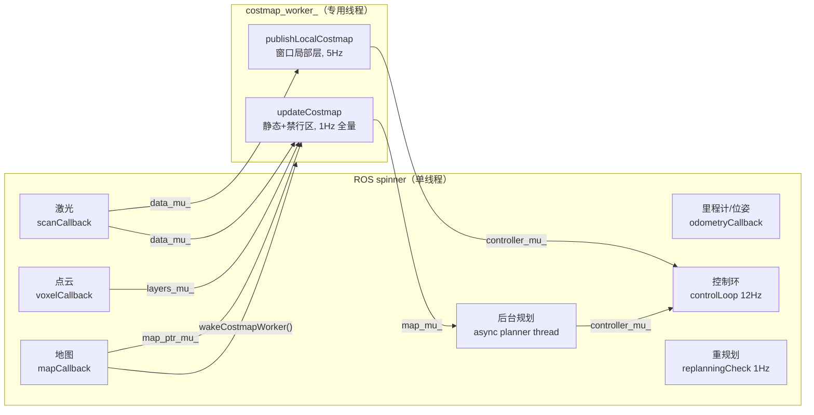

# 导航节点 ROS1 线程模型（rosiwit_navigation_ros1_node）

> 对应提交：`008654e refactor(nav): move costmap build/publish off the ROS spinner`
> 现场节点：`/robot_move_base`（`rosiwit_navigation_ros1_node`）

## 1. 为什么只挪代价地图

2026-10-31 现场问题：4M 栅格的 `updateCostmap()`（整图 copy + 膨胀 + 四层合成）和
`publishLocalCostmap()` 跟控制环挤在同一个 spinner 里，地图一大就开始吃掉控制周期。
但控制环、`ActionTask`、`async_planner_` 之间有大量隐式时序（path 只写一次、action 状态机不重入），
直接开 2 个 spinner 跑回调会引入 action/path 竞态。

所以这次重构**只做一件事**：把重活搬到专用 worker，控制/传感器回调仍是单线程。

## 2. 锁面（最小共享状态）

| 锁 | 保护的数据 | 谁写 | 谁读 |
| --- | --- | --- | --- |
| `costmap_mu_` | worker 内 `updateCostmap`/`publishLocalCostmap` 互斥（恢复分支也会同步调用） | worker / ROS 线程 | 同上 |
| `map_ptr_mu_` | `current_map_`、`map_seq_` | `mapCallback` | worker |
| `data_mu_` | `laser_points_`、`last_scan_stamp_`、`tracker_` | `scanCallback`、`clearRecoveryCostmaps` | worker |
| `map_mu_` | `planner_costmap_`、`planner_smooth_grid_` | worker（1Hz 重建） | 规划线程（smoothing/`buildStartClearedCostmap`）、`pathBlocked()`、规划器热切换 |
| `controller_mu_` | `controller_strategy_` / `coverage_controller_` 的输入注入 vs 求解 | worker（`setObstacles`/`setLocalCostmap`）、规划线程（`setPath`/`setTrajectory`） | `computeVelocityCommand`、`coverageCommand` |
| `layers_mu_` | `keepout_layer_`、`voxel_layer_`、`planner_layers_`、`local_layers_` | worker + 禁行区/点云回调 | worker + 禁行区日志 |

加锁原则：

1. **先快照后计算**：`updateCostmap`/`publishLocalCostmap` 进入后先把地图指针、扫描点、
   体素点、追踪目标做一次值拷贝，再在 `map_mu_`/`layers_mu_` 里计算。这样 worker 不会长时间
   持有 `data_mu_`/`map_ptr_mu_`，扫描回调最多等一次 `vector` 拷贝。
2. **禁止反向嵌套**：worker 的加锁顺序固定为
   `costmap_mu_ → map_ptr_mu_ → data_mu_ → map_mu_ → layers_mu_ → controller_mu_`，
   ROS 线程只取其中单把或更短的组合，不会形成环。
3. `scanCallback` 用 `unique_lock`，处理完立刻 `unlock()` 再发布 marker，避免 worker 等发布。
4. `m_has_planner_costmap_` 是跨线程标志，改成 `std::atomic<bool>`。

## 3. 行为等价性

| 项目 | 重构前 | 重构后 |
| --- | --- | --- |
| 全量规划视图 | `updateCostmap()` 1Hz（scan 回调内触发） | worker 1Hz（`last_global_costmap_update_` 门控），不变 |
| 局部代价地图 | `local_costmap_timer_` 5Hz（`costmap_update_rate_`） | worker 每周期串行 `updateCostmap + publishLocalCostmap`，5Hz |
| 地图/禁行区变更 | 回调里同步 `updateCostmap()` | `wakeCostmapWorker()` 立即唤醒，最多延迟一个 `updateCostmap` |
| 控制频率 | 12Hz（`controller_frequency_`） | 不变；只在 `computeVelocityCommand` 处与 worker 互斥 |

实测（2026-11-01 02:22，车辆静止 IDLE，691×449 地图）：

- `/local_map` 4.95 Hz（min 0.189 s / max 0.229 s）
- `/global_costmap` 1.15 Hz
- 节点 CPU 9.2%，线程数 9（main + ros spinner + worker + tf/ros internal）
- 重启后 `/robot_move_base` 的 WARN/ERROR 计数：0
- `/nav_diagnostics`：`state=IDLE, safety=PASS, safety_scale=1, replan_fail=0, scan_pts=905`

## 4. 仍未验证 / 后续

- **行驶验证未做**（当时车在充电）：需要一段真实导航确认
  `safety_scale`、`replan_fail`、`cmd_vel` 平滑度与末端原地旋转无回归。
- worker 与 `updateCostmap` 的 `last_global_costmap_update_` 仍是普通 `ros::Time`
  （ROS 线程置零、worker 写当前时间），目前只影响"是否立刻刷新"，无数据副作用；
  若后续要更严格可换成 `std::atomic<bool> force_refresh_`。
- 若将来要把 planning 也挪出 spinner，必须先给 `ActionTask` 加明确的单线程 owner。
