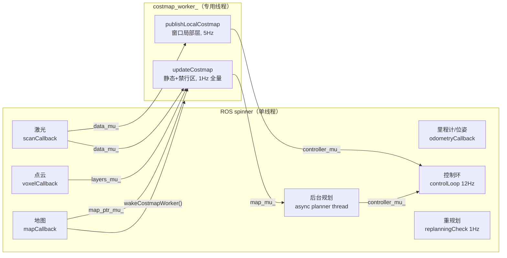

# 导航节点 ROS1 线程模型（rosiwit_navigation_ros1_node）

> 对应提交：`008654e refactor(nav): move costmap build/publish off the ROS spinner`
> 现场节点：`/robot_move_base`（`rosiwit_navigation_ros1_node`）

## 1. 为什么只挪代价地图

2026-10-31 现场问题：4M 栅格的 `updateCostmap()`（整图 copy + 膨胀 + 四层合成）和
`publishLocalCostmap()` 跟控制环挤在同一个 spinner 里，地图一大就开始吃掉控制周期。
但控制环、`ActionTask`、`async_planner_` 之间有大量隐式时序（path 只写一次、action 状态机不重入），
直接开 2 个 spinner 跑回调会引入 action/path 竞态。

所以这次重构**只做一件事**：把重活搬到专用 worker，控制/传感器回调仍是单线程。



## 2. 锁面（最小共享状态）

| 锁 | 保护的数据 | 谁写 | 谁读 |
| --- | --- | --- | --- |
| `costmap_mu_` | worker 内 `updateCostmap`/`publishLocalCostmap` 互斥（恢复分支也会同步调用） | worker / ROS 线程 | 同上 |
| `map_ptr_mu_` | `current_map_`、`map_seq_` | `mapCallback` | worker |
| `data_mu_` | `laser_points_`、`last_scan_stamp_`、`tracker_` | `scanCallback`、`clearRecoveryCostmaps` | worker |
| `map_mu_` | `planner_costmap_`、`planner_smooth_grid_` | worker（1Hz 重建） | 规划线程（smoothing/`buildStartClearedCostmap`）、`pathBlocked()`、规划器热切换 |
| `controller_mu_` | `controller_strategy_` / `coverage_controller_` 的输入注入 vs 求解 | worker（`setObstacles`/`setLocalCostmap`）、规划线程（`setPath`/`setTrajectory`） | `computeVelocityCommand`、`coverageCommand` |
| `layers_mu_` | `keepout_layer_`、`voxel_layer_`、`planner_layers_`、`local_layers_` | worker + 禁行区/点云回调 | worker + 禁行区日志 |

加锁原则：

1. **先快照后计算**：`updateCostmap`/`publishLocalCostmap` 进入后先把地图指针、扫描点、
   体素点、追踪目标做一次值拷贝，再在 `map_mu_`/`layers_mu_` 里计算。这样 worker 不会长时间
   持有 `data_mu_`/`map_ptr_mu_`，扫描回调最多等一次 `vector` 拷贝。
2. **禁止反向嵌套**：worker 的加锁顺序固定为
   `costmap_mu_ → map_ptr_mu_ → data_mu_ → map_mu_ → layers_mu_ → controller_mu_`，
   ROS 线程只取其中单把或更短的组合，不会形成环。
3. `scanCallback` 用 `unique_lock`，处理完立刻 `unlock()` 再发布 marker，避免 worker 等发布。
4. `m_has_planner_costmap_` 是跨线程标志，改成 `std::atomic<bool>`。

## 3. 行为等价性

| 项目 | 重构前 | 重构后 |
| --- | --- | --- |
| 全量规划视图 | `updateCostmap()` 1Hz（scan 回调内触发） | worker 1Hz（`last_global_costmap_update_` 门控），不变 |
| 局部代价地图 | `local_costmap_timer_` 5Hz（`costmap_update_rate_`） | worker 每周期串行 `updateCostmap + publishLocalCostmap`，5Hz |
| 地图/禁行区变更 | 回调里同步 `updateCostmap()` | `wakeCostmapWorker()` 立即唤醒，最多延迟一个 `updateCostmap` |
| 控制频率 | 12Hz（`controller_frequency_`） | 不变；只在 `computeVelocityCommand` 处与 worker 互斥 |

实测（2026-11-01 02:22，车辆静止 IDLE，691×449 地图）：

- `/local_map` 4.95 Hz（min 0.189 s / max 0.229 s）
- `/global_costmap` 1.15 Hz
- 节点 CPU 9.2%，线程数 9（main + ros spinner + worker + tf/ros internal）
- 重启后 `/robot_move_base` 的 WARN/ERROR 计数：0
- `/nav_diagnostics`：`state=IDLE, safety=PASS, safety_scale=1, replan_fail=0, scan_pts=905`

### 3.1 与旧实现的唯一语义差异：worker 周期是**墙钟**

旧实现用 `ros::Timer`（ROS 时间）驱动 5 Hz；worker 用 `std::condition_variable::wait_for`
（steady clock，墙钟）。实车 `ROS 时间 == 墙钟`，两者完全一致（2026-11-01 实车实测 4.95 Hz）；
只有在 Gazebo/回放这类 `real time factor ≠ 1` 的环境里，按 **仿真时间** 统计的频率会变成
`5 / RTF`（WSL 里 RTF≈0.5，`rostopic hz /local_costmap` 实测 9.72 Hz，old 为 5.0 Hz）。
这是观测口径差异，不是多发：按墙钟算新实现仍是 5 Hz，只是仿真里比 old 的 2.5 Hz 墙钟更快。

## 4. Gazebo 仿真 A/B 验证（2026-11-01，WSL2 Ubuntu 18.04 + Gazebo 9）

场景：`roslaunch rosiwit_starter_ros1 sim_slam_nav.launch gui:=false rviz:=false`，
house.world，`controller=rpp`，`max_velocity_x=0.8`，目标点由脚本在 `/map` 自由区里选
（BFS 2.5~3.5 m、离障 0.45 m），单次发布到 `/goal_pose`。

被测二进制：

| 变体 | 来源 | md5 |
| --- | --- | --- |
| old | `6f3820d`（重构前） | `3b099da9…` |
| new | `008654e`（本重构） | `802c2a02…` |

### 4.1 单目标 A/B（各 3 次）

| 指标 | old | new |
| --- | --- | --- |
| 结果 | SUCCEEDED ×3 | SUCCEEDED ×3 |
| 终点 xy 误差 | 0.187 / 0.182 / 0.182 m | 0.180 / 0.173 / 0.174 m |
| 终点 yaw 误差 | 0.105 / 0.034 rad | 0.043 / 0.014 rad |
| `/cmd_vel` 频率 | 10.18 / 10.09 Hz | 10.23 / 10.10 Hz |
| 单拍最大 Δv / Δω | 0.055 / 0.062 m·s⁻¹, rad·s⁻¹ | 0.053~0.055 / 0.064~0.107 |
| `plan_ms` 峰值 | 8~88 ms | 31~75 ms |
| `replan_fail` | 0 | 0 |
| `safety_scale` 最小 | 1.0 | 1.0 |

### 4.2 两段 + 禁行区抖动（每段 100+ 次 `/virtual_obstacles`）

第二段导航期间以 2 Hz 持续重发一个**远离路径**的禁行区多边形（old 101 次 / new 102 次），
每次都强制重建规划视图（`layers_mu_` + `map_mu_` + `controller_mu_` 热路径），路线不变：

| 指标 | old | new |
| --- | --- | --- |
| leg1 | SUCCEEDED 0.182 m / 0.012 rad | SUCCEEDED 0.173 m / 0.014 rad |
| leg2（带抖动） | SUCCEEDED 0.177 m / 0.038 rad | SUCCEEDED 0.175 m / 0.042 rad |
| leg2 `/cmd_vel` | 10.07 Hz | 10.04 Hz |
| leg2 单拍最大 Δv / Δω | 0.054 / 0.094 | 0.055 / 0.094 |
| leg2 `/global_costmap` | 4.58 Hz（禁行区触发额外重建） | 4.59 Hz |
| `replan_count` / `replan_fail` | 0 / 0 | 1 / 0 |
| 节点存活 / 崩溃 | 存活 | 存活（10 线程，CPU 16%） |

### 4.3 ThreadSanitizer

`catkin_make -DNAV_SANITIZE=thread` 构建，`setarch -R` 起节点（TSan 与高 ASLR 熵冲突），
跑一次 3 m 目标导航（SUCCEEDED，0.175 m / 0.038 rad）。TSan 共报
46 条 data race + 28 条 lock-order-inversion，**全部落在 `libroscpp` / `liblog4cxx` /
`librosconsole` / `libtf2_ros` 内部**；唯一命中的 node.cpp 帧是构造函数 `ROS_INFO`
（第 164/166 行）和 `main`（第 5711 行），没有一条落在 worker、锁或
`updateCostmap/publishLocalCostmap` 的新代码上。

## 5. 复现

```bash
# 在 WSL (Ubuntu 18.04 + ROS melodic) 内, 仓库放到 ~/rosiwit_ws 并 catkin_make
cd ~/rosiwit_ws
./scripts/sim/run_nav_sim.sh --driver goal   --label new
./scripts/sim/run_nav_sim.sh --driver stress --label new
./scripts/sim/run_nav_sim.sh --driver goal   --label old --binary ~/sim_verify/node_old
```

脚本做四件事：起 headless 仿真（丢机器人时自动补 `spawn_model`）→ 在 `/map` 自由区里
BFS 选可达目标 → 记录 `/nav_diagnostics`/`/cmd_vel`/`/local_map`/`/global_costmap` →
结束时打印节点存活、线程数、崩溃计数。`--driver stress` 会额外做禁行区抖动。

> 注意：仿真里 `spawn_model` 与 Gazebo world 加载有竞态，launch 自带的 spawn 偶发超时
> （"spawn service timed out waiting for entity"）。脚本会自动重试；这属于仿真环境问题，
> 与导航节点无关。

## 6. 仍未验证 / 后续

- 实车行驶验证：仿真覆盖了控制/代价地图/禁行区路径，但**实车仍要跑一段**
  确认制动距离标定（`brake_decel`）与安全区缩放。
- worker 与 `updateCostmap` 的 `last_global_costmap_update_` 仍是普通 `ros::Time`
  （ROS 线程置零、worker 写当前时间），目前只影响"是否立刻刷新"，无数据副作用；
  若后续要更严格可换成 `std::atomic<bool> force_refresh_`。
- 若将来要把 planning 也挪出 spinner，必须先给 `ActionTask` 加明确的单线程 owner。
- 观察到一次（new，压测首轮）：短时间内**重复发同一个 goal**（3 次 / 0.4 s，且上一次 plan
  正在飞）后，`goal_status` 停在 `ACCEPTED`、`state=IDLE`，补发一次才恢复。之后用
  old/new 各跑一次"3 次重复发"探针，两者都在 1.5 s 内进入 `NAVIGATING` 并走出 1.7~1.8 m，
  **未能复现**，因此没能判定归属。验证脚本因此改为单次发布（RViz/App 语义），
  并在"ACCEPTED 且 IDLE 超过 6 s"时补发一次；若现场再遇到，应先查
  `startPlanning(restart=true)` 里"取消在飞 plan + 丢弃结果"的分支。
