# rosiwit_slam_ros1 架构与代码走向

> 代码位置：`ros1_ws/src/rosiwit_slam_ros1`（ROS1 薄接口）+ `src/rosiwit_slam`（算法核心）
> 本文只描述**现状**；缺口分析见 `docs/dev` 的缺口报告与
> `docs/superpowers/plans/2026-10-26-nav-safety-recovery-hardening.md`。

---

## 1. 一句话结构

**一个进程、一个算法核心实例、一个对外接口**：
`main` 里只有 `SlamEngine`（核心持有者/输入泵）+ `SlamRos1Interface`（旧 xz_3d_slam 兼容层）。
接口层不做算法，只做「形状复刻 + 状态粘合 + 定时发布」；算法全部在 `src/rosiwit_slam`。

---

## 2. 分层架构

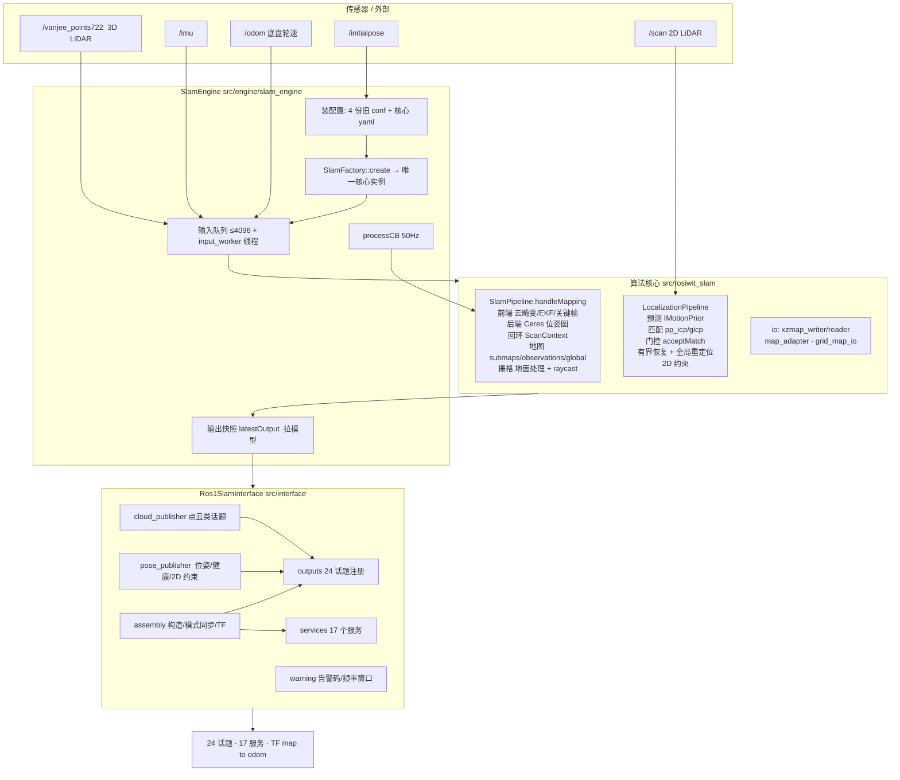

---

## 3. 线程与频率

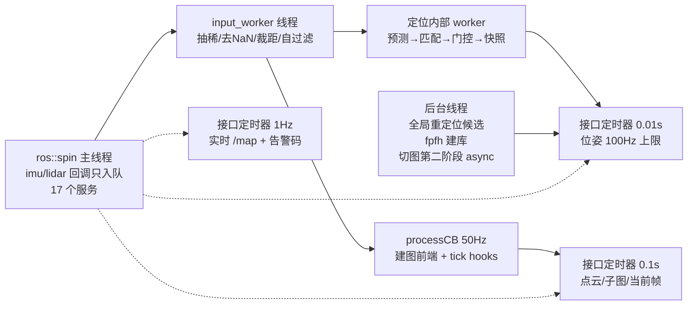

要点：**输入只入队**、**建图前端在 50 Hz 定时器里同步跑**、**定位在自己线程跑**、
**接口层靠定时器拉快照**（pull，不是回调推送）。

---

## 4. 数据流

### 4.1 建图（MAPPING）

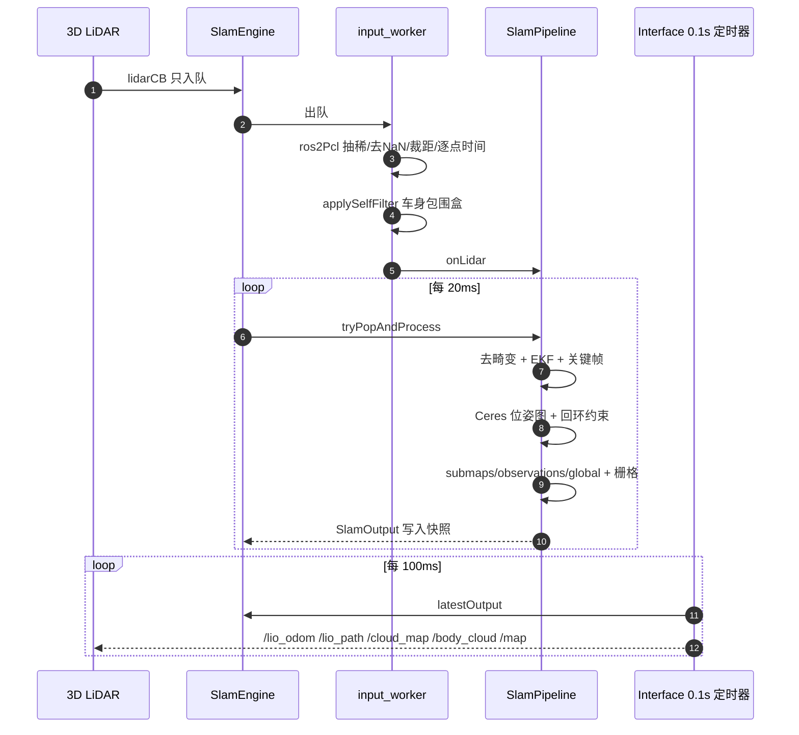

### 4.2 定位（LOCALIZATION）

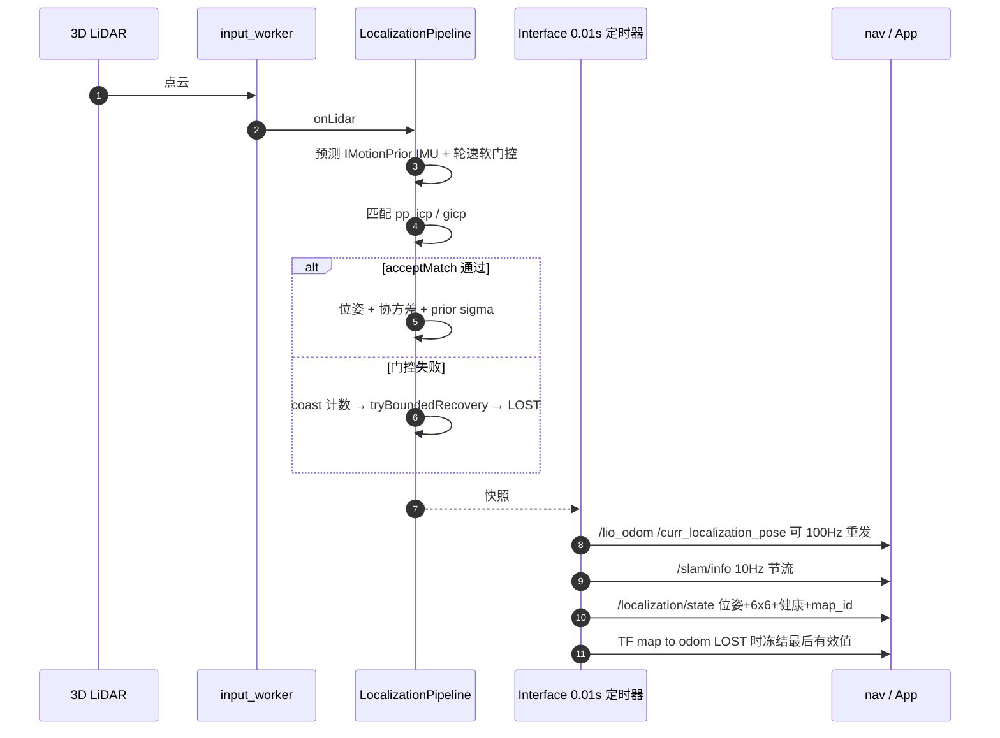

---

## 5. 启动时序

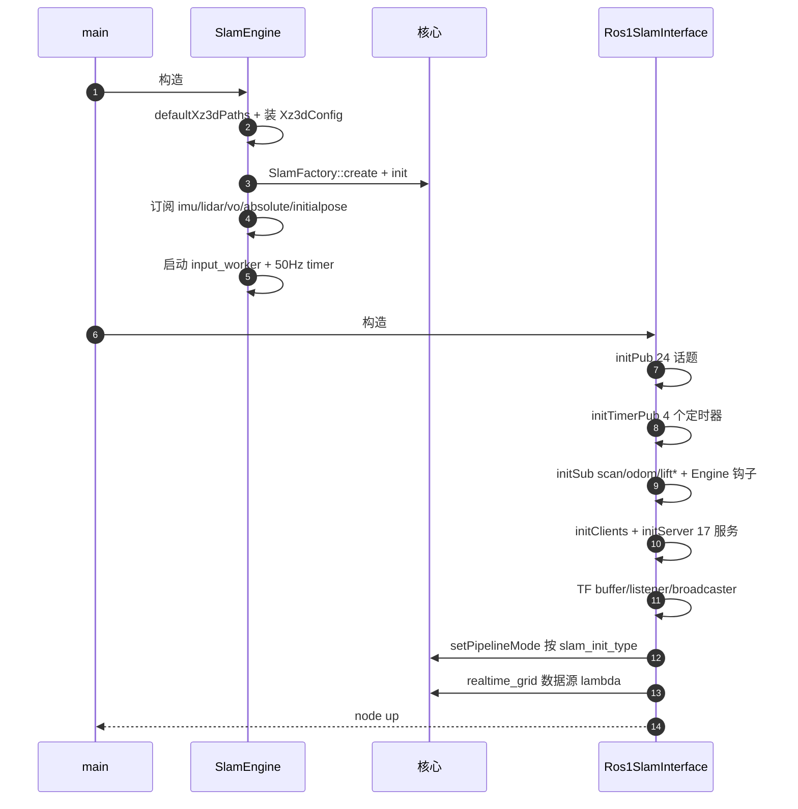

---

## 6. 关键路径（函数级）

### 6.1 模式切换 `SlamMode ↔ core pipelineMode`

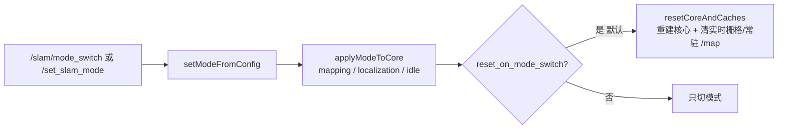

### 6.2 切图 `/switch_map`（两阶段，服务立即返回）

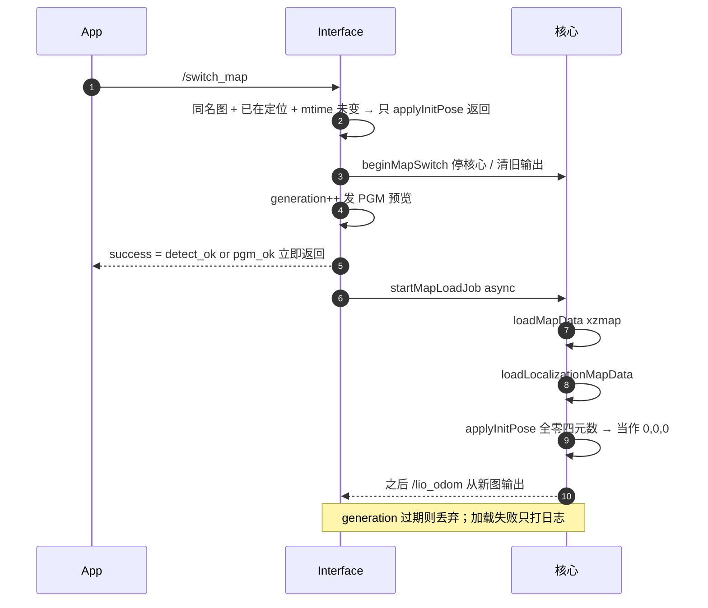

### 6.3 存图 `/stop_map_operation`

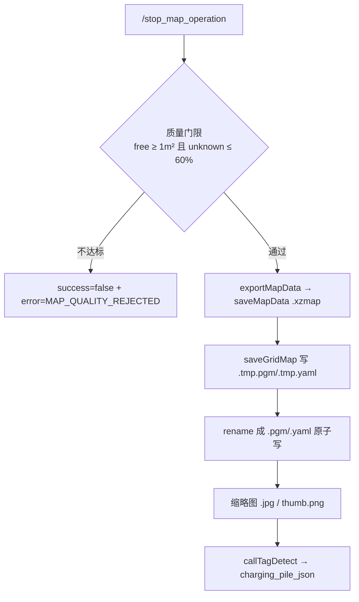

### 6.4 重定位与冷启动

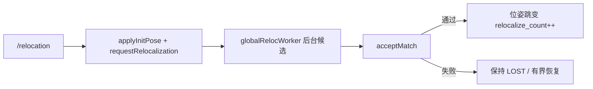

### 6.5 健康等级 `/localization/state`

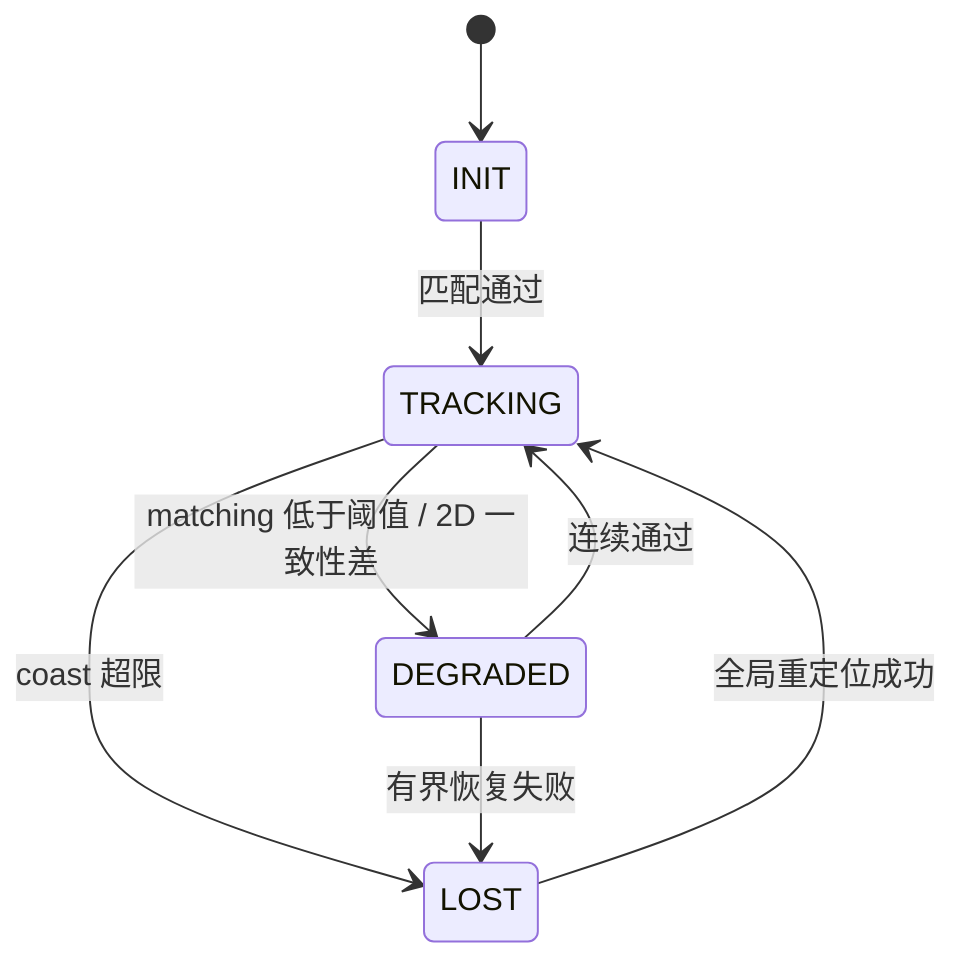

---

## 7. 对外接口（现状）

| 类别 | 内容 |
|---|---|
| 话题（24） | `/map` `/global_grid_map` `/grid_map` `/lio_odom` `/lio_path` `/curr_localization_pose` `/cloud_map` `/body_cloud` `/world_cloud` `/scan_f_map` `/curr_scan_point` `/curr_submap_point` `/origin_point` `/or_curr_scan_point` `/global_map` `/points_2d` `/mapping_path` `/slam/info` `/slam_calibration` `/slam_warning_code` `/loop_constraint` `/localization/state` |
| 服务（17） | `/switch_map` `/stop_map_operation` `/relocation` `/global_localization` `/slam/mode_switch` `/slam/dump_recorder` `/finish_task` `/start_task` `/localization/{relocalize,set_initial_pose,switch_map}` `/save_map` `/load_map` `/merge_map` `/save_grid_map` `/set_slam_mode` `/update_map_operation` |
| TF | `map→odom`（唯一发布者；LOST 时冻结最后有效值） |
| 订阅 | 核心：imu/lidar(+vo/absolute)/initialpose；接口：`scan`（频率统计）/`odom`（→核心）/`lift/state`/`lift_type` |

---

## 8. 设计上值得注意的 6 点

1. **pull 模型**：接口层用 `latestOutput()` 拉快照，引擎从不主动回调接口 →
   发布频率完全由 4 个定时器决定，与核心输出频率解耦（核心 10Hz、位姿可 100Hz 重发）。
2. **两种模式两条执行路径**：建图在 50 Hz 定时器里同步跑（会占用 spinner），
   定位在自己线程跑（避免重定位阻塞）。
3. **兼容层只做形状**：`SlamMode`(FREE/MAPPING/LOCALIZATION)、话题名、告警码、
   `map->odom` 都是照抄旧 `xz_3d_slam`，新能力（`/localization/*`）在同层旁挂。
4. **切图是两阶段 + generation**：服务立即返回、加载在后台；但 `success` 只表示
   "探测/PGM 可读"，xzmap 加载失败只能看日志。
5. **状态靠 `resetCoreAndCaches()` 清**：切建图会重建核心并清实时栅格，
   默认开启是"与旧实现一致"的选择，代价是切换瞬间建图停摆。
6. **协方差/健康是两套来源**：核心给 `localizationStatus()` + prior sigma，
   ROS 层又用 `loc_degrade_matching_` 二次分档，阈值不一致时会出现
   "核心认为不健康、对外还是 TRACKING"。

---

## 9. 文件索引

| 关注点 | 文件 |
|---|---|
| 入口 | `src/main.cpp` |
| 核心持有/输入泵/50Hz | `src/engine/slam_engine.{h,cpp}` |
| 构造顺序/模式同步/TF | `src/interface/assembly.cpp` |
| 话题注册/订阅/定时器 | `src/interface/outputs.cpp` |
| 位姿/健康/TF/2D 约束 | `src/interface/pose_publisher.cpp` |
| 点云类话题 | `src/interface/cloud_publisher.cpp` |
| 17 个服务 + 切图/存图 | `src/interface/services.cpp` |
| 告警/频率窗口 | `src/interface/warning.cpp` |
| 配置（4 份旧 conf + yaml） | `src/config/config.{h,cpp}`, `config/default.yaml`, `config/simulation.yaml` |
| 建图流水线 | `src/rosiwit_slam/src/slam_core/slam_pipeline.cpp` |
| 定位流水线 | `src/rosiwit_slam/src/algorithms/localization/localization_pipeline.cpp` |
| 匹配器 | `src/rosiwit_slam/src/algorithms/localization/matcher/*.cpp` |
| 2D 平面匹配 | `.../localization/planar_scan_matcher.cpp` |
| 地图 IO | `src/interface/io/{xzmap_writer,xzmap_reader,map_adapter}.cpp`, `.../grid_map/grid_map_io.cpp` |
| 核心单测（含未注册的 886 行） | `test/*.cpp` |


---

# 10. 目标架构（重构目标，2026-10-26 定）

## 10.1 分层与所有权（修正版：执行资源不下沉到算法里）

**关键纠正**：`WorkerPool` 是**基础设施**，不是算法组件。算法**不创建、不拥有、也不知道**线程池；
它只表达"这件事要异步做、可取消"，由组装根注入执行器并决定策略。

```
L0 基础设施 (ROS-free，谁都不依赖)
   TaskScheduler(pool) · CancelToken · Channel<T>(有界队列) · Clock
        ▲ 被注入（窄接口）
L1 算法域 (ROS-free)
   SlamAlgorithm = FrontEnd + BackEnd + MapStore + GridBuilder + RelocBuilder
        ▲ 门面调用（线程安全）
L2 ROS 适配
   SlamRosInterface : topic/service/TF 序列化，只读快照
L3 组装根
   SlamRosNode / main : 创建并注入 L0→L1→L2，负责生命周期与关停顺序
```

| 对象 | 属于 | 谁创建 | 谁拥有 | 知道线程吗 |
|---|---|---|---|---|
| `TaskScheduler` | L0 基础设施 | **组装根** | 组装根（生命周期最长） | 是（它就是） |
| `Channel<T>` | L0 基础设施 | 需要的一方（域内） | 使用它的域对象 | 是（队列） |
| `FrontEnd` / `BackEnd` | L1 域 | `SlamAlgorithm` | `SlamAlgorithm` | 是（**自带专线程**） |
| `MapStore` / `GridBuilder` / `RelocBuilder` | L1 域 | `SlamAlgorithm` | `SlamAlgorithm` | **否**：只持有 `IJobRunner*` |
| `SlamRosInterface` | L2 适配 | 组装根 | 组装根 | 否 |

### 注入的窄接口（不是直接把 pool 丢进去）

```cpp
// L0: 只暴露"提交可取消任务 + 完成回调"，不暴露线程数/队列/Stop 细节
class IJobRunner {
public:
  using JobId = uint64_t;
  virtual ~IJobRunner() = default;
  // 返回 kInvalidJobId = 拒绝（池满/正在停机），调用方负责降级
  virtual JobId submit(std::string name, JobClass cls,
                       std::function<void(CancelToken)> job,
                       std::function<void(JobResult)> done) = 0;
  virtual bool cancel(JobId id) = 0;
};

enum class JobClass {
  kIoWriter,   // 存图/写 xzmap+pgm —— **全局串行**（保证地图文件不并发写）
  kIoReader,   // 载图/预览 PGM   —— 串行
  kCpuBurst,   // 实时栅格、质量体检、缩略图 —— 可并行
  kFeatureBuild // fpfh/scan_context 建库 —— 独占 1 槽，低优先级
};
```

`JobClass` 放在 L0：**并发策略属于执行资源，不属于算法**。域代码只声明"这是写盘/读盘/CPU 突发"，
由 `TaskScheduler` 决定几条 lane、能不能并行、要不要限流。域代码里不出现 `std::thread`、
`std::mutex` 保护池、`std::async`。

### 什么用专线程、什么进池

| 判据 | 归属 | 例子 |
|---|---|---|
| 单消费者 + 严格有序 + 有可变状态 + 延迟敏感 | **专线程（域自带）** | FrontEnd（帧序）、BackEnd（关键帧序、地图版本） |
| 相互独立 + 幂等 + 可取消 + 阻塞 IO/CPU 突发 | **TaskScheduler** | 存图、载图、实时栅格、建库、体检、飞行记录落盘 |

FrontEnd/BackEnd 的线程由 `SlamAlgorithm` 创建（它们就是"顺序执行器"，等价于 `Channel` + 单线程 loop），
但**不做池化调度**——池化会让帧序/关键帧序失效。

## 10.2 线程与队列（按上表重新画）

```mermaid
flowchart TB
  subgraph L3["L3 组装根 SlamRosNode"]
    ROOT["创建 TaskScheduler → 注入 SlamAlgorithm → 注入 SlamRosInterface<br/>关停顺序: 停接收 → 域线程 → 池"]
  end
  subgraph L2["L2 ROS 适配 SlamRosInterface"]
    CB["imu/lidar/odom 回调 · 17 服务 · TF · 20Hz 发布"]
  end
  subgraph L1["L1 算法域 SlamAlgorithm"]
    FQ[["FrameQueue<br/>lidar 丢旧保新 · imu 保序 · odom 只留最新"]]
    FE["FrontEnd 专线程<br/>预处理 → 运动先验 → 匹配/LIO → Snapshot"]
    KQ[["KeyframeQueue"]]
    BE["BackEnd 专线程<br/>Ceres · 回环 · 地图版本（双缓冲）"]
    MS["MapStore / GridBuilder / RelocBuilder<br/>只持有 IJobRunner*"]
  end
  subgraph L0["L0 基础设施 TaskScheduler"]
    LANE1["IO-writer lane ×1（串行）"]
    LANE2["IO-reader lane ×1（串行）"]
    LANE3["CPU lane ×1~2"]
    LANE4["feature lane ×1（低优先级）"]
  end

  CB -->|只校验+入队| FQ
  FQ --> FE
  FE -->|关键帧| KQ
  KQ --> BE
  FE -->|Snapshot| CB
  BE -->|MapVersion| FE
  MS -->|submit(JobClass)| LANE1
  MS --> LANE2
  MS --> LANE3
  MS --> LANE4
  LANE1 -->|done(callback)| FE
  ROOT -.->|构造注入| L0
  ROOT -.->|持有| L1
  ROOT -.->|持有| L2
```

### 队列策略（不变）

| 队列 | 容量 | 满时 | 诊断计数 |
|---|---|---|---|
| lidar | 2 | 丢旧保新 | `lidar_dropped` |
| imu | 512 | 丢旧保序 | `imu_dropped` |
| odom | 1（latest-only） | 覆盖 | `odom_overwritten` |
| keyframe | 32 | 前端最多等 20 ms，再满合并 | `kf_merged` |
| 池任务 | 每 lane 16 | `submit` 返回 kInvalidJobId（调用方降级/重试） | `task_rejected` |

## 10.3 数据与状态流

- **Snapshot 无锁读**：FrontEnd 用 `std::shared_ptr<const Snapshot>` + `atomic_store` 发布；
  ROS 线程 `atomic_load`，零锁零拷贝（点云共享指针）。
- **MapVersion 双缓冲**：BackEnd 优化后生成 `shared_ptr<const MapData>`+`version`；
  FrontEnd 在**下一帧开头**换图，绝不在匹配中途换。
- **任务结果回投**：job 的 `done(JobResult)` 在池线程执行，只允许写"待应用队列"（域内的
  `Channel<JobResult>`），由 FrontEnd 在帧边界应用 —— 池线程碰不到匹配状态。

## 10.4 生命周期与关停

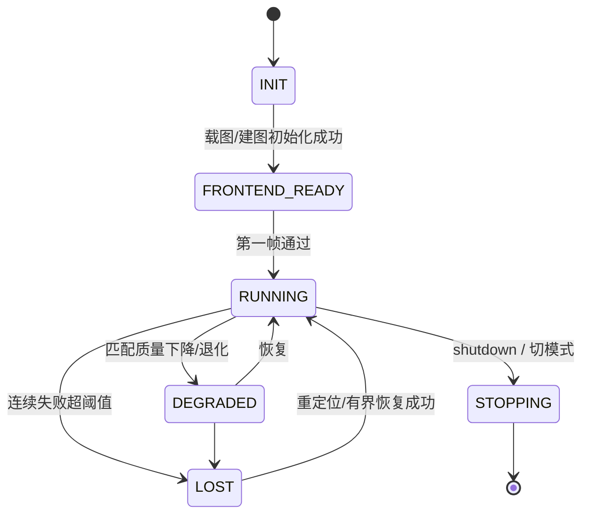

关停顺序（必须固定）：
1. `stopping_ = true`：服务返回 BUSY，回调不再入队
2. close 域队列 → `join(FrontEnd)` → `join(BackEnd)`
3. **执行器最后关**：取消在途 job → drain → `TaskScheduler::shutdown()`
4. 释放 MapStore / TF

顺序的理由：域线程可能还会 `submit`（例如 LOST 时落飞行记录），所以池必须比域活得久。

## 10.5 迁移路线（按新分层）

| 步 | 动作 | 风险 | 验收 |
|---|---|---|---|
| **M0a ✅** | 落 L0：`src/rosiwit_common/`（`Channel<T>` / `CancelToken` / `Thread` / `PeriodicThread` / `IExecutor`+`ThreadPool` / `SnapshotSlot`），ROS 无关、零依赖 | 低 | **已完成**：40 个单测（丢旧/丢新计数、串行 lane 并发数恒为 1、优先级、取消排队/在途、drain/drop 关停、RAII join、周期无漂移、快照无撕裂） |
| **M0b** | 落 L3 骨架：`SlamRosNode` 组装、注入；`SlamAlgorithm` 内部建 FrameQueue+FrontEnd，**FrontEnd 先直接调现有 onImu/onLidar** | 低 | 仿真行为等价（位姿/话题一致） |
| M1 | 删 50 Hz `processCB`，`tryPopAndProcess` 进 FrontEnd | 中 | 建图不掉帧 |
| M2 | BackEnd 独立 + KeyframeQueue + MapVersion 双缓冲 | 中 | 前端帧间隔 p99 不变 |
| M3 | MapStore/Grid/Reloc 改走 `IJobRunner`（带 JobClass 与取消） | 中 | 切图 25 s 期间照常出位姿；存图不卡 `/map` |
| M4 | 状态单源 + Snapshot `jump_reason` | 中 | nav 能感知切图/重定位跳变 |
| M5 | 压测/杀进程/4 h soak | 低 | 见验收脚本 |

## 10.6 决策（默认值，可否决）

1. lidar 满 → **丢旧保新**
2. BackEnd 触发 → **≥1 关键帧 且 距上次 ≥1 s**
3. lane 数 → IO-writer 1 / IO-reader 1 / CPU 2 / feature 1（共 5 个执行槽，但 writer/reader 各独占 1）
4. 切图/存图 → **与建图并行**（切图先在帧边界让 FrontEnd 停一拍），不独占


## 10.7 M0a 落地记录（2026-10-26）

新建 `src/rosiwit_common/`（ROS 无关、无第三方依赖，可独立 `cmake && ctest`）：

| 文件 | 作用 | 关键语义 |
|---|---|---|
| `channel.hpp` | 有界 MPMC 队列 | `kBlock / kDropOldest / kDropNewest`；`close()` 唤醒所有等待者；计数（pushed/popped/dropped/rejected/peak） |
| `cancel.hpp` | 协作式取消 | `CancelToken` 只置位不杀线程；`throw_if_cancelled()` |
| `thread.hpp/.cpp` | RAII 线程 | **析构 = requestStop + join，永不 detach**；OS 线程名（pthread_setname_np）；异常不扩散 |
| `periodic.hpp/.cpp` | 定周期线程 | `sleep_until(next += period)` 无漂移；落后超一周则重新对齐（计数 overruns） |
| `executor.hpp` | 执行器接口 | `submit(lane, opts, job, done)` / `cancel` / `shutdown(drain)` / `stats`；`LaneSpec{name, threads, capacity, overflow}` |
| `thread_pool.hpp/.cpp` | lane 化线程池 | `threads=1` 即串行执行器；优先级（同优先级 FIFO）；取消排队任务会回调 `done(false)` |
| `snapshot.hpp` | 不可变快照槽 | `shared_ptr<const T>` atomic 发布/读取 + 单调 `version` |

**没有业务概念**：lane 名字、线程数、满时策略全部由使用方用 `LaneSpec` 声明，
以后 SLAM 侧就是 `{disk_write,1,kReject} {disk_read,1,kReject} {cpu,2,kReject} {feature,1,kReject}`，
nav 侧可以声明自己的 lane —— 同一层，不共享业务语义。

**测试**（catkin gtest，已注册在 `rosiwit_slam_ros1`）：
```
test_channel    10   丢旧/丢新/close 唤醒/pop_for 超时/kBlock
test_executor   16   串行 lane 并发峰值恒 1/多线程并行/满则拒/取消排队(不执行且 done(false))/
                     取消在途(token 可见)/drain 跑完/drop 取消/优先级
test_thread     10   RAII join/requestStop 退出/异常不杀进程/周期速率/停得及时
test_snapshot    4   发布→读取/version 单调/并发读者无撕裂
```
`catkin_test_results: 246 tests, 0 failures`（含 slam 原有 206）。

**下一步 M0b**：`SlamRosNode` 组装根 + 注入；`SlamAlgorithm` 内部建 `Channel<Frame>` + `Thread(FrontEnd)`，
FrontEnd 先直接调现有 `onImu/onLidar`（行为等价），再逐步替换。


## 10.8 M0b / M1 / Pass C 落地记录（2026-10-26）

### 结构

```
ros::spin (主线程)                      ← topic/service 回调, 只做入队/取快照
   └─ SlamRosNode                       ← 组装根 (只做三件事: 建执行资源 / 按序注入 / 管关停)
        ├─ rosiwit_common::ThreadPool   ← lane: disk_write 1, disk_read 1, cpu N, feature 1
        ├─ SlamAlgorithm                ← 算法实例 (ROS-free 核心的宿主)
        │    ├─ Thread        "slam_fe"    ← FrontEnd: 唯一消费帧 (IMU/LiDAR)
        │    └─ PeriodicThread "slam_tick" ← 50 Hz: 只跑接口挂的发布钩子
        └─ SlamRos1Interface            ← ROS 适配 (话题/服务/TF), 通过 addTickHook 挂到 tick
```

* `SlamEngine` → `SlamAlgorithm`（文件 `slam_algorithm.{h,cpp}`）：名字对齐"算法实例"，
  ROS 薄壳只做转发。
* **订阅只有一处**：`SlamRosNode` 订阅 imu/lidar/initialpose/vo/absolute，
  回调 `SlamAlgorithm::onImuMsg/onLidarMsg` **只入队**（`Channel<InputItem>`, 容量 512, 丢旧保新），
  真正的处理是 `processImu/processLidar`，只在 FrontEnd 线程上跑。
  （踩过的坑：一度把订阅指向处理函数 `onImuMsg`，结果 FrontEnd 线程空转、算法退回 ROS spinner 上跑。）
* `SlamAlgorithm::start()/shutdown()` 由组装根调用；接口层的 `addTickHook()` 必须在 `start()` 之前
  （所以构造顺序是 pool → algo → iface，再 `algo.start()`）。
* 关停顺序固定：`iface_` 析构（停发布定时器）→ `algo_.shutdown()`（close 队列 + join FE + join tick）
  → `pool_.shutdown(true)`。**池最后关**：算法关停时仍可能投递任务（如 LOST 时的飞行记录落盘）。

### 线程数变化

| 之前 | 现在 |
|---|---|
| `input_worker_`（手搓 deque+mutex+cv） | `Thread("slam_fe")` + `Channel<InputItem>` |
| `ros::Timer(0.02)` 的 `processCB`（排空核心 + 跑 tick 钩子） | tick 钩子 → `PeriodicThread("slam_tick")`；核心排空 → FrontEnd 每处理完一帧 `tryPopAndProcess()` |
| `std::async(launch::async)` 后台切图 + `vector<future>` 回收 | `runOnLane("disk_read", ...)`；`disk_read` lane `threads=1` 天然串行，替代 `map_switch_mtx_` |

### Pass C：切图改投执行器

`Ros1SlamInterface::startMapLoadJob` 从 `std::async` 改为 `engine_.runOnLane("disk_read", "switch_map_load", job)`：

* 串行性由 lane 保证（`threads=1`），不再需要 `map_switch_mtx_` 与 future 列表；
* `map_switch_generation_` 守卫保留：只有最后一次切图请求会把结果应用下去，过期任务读完即丢弃；
* 任务体捕获 `this`（接口对象），因此新增**在途计数 + 条件变量**：析构时等待在途 job 归零，
  避免"接口已析构、job 还在跑"（执行器由组装根持有，关停晚于接口析构）；
* 提交被拒（池满/已关停）时显式清 `map_switch_busy_` 并报错，不会留下永久"切图中"。

### 验收

* `catkin_make` 0 error；`catkin_test_results: 246 tests, 0 failures`。
* 仿真 3 目标回归（`route_run2.sh`）：见下方"验收基线"。


## 10.9 M2 计划（后端线程与地图快照）

现状盘点（M0b 之后仍自建线程的地方）：

| 位置 | 现状 | 问题 |
|---|---|---|
| `rosiwit_slam/core: BackendWorker` | 2 条 `std::thread`（主队列 + 回环队列）+ 手搓 deque/mutex/cv；`stopAsync()` 用 **detach** | detach 唯一安全的原因是 lambda 捕获了 `shared_ptr self`；队列/唤醒语义重复实现 |
| `interface: RealtimeGrid` | 1 条 `std::thread` + `wait_for(1/hz)` + 结果加锁拷贝 | 无漂移调度靠 sleep；发布侧每次拷一份栅格（几十万 cell） |
| `LogClosureWorker`(core) / 局部 `std::thread` | 同上 | 待统一 |

M2 做法：

1. **core 引入基础层**：`add_subdirectory(../rosiwit_common)`（`if(NOT TARGET rosiwit_common)` 守卫，
   避免 ROS1/ROS2 包重复添加），`target_link_libraries(rosiwit_slam PUBLIC rosiwit_common)`。
2. **BackendWorker**：
   * 主队列 → `Channel<BackendItem>{500, kDropOldest}`（与现有"满则丢最旧"一致）；
   * 回环队列 → `Channel<KeyFrame>{200, kDropOldest}`；
   * 两条线程 → `rosiwit_common::Thread`，body 捕获 `shared_ptr self`（保证 detach 后状态仍活）；
   * OPTIMIZE 仍合并：`std::atomic<bool> optimize_requested_` + `pop_for(20ms)`，队列空且置位时优化；
   * `stopAsync()` → `requestStop()` + `abandon()`：**不阻塞服务线程**，语义与今天一致，
     但 `abandon()` 是显式 API（默认析构仍 join），并把使用条件写进 `thread.hpp`。
3. **RealtimeGrid**：`std::thread` → `PeriodicThread`；`latest()` 的整份拷贝 → `SnapshotSlot<GridInfo>`
   （`shared_ptr<const GridInfo>`），发布侧零拷贝、读取侧拿到一致快照。
4. **验收**：前端帧间隔 p99 不退化；`/map` 发布期间 `/lio_odom` 频率不掉；
   切图 25 s 期间照常出位姿；后端优化不阻塞 FE。
