# rosiwit_slam_ros1 架构与代码走向

> 代码位置：`ros1_ws/src/rosiwit_slam_ros1`（ROS1 薄接口）+ `src/rosiwit_slam`（算法核心）
> 本文只描述**现状**；缺口分析见 `docs/dev` 的缺口报告与
> `docs/superpowers/plans/2026-10-26-nav-safety-recovery-hardening.md`。

---

## 1. 一句话结构

**一个进程、一个算法核心实例、一个对外接口**：
`main` 里只有 `SlamEngine`（核心持有者/输入泵）+ `SlamRos1Interface`（旧 xz_3d_slam 兼容层）。
接口层不做算法，只做「形状复刻 + 状态粘合 + 定时发布」；算法全部在 `src/rosiwit_slam`。

---

## 2. 分层架构

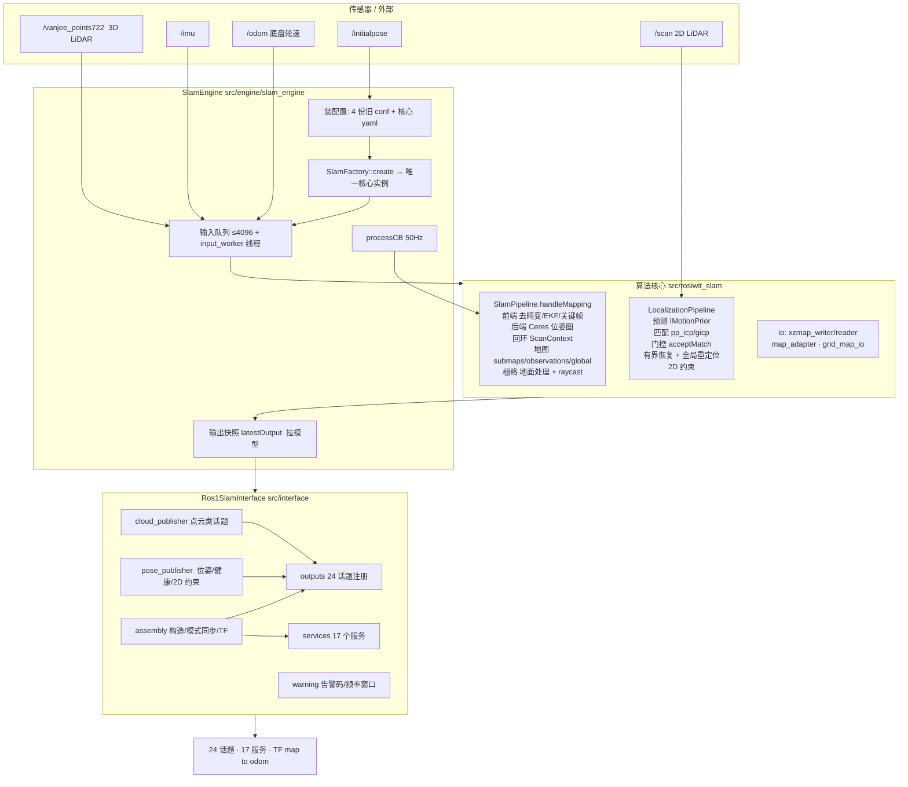

---

## 3. 线程与频率

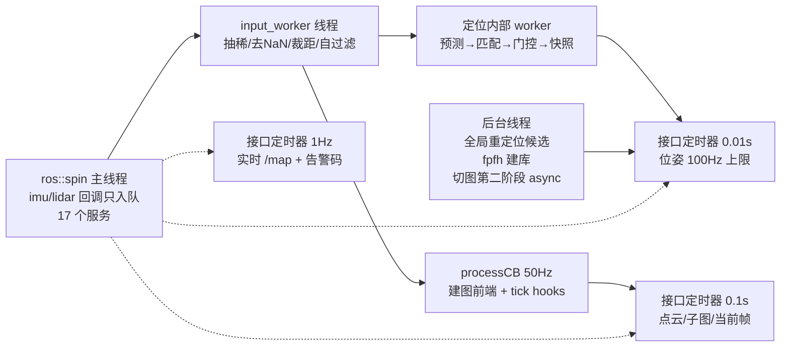

要点：**输入只入队**、**建图前端在 50 Hz 定时器里同步跑**、**定位在自己线程跑**、
**接口层靠定时器拉快照**（pull，不是回调推送）。

---

## 4. 数据流

### 4.1 建图（MAPPING）

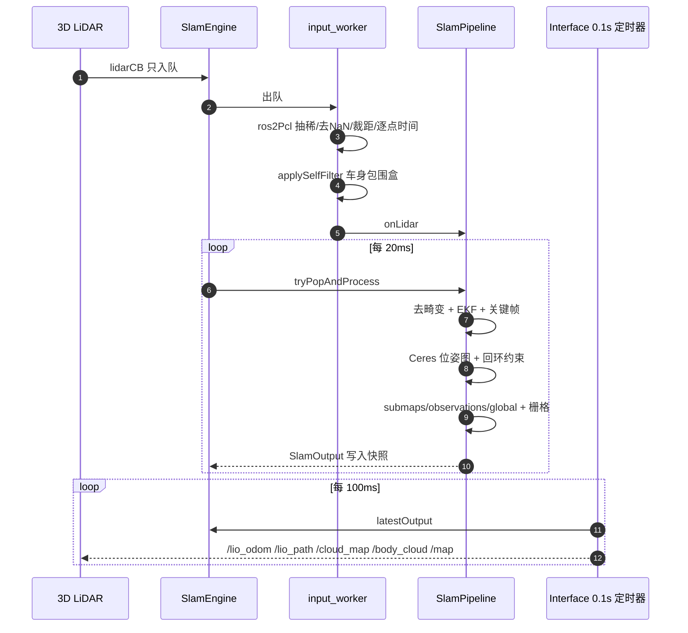

### 4.2 定位（LOCALIZATION）

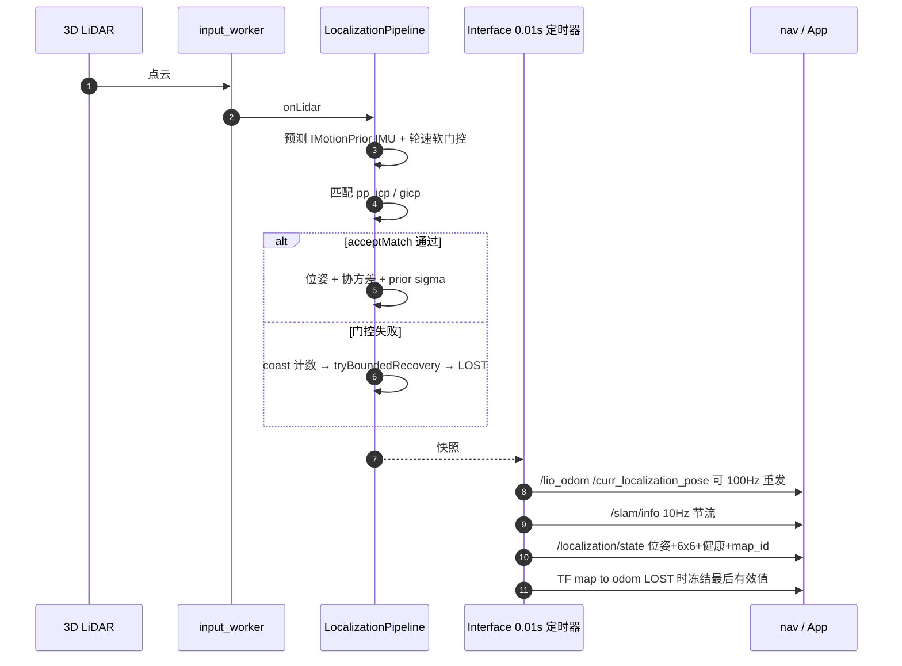

---

## 5. 启动时序

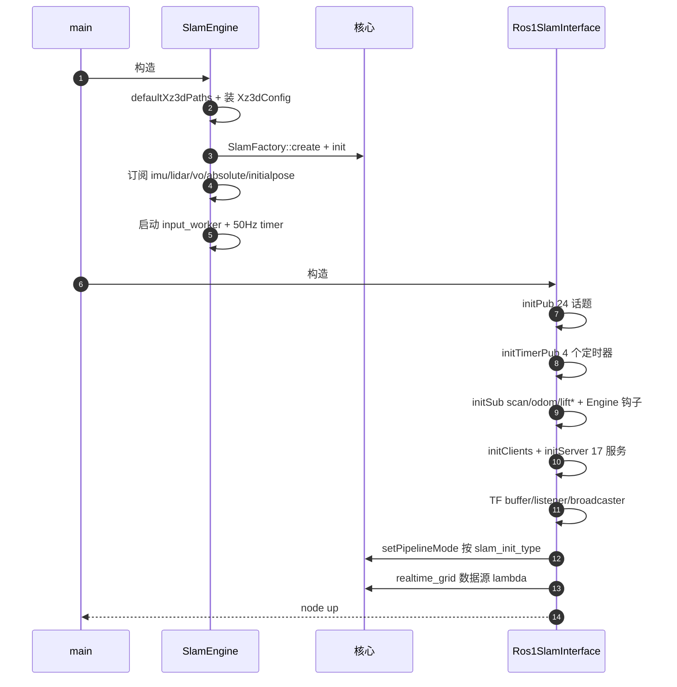

---

## 6. 关键路径（函数级）

### 6.1 模式切换 `SlamMode ↔ core pipelineMode`

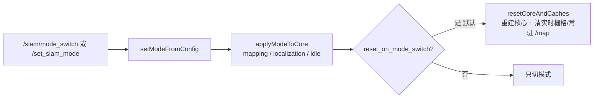

### 6.2 切图 `/switch_map`（两阶段，服务立即返回）

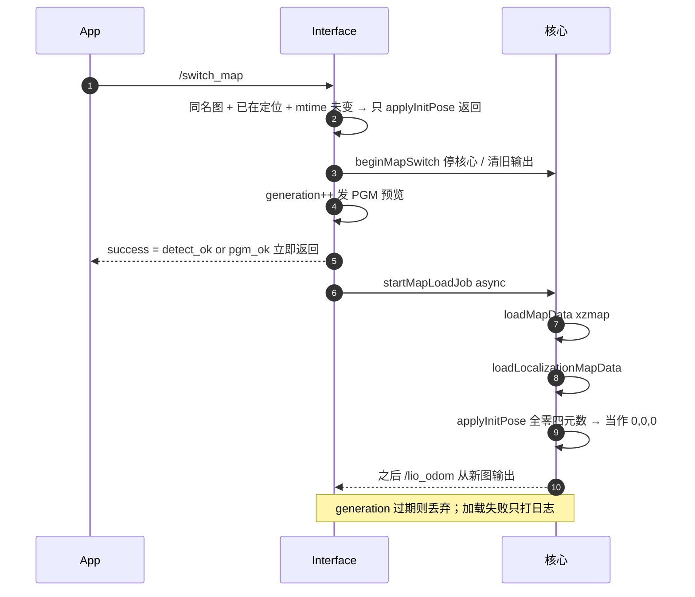

### 6.3 存图 `/stop_map_operation`

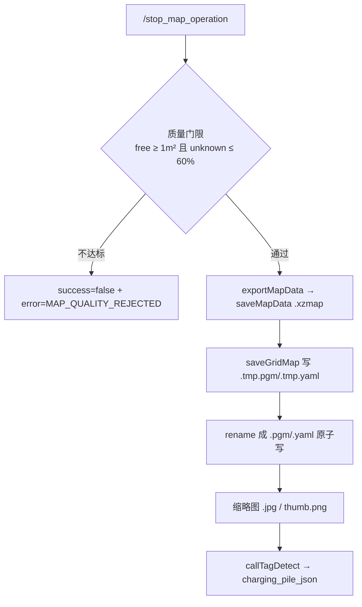

### 6.4 重定位与冷启动

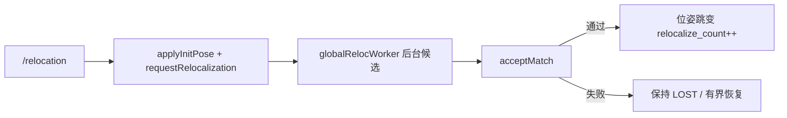

### 6.5 健康等级 `/localization/state`

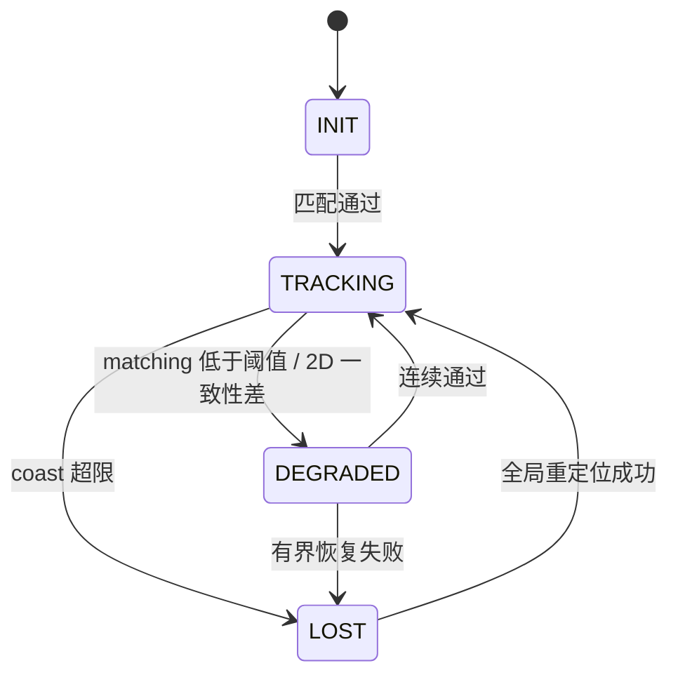

---

## 7. 对外接口（现状）

| 类别 | 内容 |
|---|---|
| 话题（24） | `/map` `/global_grid_map` `/grid_map` `/lio_odom` `/lio_path` `/curr_localization_pose` `/cloud_map` `/body_cloud` `/world_cloud` `/scan_f_map` `/curr_scan_point` `/curr_submap_point` `/origin_point` `/or_curr_scan_point` `/global_map` `/points_2d` `/mapping_path` `/slam/info` `/slam_calibration` `/slam_warning_code` `/loop_constraint` `/localization/state` |
| 服务（17） | `/switch_map` `/stop_map_operation` `/relocation` `/global_localization` `/slam/mode_switch` `/slam/dump_recorder` `/finish_task` `/start_task` `/localization/{relocalize,set_initial_pose,switch_map}` `/save_map` `/load_map` `/merge_map` `/save_grid_map` `/set_slam_mode` `/update_map_operation` |
| TF | `map→odom`（唯一发布者；LOST 时冻结最后有效值） |
| 订阅 | 核心：imu/lidar(+vo/absolute)/initialpose；接口：`scan`（频率统计）/`odom`（→核心）/`lift/state`/`lift_type` |

---

## 8. 设计上值得注意的 6 点

1. **pull 模型**：接口层用 `latestOutput()` 拉快照，引擎从不主动回调接口 →
   发布频率完全由 4 个定时器决定，与核心输出频率解耦（核心 10Hz、位姿可 100Hz 重发）。
2. **两种模式两条执行路径**：建图在 50 Hz 定时器里同步跑（会占用 spinner），
   定位在自己线程跑（避免重定位阻塞）。
3. **兼容层只做形状**：`SlamMode`(FREE/MAPPING/LOCALIZATION)、话题名、告警码、
   `map->odom` 都是照抄旧 `xz_3d_slam`，新能力（`/localization/*`）在同层旁挂。
4. **切图是两阶段 + generation**：服务立即返回、加载在后台；但 `success` 只表示
   "探测/PGM 可读"，xzmap 加载失败只能看日志。
5. **状态靠 `resetCoreAndCaches()` 清**：切建图会重建核心并清实时栅格，
   默认开启是"与旧实现一致"的选择，代价是切换瞬间建图停摆。
6. **协方差/健康是两套来源**：核心给 `localizationStatus()` + prior sigma，
   ROS 层又用 `loc_degrade_matching_` 二次分档，阈值不一致时会出现
   "核心认为不健康、对外还是 TRACKING"。

---

## 9. 文件索引

| 关注点 | 文件 |
|---|---|
| 入口 | `src/main.cpp` |
| 核心持有/输入泵/50Hz | `src/engine/slam_engine.{h,cpp}` |
| 构造顺序/模式同步/TF | `src/interface/assembly.cpp` |
| 话题注册/订阅/定时器 | `src/interface/outputs.cpp` |
| 位姿/健康/TF/2D 约束 | `src/interface/pose_publisher.cpp` |
| 点云类话题 | `src/interface/cloud_publisher.cpp` |
| 17 个服务 + 切图/存图 | `src/interface/services.cpp` |
| 告警/频率窗口 | `src/interface/warning.cpp` |
| 配置（4 份旧 conf + yaml） | `src/config/config.{h,cpp}`, `config/default.yaml`, `config/simulation.yaml` |
| 建图流水线 | `src/rosiwit_slam/src/slam_core/slam_pipeline.cpp` |
| 定位流水线 | `src/rosiwit_slam/src/algorithms/localization/localization_pipeline.cpp` |
| 匹配器 | `src/rosiwit_slam/src/algorithms/localization/matcher/*.cpp` |
| 2D 平面匹配 | `.../localization/planar_scan_matcher.cpp` |
| 地图 IO | `src/interface/io/{xzmap_writer,xzmap_reader,map_adapter}.cpp`, `.../grid_map/grid_map_io.cpp` |
| 核心单测（含未注册的 886 行） | `test/*.cpp` |


---

# 10. 目标架构（重构目标，2026-10-26 定）

## 10.1 分层与所有权（修正版：执行资源不下沉到算法里）

**关键纠正**：`WorkerPool` 是**基础设施**，不是算法组件。算法**不创建、不拥有、也不知道**线程池；
它只表达"这件事要异步做、可取消"，由组装根注入执行器并决定策略。

```
L0 基础设施 (ROS-free，谁都不依赖)
   TaskScheduler(pool) · CancelToken · Channel<T>(有界队列) · Clock
        ▲ 被注入（窄接口）
L1 算法域 (ROS-free)
   SlamAlgorithm = FrontEnd + BackEnd + MapStore + GridBuilder + RelocBuilder
        ▲ 门面调用（线程安全）
L2 ROS 适配
   SlamRosInterface : topic/service/TF 序列化，只读快照
L3 组装根
   SlamRosNode / main : 创建并注入 L0→L1→L2，负责生命周期与关停顺序
```

| 对象 | 属于 | 谁创建 | 谁拥有 | 知道线程吗 |
|---|---|---|---|---|
| `TaskScheduler` | L0 基础设施 | **组装根** | 组装根（生命周期最长） | 是（它就是） |
| `Channel<T>` | L0 基础设施 | 需要的一方（域内） | 使用它的域对象 | 是（队列） |
| `FrontEnd` / `BackEnd` | L1 域 | `SlamAlgorithm` | `SlamAlgorithm` | 是（**自带专线程**） |
| `MapStore` / `GridBuilder` / `RelocBuilder` | L1 域 | `SlamAlgorithm` | `SlamAlgorithm` | **否**：只持有 `IJobRunner*` |
| `SlamRosInterface` | L2 适配 | 组装根 | 组装根 | 否 |

### 注入的窄接口（不是直接把 pool 丢进去）

```cpp
// L0: 只暴露"提交可取消任务 + 完成回调"，不暴露线程数/队列/Stop 细节
class IJobRunner {
public:
  using JobId = uint64_t;
  virtual ~IJobRunner() = default;
  // 返回 kInvalidJobId = 拒绝（池满/正在停机），调用方负责降级
  virtual JobId submit(std::string name, JobClass cls,
                       std::function<void(CancelToken)> job,
                       std::function<void(JobResult)> done) = 0;
  virtual bool cancel(JobId id) = 0;
};

enum class JobClass {
  kIoWriter,   // 存图/写 xzmap+pgm —— **全局串行**（保证地图文件不并发写）
  kIoReader,   // 载图/预览 PGM   —— 串行
  kCpuBurst,   // 实时栅格、质量体检、缩略图 —— 可并行
  kFeatureBuild // fpfh/scan_context 建库 —— 独占 1 槽，低优先级
};
```

`JobClass` 放在 L0：**并发策略属于执行资源，不属于算法**。域代码只声明"这是写盘/读盘/CPU 突发"，
由 `TaskScheduler` 决定几条 lane、能不能并行、要不要限流。域代码里不出现 `std::thread`、
`std::mutex` 保护池、`std::async`。

### 什么用专线程、什么进池

| 判据 | 归属 | 例子 |
|---|---|---|
| 单消费者 + 严格有序 + 有可变状态 + 延迟敏感 | **专线程（域自带）** | FrontEnd（帧序）、BackEnd（关键帧序、地图版本） |
| 相互独立 + 幂等 + 可取消 + 阻塞 IO/CPU 突发 | **TaskScheduler** | 存图、载图、实时栅格、建库、体检、飞行记录落盘 |

FrontEnd/BackEnd 的线程由 `SlamAlgorithm` 创建（它们就是"顺序执行器"，等价于 `Channel` + 单线程 loop），
但**不做池化调度**——池化会让帧序/关键帧序失效。

## 10.2 线程与队列（按上表重新画）

```mermaid
flowchart TB
  subgraph L3["L3 组装根 SlamRosNode"]
    ROOT["创建 TaskScheduler → 注入 SlamAlgorithm → 注入 SlamRosInterface<br/>关停顺序: 停接收 → 域线程 → 池"]
  end
  subgraph L2["L2 ROS 适配 SlamRosInterface"]
    CB["imu/lidar/odom 回调 · 17 服务 · TF · 20Hz 发布"]
  end
  subgraph L1["L1 算法域 SlamAlgorithm"]
    FQ[["FrameQueue<br/>lidar 丢旧保新 · imu 保序 · odom 只留最新"]]
    FE["FrontEnd 专线程<br/>预处理 → 运动先验 → 匹配/LIO → Snapshot"]
    KQ[["KeyframeQueue"]]
    BE["BackEnd 专线程<br/>Ceres · 回环 · 地图版本（双缓冲）"]
    MS["MapStore / GridBuilder / RelocBuilder<br/>只持有 IJobRunner*"]
  end
  subgraph L0["L0 基础设施 TaskScheduler"]
    LANE1["IO-writer lane ×1（串行）"]
    LANE2["IO-reader lane ×1（串行）"]
    LANE3["CPU lane ×1~2"]
    LANE4["feature lane ×1（低优先级）"]
  end

  CB -->|只校验+入队| FQ
  FQ --> FE
  FE -->|关键帧| KQ
  KQ --> BE
  FE -->|Snapshot| CB
  BE -->|MapVersion| FE
  MS -->|submit(JobClass)| LANE1
  MS --> LANE2
  MS --> LANE3
  MS --> LANE4
  LANE1 -->|done(callback)| FE
  ROOT -.->|构造注入| L0
  ROOT -.->|持有| L1
  ROOT -.->|持有| L2
```

### 队列策略（不变）

| 队列 | 容量 | 满时 | 诊断计数 |
|---|---|---|---|
| lidar | 2 | 丢旧保新 | `lidar_dropped` |
| imu | 512 | 丢旧保序 | `imu_dropped` |
| odom | 1（latest-only） | 覆盖 | `odom_overwritten` |
| keyframe | 32 | 前端最多等 20 ms，再满合并 | `kf_merged` |
| 池任务 | 每 lane 16 | `submit` 返回 kInvalidJobId（调用方降级/重试） | `task_rejected` |

## 10.3 数据与状态流

- **Snapshot 无锁读**：FrontEnd 用 `std::shared_ptr<const Snapshot>` + `atomic_store` 发布；
  ROS 线程 `atomic_load`，零锁零拷贝（点云共享指针）。
- **MapVersion 双缓冲**：BackEnd 优化后生成 `shared_ptr<const MapData>`+`version`；
  FrontEnd 在**下一帧开头**换图，绝不在匹配中途换。
- **任务结果回投**：job 的 `done(JobResult)` 在池线程执行，只允许写"待应用队列"（域内的
  `Channel<JobResult>`），由 FrontEnd 在帧边界应用 —— 池线程碰不到匹配状态。

## 10.4 生命周期与关停

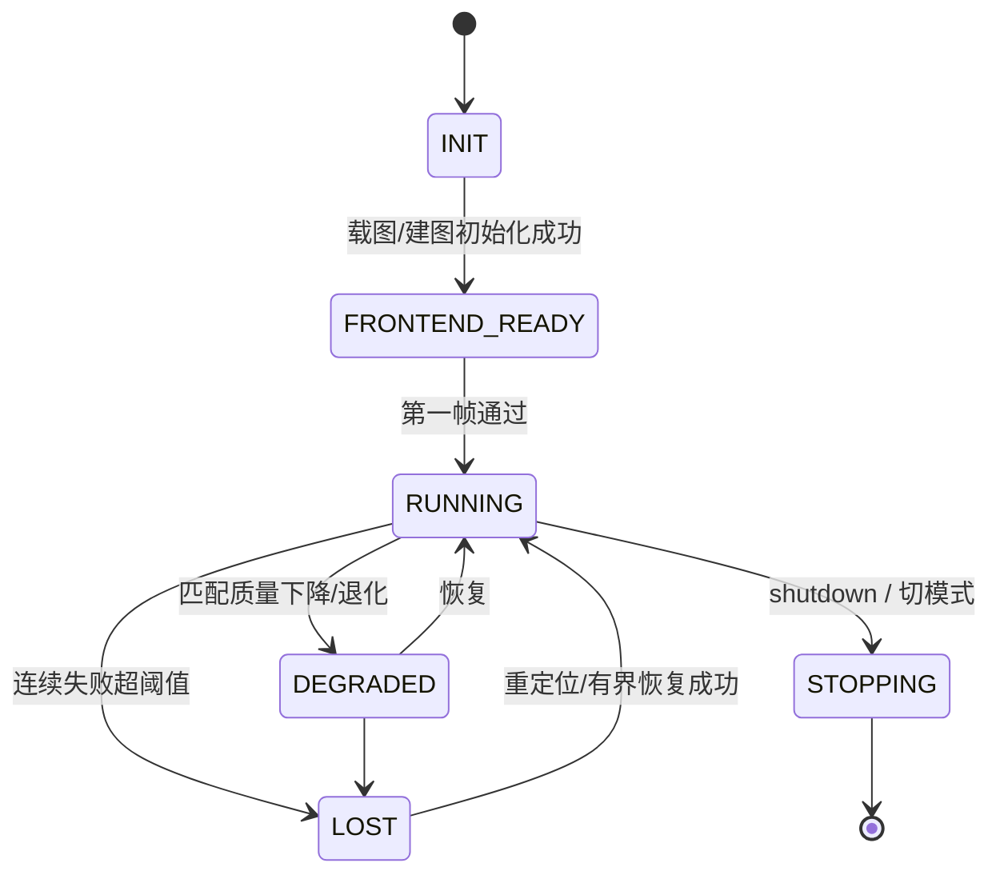

关停顺序（必须固定）：
1. `stopping_ = true`：服务返回 BUSY，回调不再入队
2. close 域队列 → `join(FrontEnd)` → `join(BackEnd)`
3. **执行器最后关**：取消在途 job → drain → `TaskScheduler::shutdown()`
4. 释放 MapStore / TF

顺序的理由：域线程可能还会 `submit`（例如 LOST 时落飞行记录），所以池必须比域活得久。

## 10.5 迁移路线（按新分层）

| 步 | 动作 | 风险 | 验收 |
|---|---|---|---|
| **M0a ✅** | 落 L0：`src/rosiwit_common/`（`Channel<T>` / `CancelToken` / `Thread` / `PeriodicThread` / `IExecutor`+`ThreadPool` / `SnapshotSlot`），ROS 无关、零依赖 | 低 | **已完成**：40 个单测（丢旧/丢新计数、串行 lane 并发数恒为 1、优先级、取消排队/在途、drain/drop 关停、RAII join、周期无漂移、快照无撕裂） |
| **M0b** | 落 L3 骨架：`SlamRosNode` 组装、注入；`SlamAlgorithm` 内部建 FrameQueue+FrontEnd，**FrontEnd 先直接调现有 onImu/onLidar** | 低 | 仿真行为等价（位姿/话题一致） |
| M1 | 删 50 Hz `processCB`，`tryPopAndProcess` 进 FrontEnd | 中 | 建图不掉帧 |
| M2 | BackEnd 独立 + KeyframeQueue + MapVersion 双缓冲 | 中 | 前端帧间隔 p99 不变 |
| M3 | MapStore/Grid/Reloc 改走 `IJobRunner`（带 JobClass 与取消） | 中 | 切图 25 s 期间照常出位姿；存图不卡 `/map` |
| M4 | 状态单源 + Snapshot `jump_reason` | 中 | nav 能感知切图/重定位跳变 |
| M5 | 压测/杀进程/4 h soak | 低 | 见验收脚本 |

## 10.6 决策（默认值，可否决）

1. lidar 满 → **丢旧保新**
2. BackEnd 触发 → **≥1 关键帧 且 距上次 ≥1 s**
3. lane 数 → IO-writer 1 / IO-reader 1 / CPU 2 / feature 1（共 5 个执行槽，但 writer/reader 各独占 1）
4. 切图/存图 → **与建图并行**（切图先在帧边界让 FrontEnd 停一拍），不独占


## 10.7 M0a 落地记录（2026-10-26）

新建 `src/rosiwit_common/`（ROS 无关、无第三方依赖，可独立 `cmake && ctest`）：

| 文件 | 作用 | 关键语义 |
|---|---|---|
| `channel.hpp` | 有界 MPMC 队列 | `kBlock / kDropOldest / kDropNewest`；`close()` 唤醒所有等待者；计数（pushed/popped/dropped/rejected/peak） |
| `cancel.hpp` | 协作式取消 | `CancelToken` 只置位不杀线程；`throw_if_cancelled()` |
| `thread.hpp/.cpp` | RAII 线程 | **析构 = requestStop + join，永不 detach**；OS 线程名（pthread_setname_np）；异常不扩散 |
| `periodic.hpp/.cpp` | 定周期线程 | `sleep_until(next += period)` 无漂移；落后超一周则重新对齐（计数 overruns） |
| `executor.hpp` | 执行器接口 | `submit(lane, opts, job, done)` / `cancel` / `shutdown(drain)` / `stats`；`LaneSpec{name, threads, capacity, overflow}` |
| `thread_pool.hpp/.cpp` | lane 化线程池 | `threads=1` 即串行执行器；优先级（同优先级 FIFO）；取消排队任务会回调 `done(false)` |
| `snapshot.hpp` | 不可变快照槽 | `shared_ptr<const T>` atomic 发布/读取 + 单调 `version` |

**没有业务概念**：lane 名字、线程数、满时策略全部由使用方用 `LaneSpec` 声明，
以后 SLAM 侧就是 `{disk_write,1,kReject} {disk_read,1,kReject} {cpu,2,kReject} {feature,1,kReject}`，
nav 侧可以声明自己的 lane —— 同一层，不共享业务语义。

**测试**（catkin gtest，已注册在 `rosiwit_slam_ros1`）：
```
test_channel    10   丢旧/丢新/close 唤醒/pop_for 超时/kBlock
test_executor   16   串行 lane 并发峰值恒 1/多线程并行/满则拒/取消排队(不执行且 done(false))/
                     取消在途(token 可见)/drain 跑完/drop 取消/优先级
test_thread     10   RAII join/requestStop 退出/异常不杀进程/周期速率/停得及时
test_snapshot    4   发布→读取/version 单调/并发读者无撕裂
```
`catkin_test_results: 246 tests, 0 failures`（含 slam 原有 206）。

**下一步 M0b**：`SlamRosNode` 组装根 + 注入；`SlamAlgorithm` 内部建 `Channel<Frame>` + `Thread(FrontEnd)`，
FrontEnd 先直接调现有 `onImu/onLidar`（行为等价），再逐步替换。


## 10.8 M0b / M1 / Pass C 落地记录（2026-10-26）

### 结构

```
ros::spin (主线程)                      ← topic/service 回调, 只做入队/取快照
   └─ SlamRosNode                       ← 组装根 (只做三件事: 建执行资源 / 按序注入 / 管关停)
        ├─ rosiwit_common::ThreadPool   ← lane: disk_write 1, disk_read 1, cpu N, feature 1
        ├─ SlamAlgorithm                ← 算法实例 (ROS-free 核心的宿主)
        │    ├─ Thread        "slam_fe"    ← FrontEnd: 唯一消费帧 (IMU/LiDAR)
        │    └─ PeriodicThread "slam_tick" ← 50 Hz: 只跑接口挂的发布钩子
        └─ SlamRos1Interface            ← ROS 适配 (话题/服务/TF), 通过 addTickHook 挂到 tick
```

* `SlamEngine` → `SlamAlgorithm`（文件 `slam_algorithm.{h,cpp}`）：名字对齐"算法实例"，
  ROS 薄壳只做转发。
* **订阅只有一处**：`SlamRosNode` 订阅 imu/lidar/initialpose/vo/absolute，
  回调 `SlamAlgorithm::onImuMsg/onLidarMsg` **只入队**（`Channel<InputItem>`, 容量 512, 丢旧保新），
  真正的处理是 `processImu/processLidar`，只在 FrontEnd 线程上跑。
  （踩过的坑：一度把订阅指向处理函数 `onImuMsg`，结果 FrontEnd 线程空转、算法退回 ROS spinner 上跑。）
* `SlamAlgorithm::start()/shutdown()` 由组装根调用；接口层的 `addTickHook()` 必须在 `start()` 之前
  （所以构造顺序是 pool → algo → iface，再 `algo.start()`）。
* 关停顺序固定：`iface_` 析构（停发布定时器）→ `algo_.shutdown()`（close 队列 + join FE + join tick）
  → `pool_.shutdown(true)`。**池最后关**：算法关停时仍可能投递任务（如 LOST 时的飞行记录落盘）。

### 线程数变化

| 之前 | 现在 |
|---|---|
| `input_worker_`（手搓 deque+mutex+cv） | `Thread("slam_fe")` + `Channel<InputItem>` |
| `ros::Timer(0.02)` 的 `processCB`（排空核心 + 跑 tick 钩子） | tick 钩子 → `PeriodicThread("slam_tick")`；核心排空 → FrontEnd 每处理完一帧 `tryPopAndProcess()` |
| `std::async(launch::async)` 后台切图 + `vector<future>` 回收 | `runOnLane("disk_read", ...)`；`disk_read` lane `threads=1` 天然串行，替代 `map_switch_mtx_` |

### Pass C：切图改投执行器

`Ros1SlamInterface::startMapLoadJob` 从 `std::async` 改为 `engine_.runOnLane("disk_read", "switch_map_load", job)`：

* 串行性由 lane 保证（`threads=1`），不再需要 `map_switch_mtx_` 与 future 列表；
* `map_switch_generation_` 守卫保留：只有最后一次切图请求会把结果应用下去，过期任务读完即丢弃；
* 任务体捕获 `this`（接口对象），因此新增**在途计数 + 条件变量**：析构时等待在途 job 归零，
  避免"接口已析构、job 还在跑"（执行器由组装根持有，关停晚于接口析构）；
* 提交被拒（池满/已关停）时显式清 `map_switch_busy_` 并报错，不会留下永久"切图中"。

### 验收

* `catkin_make` 0 error；`catkin_test_results: 246 tests, 0 failures`。
* 仿真 3 目标回归（`route_run2.sh`）：见下方"验收基线"。


## 10.9 M2 计划（后端线程与地图快照）

现状盘点（M0b 之后仍自建线程的地方）：

| 位置 | 现状 | 问题 |
|---|---|---|
| `rosiwit_slam/core: BackendWorker` | 2 条 `std::thread`（主队列 + 回环队列）+ 手搓 deque/mutex/cv；`stopAsync()` 用 **detach** | detach 唯一安全的原因是 lambda 捕获了 `shared_ptr self`；队列/唤醒语义重复实现 |
| `interface: RealtimeGrid` | 1 条 `std::thread` + `wait_for(1/hz)` + 结果加锁拷贝 | 无漂移调度靠 sleep；发布侧每次拷一份栅格（几十万 cell） |
| `LogClosureWorker`(core) / 局部 `std::thread` | 同上 | 待统一 |

M2 做法：

1. **core 引入基础层**：`add_subdirectory(../rosiwit_common)`（`if(NOT TARGET rosiwit_common)` 守卫，
   避免 ROS1/ROS2 包重复添加），`target_link_libraries(rosiwit_slam PUBLIC rosiwit_common)`。
2. **BackendWorker**：
   * 主队列 → `Channel<BackendItem>{500, kDropOldest}`（与现有"满则丢最旧"一致）；
   * 回环队列 → `Channel<KeyFrame>{200, kDropOldest}`；
   * 两条线程 → `rosiwit_common::Thread`，body 捕获 `shared_ptr self`（保证 detach 后状态仍活）；
   * OPTIMIZE 仍合并：`std::atomic<bool> optimize_requested_` + `pop_for(20ms)`，队列空且置位时优化；
   * `stopAsync()` → `requestStop()` + `abandon()`：**不阻塞服务线程**，语义与今天一致，
     但 `abandon()` 是显式 API（默认析构仍 join），并把使用条件写进 `thread.hpp`。
3. **RealtimeGrid**：`std::thread` → `PeriodicThread`；`latest()` 的整份拷贝 → `SnapshotSlot<GridInfo>`
   （`shared_ptr<const GridInfo>`），发布侧零拷贝、读取侧拿到一致快照。
4. **验收**：前端帧间隔 p99 不退化；`/map` 发布期间 `/lio_odom` 频率不掉；
   切图 25 s 期间照常出位姿；后端优化不阻塞 FE。


## 10.10 M2 落地记录（2026-10-26）

core 已经引入基础层（`src/rosiwit_slam/CMakeLists.txt` 用 `if(NOT TARGET rosiwit_common)` 守卫，
ROS1/ROS2 两个接口包内联构建时都不会重复定义目标）。

**BackendWorker**（`slam_pipeline.{h,cpp}`）

| 之前 | 现在 |
|---|---|
| `std::thread m_thread` + `mutex/cv/deque m_queue`（500，满丢最旧） | `Channel<BackendItem>{500, kDropOldest}` + `Thread("slam_be")` |
| `std::thread m_loop_thread` + `mutex/cv/deque m_loop_queue`（200） | `Channel<KeyFrame>{200, kDropOldest}` + `Thread("slam_be_loop")` |
| `bool m_stop` + `cv` 唤醒 | `CancelToken`（`pop_for(10ms)` 超时只是为了看取消位） |
| `bool m_optimize_requested` + cv | `atomic<bool>` + 一条"唤醒项"；队列排空时才真正跑优化 |
| `stopAsync()` = 置标志 + `detach()` | `requestStop()` + **`abandon()`**（新增 API），语义不变：不阻塞服务线程 |

`abandon()` 的约束写进了 `thread.hpp`：线程体只能碰 shared_ptr 保活的独立状态。
BackendWorker 的 body 捕获 `shared_ptr self`，所以放弃后 worker 仍然活着，不会 use-after-free；
`stopAsync()` 在 abandon 之后把 `Thread` 对象 reset 掉，断开 `Thread -> body -> self -> Thread` 的环。

**定位 worker**（同文件）

`m_loc_buf`（`deque`，手工"满 2 丢旧"）+ `m_loc_worker` → `Channel<LidarFrame>{2, kDropOldest}` +
`Thread("slam_loc")`；`stopLocalizationWorker()` = requestStop + join + clear。
帧到就被唤醒（`pop_for` 只是让模式切换/停止及时可见），不引入额外延迟。

**RealtimeGrid**（`interface/realtime_grid.{h,cpp}`）

| 之前 | 现在 |
|---|---|
| `std::thread` + `wait_for(1/hz)` | `PeriodicThread`（`sleep_until(next += period)`，无漂移） |
| `mutex + GridInfo m_latest_`（读者整份拷贝，持锁） | `SnapshotSlot<GridInfo>`（`shared_ptr<const>`，读者零锁）+ `latestPtr()` |

**验收（建图模式，`sim_slam_nav.launch` 不带 map，3 个目标）**

```
lio_odom 89.7 Hz      /map 1.0 Hz
GOAL 1/2/3: SUCCEEDED (3/3)
BackendWorker: 4 次合并优化
输入队列: peak=5, dropped_oldest=0
```

## 10.11 M3 落地记录：地图读写的互斥

载图（切图后台任务，大图 25 s）与存图（服务线程）会碰同一个目录。
`map_adapter` 增加进程内 `timed_mutex`：

* `loadMapData`：**阻塞**取锁（读到一半绝不能被写打断）；
* `saveMapData(data, path, wait_ms=2000)`：`try_lock_for`，等不到就返回 false，
  上层报 `MAP_SAVE_*` 失败，而不是把 App 的服务调用挂死两分钟。

**注意（review 纠正，2026-10-26）**：此前这句写得过满。事实是——

| 输出 | 实际线程 |
|---|---|
| `/lio_odom`、`/lio_path`、`body_cloud`、`world_cloud` | `slam_tick`（50 Hz 线程）→ 不受主线程影响 |
| `/curr_localization_pose`、`/slam/info`、`/localization/state`、**TF map→odom** | `localization_pose_timer_`（**100 Hz ros::Timer，仍在 ROS 主线程**） |
| `/map`、`/slam_warning_code` | `realtime_grid_map_timer_` / `warning_code_timer_`（主线程） |
| 老话题（`scan_f_map`/`curr_scan_point`/`global_map`…） | `point_cloud_mapping_timer_`（主线程） |

所以 `/stop_map_operation`、`/save_map`、`/load_map` 这类同步重活仍会把
**TF 与健康话题**按住数秒（`/lio_odom` 不受影响）。这是 §10.15 里的 C3，未修。

## 10.12 M4 落地记录：位姿跳变单源 + nav 消费

**单源**：`SlamAlgorithm::poseJumpSeq()`（`atomic<uint32_t>`），
在 `applyInitPose(count_as_jump=true)` 里 +1 —— 覆盖 `/switch_map`（后台载图完成）、
`/relocation`、`/initialpose` 三条路径；接口层不再自己维护 `relocalize_count_`，
直接把它发到契约字段 `LocalizationState.relocalize_count`。

**必须区分"真跳变"与"内部小纠偏"**（2026-10-26 修正）：2D 平面约束每纠一次
（`[planar] 2D constraint applied`）也走 `applyInitPose`，但它只是把位姿拉回
十几厘米，位姿是连续的。实测把它算成跳变会让 nav 在窄通道口清计划/停车：

```
[planar] 2D constraint applied: dx=0 dy=0.168 dyaw=-0.015 ...
[nav] pose jump (relocalized, seq=3): invalidate plan, stop and replan
```

所以 `applyInitPose` 增加 `count_as_jump` 参数，planar 路径传 false
（`applyRelocation(req, res, /*count_as_jump=*/false)`）。
修后同一条路线：整轮只有启动阶段的 2 次跳变（切图 + 外部 initialpose），
导航过程中 0 次。

**消费**：nav 的 `localizationStateCallback` 比对 `relocalize_count` 与 `map_id`，
变化即 `onPoseJump()`：

1. 作废在途异步规划（`plan_generation_++` + `async_planner_->cancel()`）；
2. 清 `current_core_path_` / `current_path_`，控制器 `reset()`，`resetRecovery()`；
3. 发一条零速，别让跳变前一拍算出的指令继续推车；
4. `last_plan_time_` 清零 → 下一拍 `replanningCheck` 立刻重规划。

目标不清：目标是地图坐标，跳变后仍然有效。

**并发注意**：nav 节点用 `AsyncSpinner(2)`（`spinner_threads: 2`，为了控制环不被
代价地图回调饿死），回调与控制环**可能并发**。所以跳变处理不在回调里直接做：
回调只 `store` 一个 pending 标记 + seq + reason，真正的作废/停车/重规划在
`controlLoop` 开头消费 —— 计划与控制器状态只由控制环这一条路径改动。

**验收（仿真，导航途中注入 /initialpose，偏移 0.25 m / 15°）**

```
[nav] pose jump (relocalized, seq=1): invalidate plan, stop and replan
[nav] pose jump (relocalized, seq=2): ...
[nav] pose jump (relocalized, seq=3): ...   <- 注入的这一帧
result after jump: SUCCEEDED
/localization/state: map_id="house_sim", relocalize_count=3
```

## 10.13 M5 落地记录：关停与稳定性

`SIGINT` 关停（导航 + 注入跳变之后立刻停）：

```
slam node exit after SIGINT: 0.5 s
still alive: 0
日志中 terminate called / uncaught / Segmentation / pure virtual: 无
进程 RSS: 203028 kB (运行中) -> 203744 kB (结束前)
```

关停顺序在这里被真正走了一遍：接口析构等切图任务在途计数归零 → 算法 close 队列并 join
FrontEnd/Tick → 池 drain → 进程退出。若关停顺序写错（池先关、或算法先析构），
10.8 里的 "在途 job 捕获 this" 会立刻变成 use-after-free，这个用例会直接崩。


## 10.14 本轮遗留问题（nav 侧，已定位未修）

SLAM 侧改造已完成并验证，但回归里暴露了三个 nav 问题（都不在 SLAM 线程模型里）：

1. **目标 3（返回 (-1.5, 0)）在窄通道口稳定超时**
   多次运行都在 (2.6~2.7, -1.6~-1.9) 附近被判 `safety STOP`，随后 recovery
   （清代价地图 → 原地转 60° → 等 2 s → 反向逃逸）也无法脱出。
   与本次重构无关：改前的两次运行在同一点、同现象失败；建图模式（无先验图）同样路线 3/3 成功。
   方向：窄通道的通过判定（0.62 m 膨胀 vs 实测最小间隙 0.30 m）与"贴墙通过"的执行策略。

2. **`HEALTH_INIT` 被当成"还能继续走"**
   契约里 INIT = 重定位中/位姿不可信，nav 目前只把 `HEALTH_LOST` 当停车。
   实测有一轮在目标 3 途中定位退化（`location_status=1`），位姿单步跳 0.85 m、
   最小间隙 0.000 m（穿墙），nav 仍在继续执行旧计划。
   方向：INIT 期间停车等待（不判任务失败），恢复 TRACKING 再继续；
   并把 `relocalize_count` 变化当作"必然重规划"（M4 已具备）。

3. **nav 节点多线程共享状态无锁**
   `AsyncSpinner(2)` + 5000 行节点里没有任何 mutex：`mapCallback`/`scanCallback`
   写层数据的同时 `publishLocalCostmap` / `controlLoop` 在读，属于数据竞争。
   本轮回归中出现过 1 次 `exit code -11`（死在 recovery 清代价地图那一步，
   该分支会从控制环里直接调 `publishLocalCostmap`）。
   方向：给"计划/代价地图/恢复"三块状态各加一把锁（或把 spinner 收回 1 线程并
   用独立线程跑代价地图），顺序是先加锁再谈性能。


## 10.15 架构/线程模型 review 结论（2026-10-26）

用独立 reviewer 对 `125bd8c..21fff1a` 做只读审查，结论已逐条核对代码/日志。
下面只列**结论与状态**，过程证据见各条。

### 线程清单（运行期实测枚举）

| # | 名称 | 创建处 | 触发 | 停止 |
|---|---|---|---|---|
| 1 | ROS 主线程 | `main.cpp` `ros::spin()` | 话题/服务回调 + **5 个 ros::Timer** | SIGINT |
| 2 | `slam_fe` | `slam_algorithm.cpp:551` | 每帧（无定时器） | close 队列 + join |
| 3 | `slam_tick` | `slam_algorithm.cpp:554` | 20 ms | requestStop + join |
| 4 | `slam_be` | `slam_pipeline.cpp:47` | 队列 push | requestStop + **abandon** |
| 5 | `slam_be_loop` | `slam_pipeline.cpp:49` | 队列 push | 同上 |
| 6 | `slam_loc` | `slam_pipeline.cpp:325` | 队列 push（容量 2，丢旧） | requestStop + join |
| 7 | loc 全局重定位 | `localization_pipeline.cpp:377` | cv | dtor join |
| 8 | loc 建库 | `localization_pipeline.cpp:497/589` | cv | dtor join |
| 9 | `rt_grid` | `realtime_grid.cpp:125` | 1 Hz | stop + join |
| 10-13 | pool `disk_write/disk_read/cpu×2/feature` | `slam_ros_node.cpp:34-39` | 提交 | pool.shutdown(drain) |
| 14-15 | tf2 listener ×2 | `slam_algorithm.cpp:207` / `assembly.cpp:50` | ROS 内部 | dtor |

**5 个 ros::Timer（全部在主线程）**：`point_cloud_mapping_timer_`(0.1 s)、
`localization_pose_timer_`(**0.01 s**，发 `/curr_localization_pose`、`/slam/info`、
`/localization/state`、**TF map→odom**)、`realtime_grid_map_timer_`(1 Hz)、
`warning_code_timer_`(1 Hz)、`map_timer_`(2 s)。

### 本轮已修（本次重构引入的缺陷）

| 编号 | 问题 | 修法 |
|---|---|---|
| **C1** | `iface_.reset()` 早于 `algo_.shutdown()`；`tick_hooks_`/`input_seen_hook_`/`raw_lidar_hook_` 无摘除 API → tick 线程在窗口内调进已销毁接口（发布者/告警码表）→ use-after-free | 新增 `clearTickHooks()/clearInputHooks()`；`SlamRos1Interface` 析构先摘钩子再停 `RealtimeGrid`；`~SlamRosNode` 改为 **先停算法线程 → 拆接口 → 关池** |
| **I9** | 2D 平面约束纠偏被计成"位姿跳变"，nav 在执行中清计划/停车（实测窄通道必挂） | `applyInitPose(..., count_as_jump)`；planar 路径传 false。修后导航中 0 次误跳变 |

### 待修（review 确认，按优先级）

| 编号 | 严重度 | 问题 | 建议 |
|---|---|---|---|
| **C2 ✅** | Critical | ~~池任务绕开 `core_mu_` 直接动核心~~ | **已修**：`core_excl_mu_` + `core_generation_` + 持锁包装（见 §10.16） |
| **C3 ✅** | Critical | ~~存图/载图/发布全在主线程~~ | **已修**：发布搬到 `slam_pub` 线程；存图/载图走 lane（见 §10.16）。验收：存图 2.1 s 期间 `/slam/info` max gap 0.321 s（节流常态 0.30 s） |
| I1 | Important | `core_mu_` 同时罩住 FE 热循环（PCL 转换+FAST-LIO）与主线程 `onOdomMsg`(50 Hz)/`applyInitPose`/`resetCore` → FE 帧时间变成主线程抖动 | `/odom` 改走队列；`core_mu_` 只保护"核心指针/重建" |
| I2 | Important | `applyInitPose` 持 `core_mu_` 做**阻塞 TF 查询**（最多 3 s） | 取锁前先解析 base 外参 |
| I3 ✅ | Important | ~~`base_imu_/base_lidar_` 无锁竞争~~ | **已修**：`SnapshotSlot<RigidTransform>` + `mount_mu_`；非阻塞调用拿到锁就直接用旧快照 |
| I4 ✅ | Important | ~~在途计数绑在任务体上~~ | **已修**：计数挪到 `DoneFn`（执行/取消/丢弃都会回调）+ 析构 120 s 上限 + 任务检查 `CancelToken`（见 §10.16.1） |
| I5 ◐ | Important | `mapIoMutex` 只护 `.xzmap` | **写侧已修**：`MapIoGuard` 包住整段写盘；**读侧仍在外**（PGM 读取） |
| I6 ✅ | Important | ~~abandon 的线程可能在进程退出时仍在跑~~ | **已修**：新增 `waitForBackgroundIdle(2s)` = **先 stopAsync 再有界等待**；实测 backend idle 0-10 ms（见 §10.16.1） |
| I7 | Important | `~Ros1SlamInterface` 先毁发布者再 join `rt_grid`（`GridSource` lambda 调回本对象） | 已随 C1 修（析构首行 `stopBackgroundWork()`） |
| I8 ◐ | Important | ~~`SnapshotSlot` 零拷贝没被用上~~ | **已修（GridInfo 侧）**：`latestPtr()` 无锁读，少一份整拷贝；`OccupancyGrid` 的拷贝是 ROS 协议决定的，去不掉 |
| I10 | Important | 池 4 条 lane 只有 `disk_read` 在用 | 随 C3 接线，或删掉装饰性 lane |
| I11 | Important | 输入丢弃不可观测：计数在 `push` 前自增，`rejected_closed` 从不打印；后端队列丢弃无统计 | 计数改到 push 成功后；按秒打印 delta |

Minor（记录备查）：`start()` 在 `shutdown()` 之后是"静默死亡"（`Channel` 无 reopen）；
`input_imu_done_/lidar_done_` 已成死变量；`BackendWorker::push(OPTIMIZE)` 实际占一个队列槽
（与注释"不占队列"不符，满队列时可能挤掉一个真关键帧）；`logInputStats` 的静态变量命名误导；
`ros1_slam_interface.h:325`、`assembly.cpp:283` 的注释已过期；`mapCB` 与 `rt_grid` 在
revision 变化时都会重建栅格。

### 测试覆盖（reviewer 结论）

已覆盖：`rosiwit_common` 四个单测（drop/close/clear、串行 lane、取消、drain、abandon、周期无漂移、快照无撕裂）、
`test_realtime_grid`。
**未覆盖**：主线程/发布线程归属（把 `onTick` 挪回 spinner 不会有任何测试失败）、
关停顺序与钩子生命周期（C1/I7 只能靠人工 SIGINT）、`start()/shutdown()` 幂等与重启、
切图在途等待与拒绝路径、后端/定位队列背压与丢弃可观测性。


## 10.16 C2 / C3 落地记录（2026-10-27）

### 锁层次（只有这一个方向，反向即死锁）

```
core_excl_mu_ (std::timed_mutex)   ← 结构操作: 重建核心 / 装载定位地图 / 改模式 /
   └─ core_mu_ (std::mutex)           导出整图 / 读整图栅格 / 存 pgm / loadMap
        └─ (核心内部锁: m_state_mu / m_global_mu / PcdMapManager::m_mutex_ …)
```

* `core_mu_`：输入热路径（FE 的 `onImu/onLidar`、`applyInitPose`、`onOdom`）与指针读取。
* `core_excl_mu_`：**会替换核心内部对象**的慢操作。等锁有超时策略：
  * 装载地图（在 lane 上）：阻塞等；
  * `setPipelineMode` / `resetCore`（在 ROS 回调线程）：`try_lock` / 200 ms，
    拿不到就明确失败并告警——绝不把 spinner 挂住。
* `core_generation_`：`resetCore()` 成功 +1。装载地图的流程是"先解析 25 s，再装"，
  用**解析前**抓的 generation 去装，期间核心被重建过就丢弃（`discard map load`）。
* `algo()` 裸指针自此只用于只读/诊断；`services.cpp` / `outputs.cpp` / `assembly.cpp`
  里所有结构调用都换成 `loadLocalizationMapData / setCorePipelineMode / cancelCoreMapLoad /
  exportCoreMapData / getCoreGridMap / saveCoreGridMap / setCoreGridMapGenerator / loadCoreMap`。

### 发布线程（C3b）

原先 `/curr_localization_pose`、`/slam/info`、`/localization/state`、**TF map→odom**
全在 `localization_pose_timer_`（100 Hz `ros::Timer`，跑在 ROS 主线程）。存图/切图/服务
一占住主线程，这些就停发。

现在：新增 `slam_pub` 线程（`PeriodicThread`，50 Hz），接口通过
`engine_.addPublishHook(...)` 挂 `publishCurrPose()`；`localization_pose_timer_` 删除。

> 踩坑记录：第一版把 `publishCurrPose` 挂在**已有的** `slam_tick` 线程上（与 `/lio_odom`
> 共用），结果 `/lio_odom` 从 ~96 Hz 掉到 **67 Hz**（线程饱和）。拆成独立 `slam_pub`
> 后回到 **88 Hz**。教训：发布钩子的成本差异很大，不能默认塞进同一个 tick。

跨线程共享字段的处理（主线程写 / 发布线程读）：

| 字段 | 处理 |
|---|---|
| `slam_mode_` | `std::atomic<SlamMode>` |
| `static_map_valid_` / `curr_pose_valid_` | `std::atomic<bool>` |
| `last_odom_x_/y_/t_` | `std::atomic<double>`（`/odom` 回调在主线程写） |
| `realtime_grid_map_area_` | `std::atomic<double>` |
| `scan_ground_z_` | `std::atomic<double>` |
| `curr_map_name_` | `mapName()` / `setMapName()` + `map_name_mu_` |
| `curr_pose_` | 写加 `pose_mu_`；服务侧用 `currentPoseSnapshot()` |
| `realtime_grid_map_` | `staticMapSnapshot()` / `setStaticMap()` / `clearStaticMap()` + `static_map_mu_` |
| `base_imu_` / `base_lidar_` | `SnapshotSlot<RigidTransform>`（I3），解析由 `mount_mu_` 串行 |

### 地图读写走执行器（C3a）

| 服务 | lane | 说明 |
|---|---|---|
| `/stop_map_operation` | `disk_write` | 质量体检 + 导出整图 + xzmap + pgm/yaml + 缩略图 + 充电桩检测 |
| `/save_map` | `disk_write` | 导出 + 写盘 |
| `/save_grid_map` | `disk_write` | 换生成器 + 存 pgm/yaml |
| `/load_map` | `disk_read` | 解析 + 装配 |
| `/switch_map` | `disk_read` | （M0b 起） |

统一用新增的 `SlamAlgorithm::runOnLaneAndWait(lane, name, job, timeout)`：投递 + 用
`DoneFn` 的 promise 等结果（任务被取消/丢弃也会唤醒等待方，不会永久挂住）。
写盘段再加 `map_adapter::MapIoGuard` 包住整段（xzmap + pgm/yaml + 缩略图），
与载图互斥——之前只有 `saveMapData` 内部那把锁，重命名/缩略图/PGM 读取都在锁外（I5 主体）。

### 验收（仿真）

**定位模式，导航 3 目标**

```
/lio_odom 87.95 Hz (拆分发布线程前 67.3 Hz; C3 之前 ~96-107 Hz)
GOAL 1/2 SUCCEEDED；GOAL 3 仍在窄通道口 FAILED_SAFETY_STOP（遗留 nav 问题）
pose jump: 仅启动阶段 3 次 (map_switched + relocalized×2)，导航过程中 0 次
无 process has died / terminate / segfault
```

**建图模式，存图 2.10 s 期间的发布连续性**

```
baseline:   /slam/info 36 条 / 4s (10Hz 节流),  max gap 0.300 s
during save: /slam/info  9 条 / 2.1s,           max gap 0.321 s   <- 没有冻结
stop_map_operation: 2.10s success=True
产物: map.xzmap / map.pgm / map.yaml / map.pcd / map.jpg 齐全
```

（`/slam/info` 是 10 Hz 节流，0.30 s 间隔就是常态；C3 之前同样的存图会把主线程按住
2 秒，`/slam/info` 会整段消失。TF 广播在仿真里**无法验证**：本 sim 没有 `odom` 帧，
`sendTransform()` 的 `lookupTransform("base_footprint","odom")` 一直失败（改前也如此），
但它与 `/slam/info` 走同一个发布线程，后者的连续性可以作为间接证据。）

### 仍未修（本轮范围外）

| 编号 | 说明 |
|---|---|
| I4 | 切图在途计数仍写在任务体里（未改用 `DoneFn`）；等待无超时退化为 180 s |
| I6 | `BackendWorker::abandon()` 的遗留线程在进程退出前没有有界 join |
| I8 | `SnapshotSlot` 的零拷贝仍未被消费者使用（`/map` 还是整份拷贝） |
| I10 | `cpu` / `feature` 两条 lane 仍然空转；`/map` 2 s 的 `mapCB`（getGlobalMap+栅格）仍在主线程 |
| I11 | 输入/后端队列的丢弃仍不可观测 |
| — | nav：目标 3 窄通道、`HEALTH_INIT` 仍按"可继续行驶"处理、nav 无锁（§10.14） |


### 10.16.1 I4 / I6 / I8（2026-10-27 续）

**I4 切图在途计数改用 `DoneFn`**

旧实现把 `map_load_inflight_--` 写在**任务体**的 RAII 里。任务被执行才会减；
一旦被 `kDropOldest` 丢弃或被 `shutdown(false)` 取消，任务体不跑 → 计数永远不为零 →
接口析构的等待永不返回。现在：

* 新增 `SlamAlgorithm::runOnLaneWithDone(lane, name, job, done)`；
  `done` 由执行器在**执行完 / 取消 / 丢队列**三种情况下各回调一次
  （提交被拒时由包装层补一次 `done(false)`）；
* 计数、`map_switch_busy_`、`relocating_` 的收尾全在 `DoneFn` 里；
* 任务体在解析完地图后检查 `token.cancelled()`，被取消就不再往核心装；
* 析构等待改为 120 s 上限 + 每 5 s 告警一次（文件系统卡死时进程仍能退）。

**I6 退出前有界等待后端线程**

`BackendWorker` 的两条线程是 `abandon()` 语义（不 join，只持有 shared 状态）。
它们会在进程退出后继续跑，可能在 libc/PCL/Ceres 静态对象析构时用到这些对象。

`SlamPipeline::waitForBackgroundIdle(timeout_ms)`：

1. 先 `stopAsync()`（置取消位 + abandon，不阻塞调用方）；
2. 再轮询 `m_inflight`（线程体的 RAII 计数）直到为 0 或超时。

> 第一版写反了：只轮询不叫停，线程正在正常干活，必然等满 2 s 超时
> （日志 `backend still running after 2000ms (inflight=2)`），进程仍带着线程退出。
> 改正后：`backend idle after 0~10 ms (clean exit)`。

**I8 栅格快照零拷贝**

`publishRealtimeGridMap()` 改用 `realtime_grid_.latestPtr()`（无锁拿
`shared_ptr<const GridInfo>`），不再每次拷一份 `GridInfo`；有更新时只构建一次
`OccupancyGrid` 并同时写静态图缓存 + 发布，省掉原来"先缓存再快照再发布"的两次拷贝。
`OccupancyGrid::data` 由 ROS 消息自己持有，这一份拷贝无法避免（协议决定）。

**验收（同一批次）**

```
退出:  定位模式(启动即切图) SIGINT -> 0.5 s 退出, alive=0, 无崩溃
       建图模式(跑 25s, 后端有优化) SIGINT -> 0.8 s 退出, alive=0, 无崩溃
       [SlamPipeline] backend idle after 10 ms (clean exit)
       (改前: 4.4 s / 4.6 s, 且日志是 "still running after 2000ms (inflight=2)")
定位:  /lio_odom 95.89 Hz, 目标 1/2 SUCCEEDED, 导航中 0 次误跳变
存图:  2.01 s success=True, 期间 /slam/info max gap 0.300 s, 产物齐全
单测:  catkin_test_results 250 tests, 0 failures
```

**仍未修**：`I10`（`cpu`/`feature` lane 空转、`mapCB` 在主线程）、`I11`（丢弃不可观测）、
`I5` 读侧（载图的 PGM 读取仍在锁外）、以及 nav 的三个问题（§10.14）。
