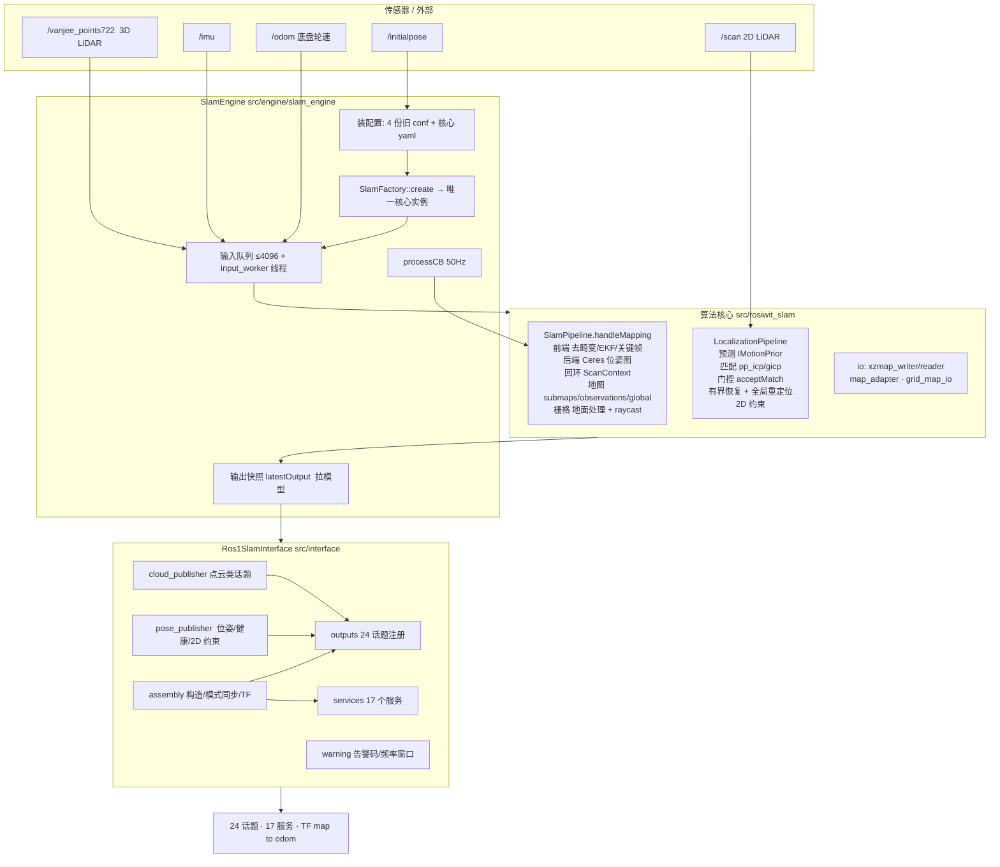
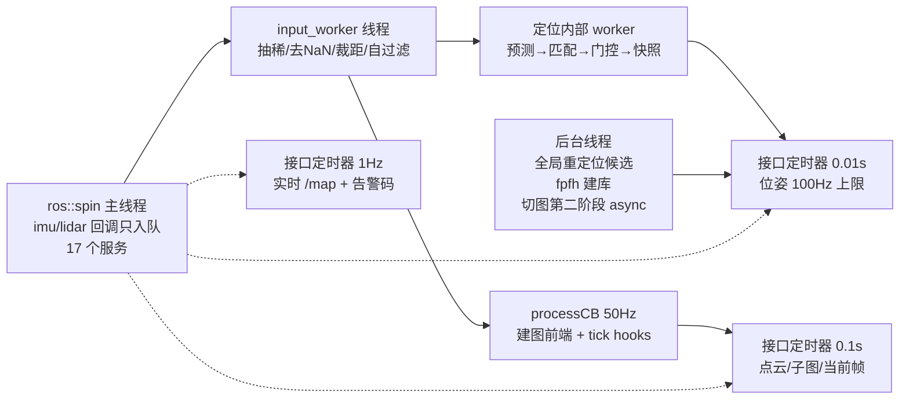
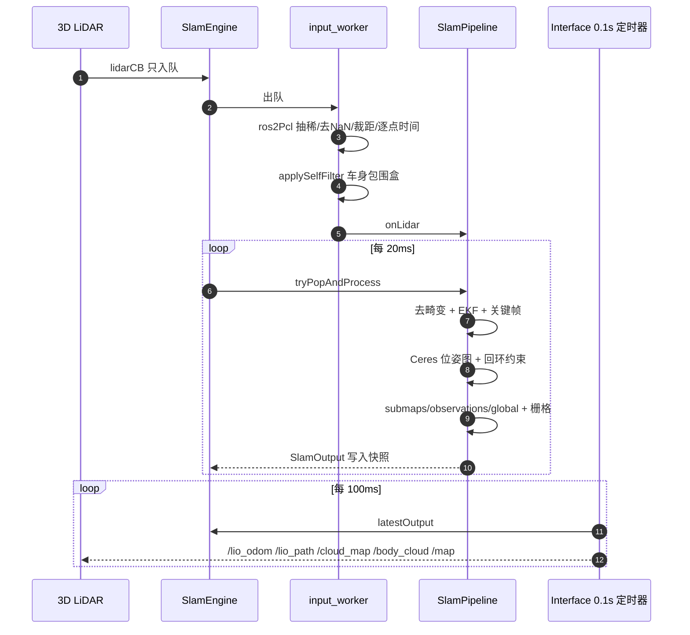
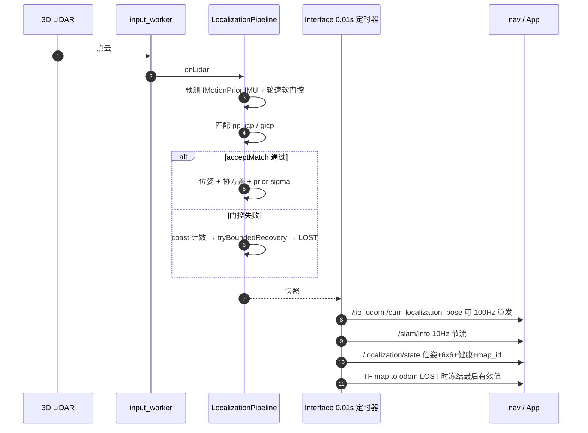
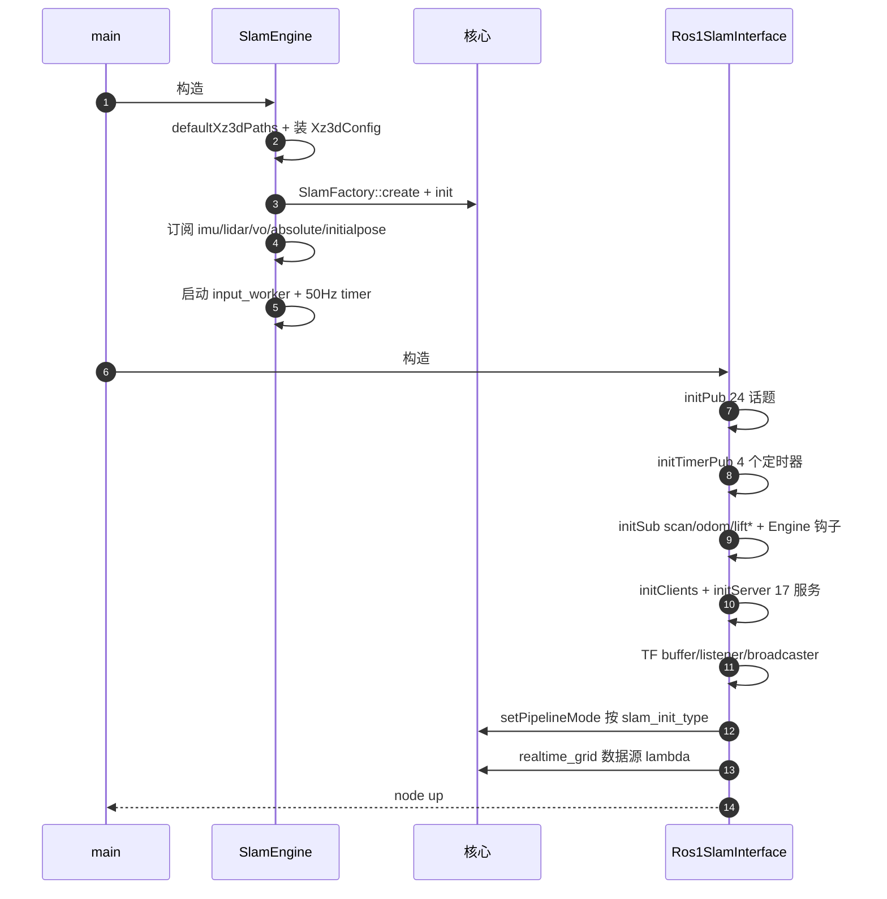
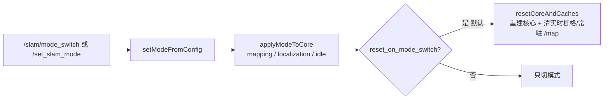
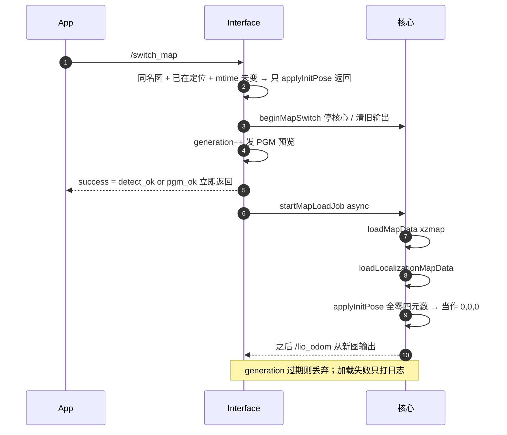
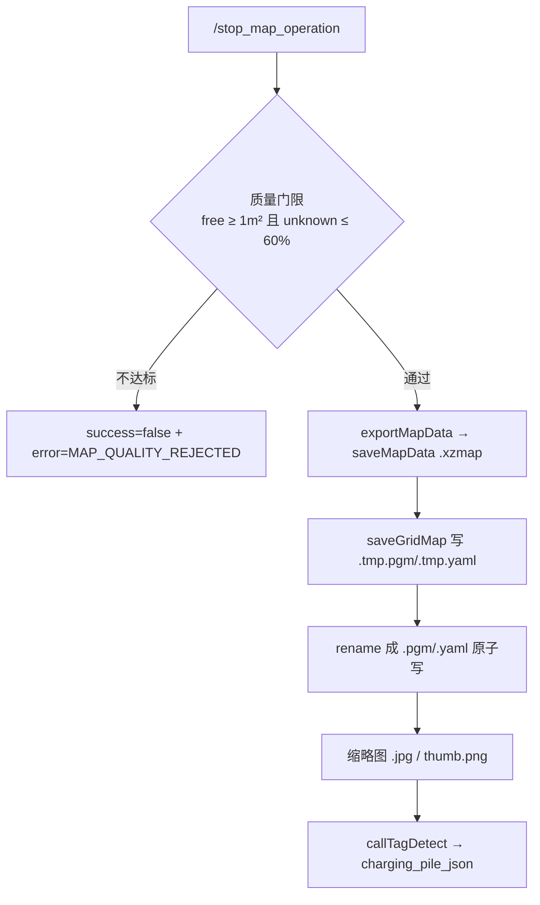
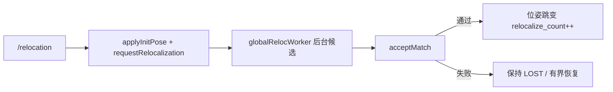
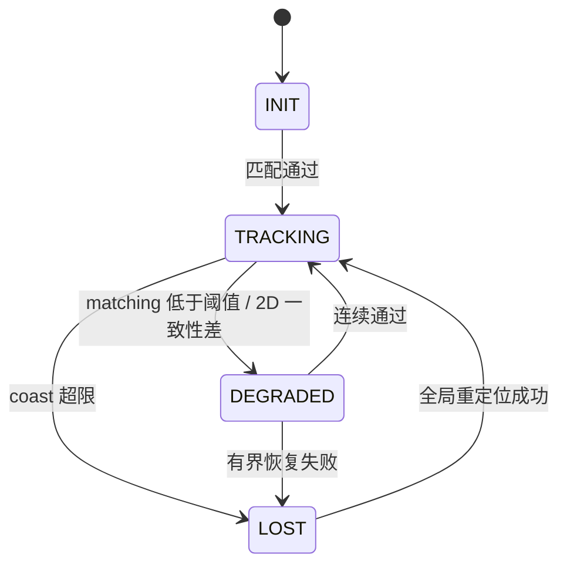

# rosiwit_slam_ros1 架构与代码走向

> 代码位置：`ros1_ws/src/rosiwit_slam_ros1`（ROS1 薄接口）+ `src/rosiwit_slam`（算法核心）
> 本文只描述**现状**；缺口分析见 `docs/dev` 的缺口报告与
> `docs/superpowers/plans/2026-10-26-nav-safety-recovery-hardening.md`。

---

## 1. 一句话结构

**一个进程、一个算法核心实例、一个对外接口**：
`main` 里只有 `SlamEngine`（核心持有者/输入泵）+ `SlamRos1Interface`（旧 xz_3d_slam 兼容层）。
接口层不做算法，只做「形状复刻 + 状态粘合 + 定时发布」；算法全部在 `src/rosiwit_slam`。

---

## 2. 分层架构

---

## 3. 线程与频率

要点：**输入只入队**、**建图前端在 50 Hz 定时器里同步跑**、**定位在自己线程跑**、
**接口层靠定时器拉快照**（pull，不是回调推送）。

---

## 4. 数据流

### 4.1 建图（MAPPING）

### 4.2 定位（LOCALIZATION）

---

## 5. 启动时序

---

## 6. 关键路径（函数级）

### 6.1 模式切换 `SlamMode ↔ core pipelineMode`

### 6.2 切图 `/switch_map`（两阶段，服务立即返回）

### 6.3 存图 `/stop_map_operation`

### 6.4 重定位与冷启动

### 6.5 健康等级 `/localization/state`

---

## 7. 对外接口（现状）

| 类别 | 内容 |
|---|---|
| 话题（24） | `/map` `/global_grid_map` `/grid_map` `/lio_odom` `/lio_path` `/curr_localization_pose` `/cloud_map` `/body_cloud` `/world_cloud` `/scan_f_map` `/curr_scan_point` `/curr_submap_point` `/origin_point` `/or_curr_scan_point` `/global_map` `/points_2d` `/mapping_path` `/slam/info` `/slam_calibration` `/slam_warning_code` `/loop_constraint` `/localization/state` |
| 服务（17） | `/switch_map` `/stop_map_operation` `/relocation` `/global_localization` `/slam/mode_switch` `/slam/dump_recorder` `/finish_task` `/start_task` `/localization/{relocalize,set_initial_pose,switch_map}` `/save_map` `/load_map` `/merge_map` `/save_grid_map` `/set_slam_mode` `/update_map_operation` |
| TF | `map→odom`（唯一发布者；LOST 时冻结最后有效值） |
| 订阅 | 核心：imu/lidar(+vo/absolute)/initialpose；接口：`scan`（频率统计）/`odom`（→核心）/`lift/state`/`lift_type` |

---

## 8. 设计上值得注意的 6 点

1. **pull 模型**：接口层用 `latestOutput()` 拉快照，引擎从不主动回调接口 →
   发布频率完全由 4 个定时器决定，与核心输出频率解耦（核心 10Hz、位姿可 100Hz 重发）。
2. **两种模式两条执行路径**：建图在 50 Hz 定时器里同步跑（会占用 spinner），
   定位在自己线程跑（避免重定位阻塞）。
3. **兼容层只做形状**：`SlamMode`(FREE/MAPPING/LOCALIZATION)、话题名、告警码、
   `map->odom` 都是照抄旧 `xz_3d_slam`，新能力（`/localization/*`）在同层旁挂。
4. **切图是两阶段 + generation**：服务立即返回、加载在后台；但 `success` 只表示
   "探测/PGM 可读"，xzmap 加载失败只能看日志。
5. **状态靠 `resetCoreAndCaches()` 清**：切建图会重建核心并清实时栅格，
   默认开启是"与旧实现一致"的选择，代价是切换瞬间建图停摆。
6. **协方差/健康是两套来源**：核心给 `localizationStatus()` + prior sigma，
   ROS 层又用 `loc_degrade_matching_` 二次分档，阈值不一致时会出现
   "核心认为不健康、对外还是 TRACKING"。

---

## 9. 文件索引

| 关注点 | 文件 |
|---|---|
| 入口 | `src/main.cpp` |
| 核心持有/输入泵/50Hz | `src/engine/slam_engine.{h,cpp}` |
| 构造顺序/模式同步/TF | `src/interface/assembly.cpp` |
| 话题注册/订阅/定时器 | `src/interface/outputs.cpp` |
| 位姿/健康/TF/2D 约束 | `src/interface/pose_publisher.cpp` |
| 点云类话题 | `src/interface/cloud_publisher.cpp` |
| 17 个服务 + 切图/存图 | `src/interface/services.cpp` |
| 告警/频率窗口 | `src/interface/warning.cpp` |
| 配置（4 份旧 conf + yaml） | `src/config/config.{h,cpp}`, `config/default.yaml`, `config/simulation.yaml` |
| 建图流水线 | `src/rosiwit_slam/src/slam_core/slam_pipeline.cpp` |
| 定位流水线 | `src/rosiwit_slam/src/algorithms/localization/localization_pipeline.cpp` |
| 匹配器 | `src/rosiwit_slam/src/algorithms/localization/matcher/*.cpp` |
| 2D 平面匹配 | `.../localization/planar_scan_matcher.cpp` |
| 地图 IO | `src/interface/io/{xzmap_writer,xzmap_reader,map_adapter}.cpp`, `.../grid_map/grid_map_io.cpp` |
| 核心单测（含未注册的 886 行） | `test/*.cpp` |
