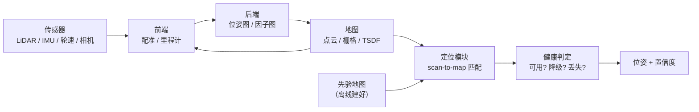

# 00 全景：SLAM 在解决什么问题

## 问题拆解

SLAM（Simultaneous Localization and Mapping）有两个必须分开的子问题：

- **建图（mapping）**：环境未知，边估计位姿边构建地图；
- **定位（localization）**：地图已知，估计机器人在图中的位姿。

两者共用同一套数学工具（位姿表示、配准、状态估计、优化），但**失效模式完全不同**：

| | 建图 | 定位 |
|---|---|---|
| 主要误差 | 累积漂移 | 局部错锁（自信地错） |
| 兜底手段 | 回环、后端优化 | 重定位、多假设、健康判据 |
| 危险表现 | 地图慢慢歪 | 位姿突然跳、或在错的位置稳定输出 |
| 验收方式 | 地图闭合误差 | ATE、跳变次数、任务成功率 |

工程上最容易犯的错，是拿建图的经验做定位：建图允许“慢慢歪，最后回环拉回来”，定位不允许“错了还自信”。

## 系统结构

各模块的职责一句话：

| 模块 | 输入 | 输出 | 失败表现 |
|---|---|---|---|
| 前端 | 相邻帧 + IMU | 帧间相对位姿 / 高频里程计 | 配准滑走、退化 |
| 后端 | 关键帧 + 约束 | 全局一致位姿 | 优化发散、错误回环拉歪全图 |
| 地图 | 位姿 + 点云 | 可查询的地图 | 重影、分辨率不当 |
| 定位 | 当前帧 + 先验地图 | 绝对位姿 | 局部错锁、跳变 |
| 健康判定 | 匹配指标 + 运动学 | 三态 | 判据失效（最常见的根因） |

## 一条主线：三个永恒问题

任何 SLAM 系统的复杂度，都可以归到三件事上：

1. **数据关联（data association）**：这一点对应到哪一点？对应错了，后面全错。
2. **状态估计（state estimation）**：已知对应，如何最优地估计位姿？滤波还是优化，松耦合还是紧耦合。
3. **一致性（consistency）**：估计出来的不确定度是否诚实？错误能否被自己的判据发现？

第三条最容易被忽略。一个“没有一致性检查”的系统，跑得再好也只是“还没错”。

## 两种建模范式

| | 滤波（EKF / ESKF / IEKF） | 优化（因子图 / 位姿图） |
|---|---|---|
| 状态 | 当前时刻 | 一段历史窗口或全部关键帧 |
| 增量 | 天然增量 | 需要重优化或增量求解 |
| 优点 | 实时、内存恒定 | 精度高、能回环、易加约束 |
| 缺点 | 线性化误差累积、难回环 | 计算量随历史增长 |
| 典型 | FAST-LIO2、MSCKF | LIO-SAM、Cartographer、ORB-SLAM |

**工程上常见组合**：前端滤波出高频里程计，后端优化做全局一致。两者用关键帧衔接。

## 一条贯穿全书的判断标准

> **每个模块都必须回答：“我错了，怎么被发现？”**

没有独立判据的模块，错误会静默传播。定位系统最危险的失效不是“报错”，而是“自信地给出错误位姿”——因为下游会完全信任它。

这条标准会反复出现在后面的章节：

- 配准（第 03 章）：匹配分数高 ≠ 位姿对；
- 融合（第 09 章）：先验和观测谁错？需要新息检验；
- 健康度（第 10 章）：判据本身会不会失效？
- 评估（第 11 章）：怎么在离线环境证明它真的变好了。

## 常见坑（类型化）

| 坑 | 后果 |
|---|---|
| 只用一个判据（如匹配分数）定健康 | 位姿整体滑走时不报警 |
| 把“可用状态”和“不可信状态”并在一个布尔量里 | 下游无法分级响应 |
| 用建图的验收标准衡量定位 | 掩盖“稳定输出错误位姿”的问题 |
| 没有离线回放，只靠现场试 | 改动的收益无法量化，只能靠感觉 |

## 自测题

1. 为什么定位系统不能用“地图闭合误差”作为主要验收指标？
2. 一个只有前端的系统，最可能在什么场景下失效？
3. “后端优化精度更高”这句话在什么条件下不成立？
4. 如果你只能加一个健康判据，你会选什么？为什么它必须与位姿来源独立？
