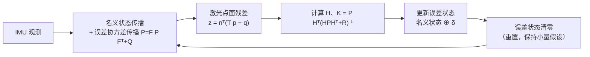

# 04 前端（二）：LIO

> 纯激光配准有两个先天问题：帧率受扫描周期限制（10 Hz），且退化时没有别的约束。IMU 恰好补这两点：高频、独立于地图。LIO（LiDAR-Inertial Odometry）= 把两者在**同一个状态估计器**里耦合。

## 为什么是“紧”耦合

| 方式 | 做法 | 特点 |
|---|---|---|
| 松耦合 | 激光里程计与 IMU 各自出位姿，再做融合 | 简单；内参不可辨；去畸变精度受限 |
| 紧耦合 | IMU 预积分提供预测，激光点面残差直接进入同一次更新 | 精度高；可估零偏；计算量集中 |

主流实现都是紧耦合。

## IMU 预积分

在两个关键帧 `i`、`j` 之间，把 IMU 观测积分成“相对运动”，并传播协方差：

```
ΔR_ij = ∏ Exp( (ω_k − b_g) · Δt )
Δv_ij = Σ ΔR_ik · (a_k − b_a) · Δt
Δp_ij = Σ ( Δv_ik · Δt + ½ ΔR_ik · (a_k − b_a) · Δt² )
```

预积分的好处：**零偏变化时可以一阶修正**，不必从头重积。协方差按噪声模型传播，作为后续更新的先验。

实践要点：

- 噪声必须按 `1/√dt` 离散化；
- 零偏要可估（否则积分误差持续累积）；
- 重力方向必须对齐（静止初始化或首帧估计）。

## ESKF：误差状态卡尔曼滤波

直接对旋转做 EKF 线性化会破坏正交性。ESKF 把状态拆成**名义状态**与**误差状态**：

```
名义： p, v, q, b_g, b_a
误差： δp, δv, δθ, δb_g, δb_a   （δθ 是小角度，线性化良好）
```

流程：



三个易错点：

1. **重置（reset）**：更新后误差状态清零，但协方差要按重置雅可比修正（通常近似为投影到切空间）；
2. **观测雅可比**：点面残差对旋转的雅可比需要正确处理左乘/右乘约定；
3. **协方差对称性**：数值误差会破坏对称正定，需周期性对称化。

## IEKF（迭代扩展卡尔曼）

FAST-LIO 系列用迭代更新：在当前估计点反复线性化直到收敛，等价于在流形上做高斯-牛顿。相比标准 EKF，一次更新能用上更多信息，精度更高。

## 点云去畸变

扫描周期内机器人一直在动，每个点采样时刻不同。标准做法：

1. 对每个点用其时间戳，在 IMU 预积分轨迹上插值位姿；
2. 把点变换到该帧的参考时刻（通常是帧末或帧中）；
3. 再去配准。


不做去畸变的后果：快速旋转时点云“被拉斜”，配准出系统性偏差——在窄道里表现为“总是贴着一边走”。

## scan-to-local-map

LIO 的配准目标不是全局地图，而是**最近若干关键帧拼成的局部地图**（ikd-tree 增量维护）。理由：

- 局部地图与当前扫描时间接近，环境变化小；
- 计算量可控（O(局部点数)）；
- 累积误差由后端/回环处理。

## 主流实现对比

| | FAST-LIO2 | LIO-SAM | Point-LIO |
|---|---|---|---|
| 估计器 | IEKF | 因子图（gtsam） | 逐点更新（无帧概念） |
| 地图 | ikd-tree | 关键帧子图 | 逐点 |
| 回环 | 无（可选加） | 有（Scan Context） | 无 |
| 特点 | 快、嵌入式友好 | 全局一致性好 | 高动态场景强 |
| 代价 | 无全局优化 | 计算量大 | 实现复杂 |

## 工程要点

1. **静止初始化**：上电静止 1~3 s，估陀螺零偏与重力方向；不充分则全程航向漂；
2. **外参与时间同步**：雷达-IMU 外参误差 1° 就能在远距离造成明显偏差；
3. **CPU 预算**：ikd-tree 增量更新 + 点面残差是主要开销；点数抽稀要谨慎（抽太狠会丢几何约束）；
4. **退化处理**：走廊场景下沿墙方向不可观，必须让该方向的修正失效，而不是硬拉；
5. **失效检测**：LIO 也会“自信地错”——需要独立判据（第 10 章）。

## 常见坑（类型化）

| 坑 | 表现 |
|---|---|
| 零偏未估或初始化不足 | 航向缓慢漂移 |
| 噪声未按采样率离散化 | 换频率后参数失效 |
| 去畸变用“帧末位姿”统一变换 | 高速旋转时点云变形 |
| 外参用欧拉角传递且顺序不一致 | 系统性偏差，难以定位 |
| 局部地图关键帧过多/过少 | 计算量爆炸或约束不足 |
| 把 LIO 输出直接当绝对位姿 | 长时间运行后整体偏移 |

## 自测题

1. 紧耦合与松耦合的本质区别是什么？为什么紧耦合能估零偏？
2. 预积分为何能避免“零偏一变就重积”？
3. ESKF 中误差状态重置的作用是什么？不重置会怎样？
4. 去畸变时用帧末位姿统一变换所有点，会在什么工况下产生明显误差？
5. LIO 在长走廊里为什么仍可能沿走廊方向漂？它自身能发现吗？
