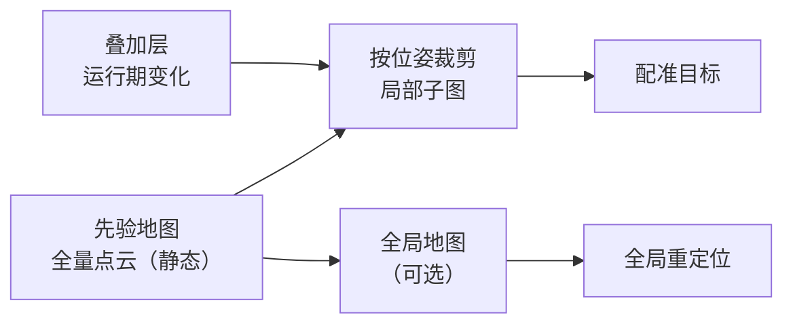

# 05 地图表示

> 地图是“位姿的下游”，也是“定位的上游”。选错表示，会在两个方向上同时付代价：内存/计算，以及匹配精度。

## 四类表示

| 表示 | 数据 | 典型用途 | 优点 | 缺点 |
|---|---|---|---|---|
| 点云地图 | 3D 点集 | 3D 定位、可视化 | 保真、实现简单 | 体积大、无占用概率 |
| 占据栅格 | 2D/3D 栅格，0..100 | 2D 导航、路径规划 | 可直接用于规划、支持未知 | 分辨率固定、内存 O(V/δ³) |
| TSDF | 体素内截断符号距离 | 重建、避障 | 表面平滑、可插值 | 内存大、需维护 |
| ESDF | 体素到最近障碍距离 | 轨迹优化、避障 | 梯度可用 | 更新昂贵 |

## 分辨率-内存-精度

占据栅格内存 ≈ `X·Y·Z / δ³` 字节。以 50 m × 30 m × 3 m、δ = 0.05 m 的 2D 投影为例：

```
2D：50/0.05 × 30/0.05 = 1000 × 600 = 60 万格 ≈ 0.6 MB（int8）
3D：再加 3/0.05 = 60 层 → 3600 万格 ≈ 36 MB（int8），实际维护成本更高
```

工程结论：

- **2D 导航用 2D 栅格**（便宜且直接可规划）；
- **3D 定位用点云/体素**（保真）；
- 需要距离场时再挂 ESDF，且只维护机器人附近窗口。

## 点云地图的增量结构

| 结构 | 插入 | 删除 | 查询 | 适用 |
|---|---|---|---|---|
| KD-tree（静态） | 不支持 | 不支持 | 快 | 离线地图、定位目标 |
| 体素哈希 | 快 | 快 | 快 | 大场景点云 |
| ikd-tree | 快 | 快（懒删除） | 快 | LIO 局部地图 |

定位场景常用“静态先验地图 + 运行期局部子图”：



**为什么裁子图**：全量点云配准的计算量与点数成正比；裁剪后既省算力，又限制了“可能匹配到多远的结构”，降低远距离误匹配。

**代价**：局部子图没有全局约束力——位姿整体偏了一段距离时，子图跟着偏，配准仍能在错的位置找到相似结构（“自洽但错”）。这是第 10 章要解决的检测问题。

## 未知、自由、占用

占据栅格的标准语义（`nav_msgs/OccupancyGrid`）：

| 值 | 含义 | 规划语义 |
|---|---|---|
| `-1` | 未知（无观测） | 既非墙也非自由 |
| `0` | 自由 | 可通行 |
| `1..99` | 代价（膨胀/风险） | 可通行，尽量远离 |
| `100` | 占用 | 不可通行 |

**最常见的实现错误**：把 `-1` 当 `100`。未知区域不是墙；把它当墙会导致“明明不在障碍里却拒绝规划”。正确做法是折成一个高代价（例如 99），让规划器“尽量绕开但可以通过”。

## 地图更新：破坏式 vs 非破坏式

| 方式 | 做法 | 优点 | 风险 |
|---|---|---|---|
| 破坏式 | 直接改先验地图 | 简单、省内存 | 错误更新不可回滚；多点累积后地图失真 |
| 非破坏式 | 先验图冻结，变化写叠加层 | 可回滚、可审计 | 需处理“原结构被移除”的压制逻辑 |

非破坏式的关键设计：

1. **变化检测**：只有“离原图足够远的新结构”才沉淀，避免噪声写入；
2. **确认机制**：连续多帧观测到才算变化（过滤行人/临时物体）；
3. **压制（override）**：同一位置的新结构可压制原图旧结构（应对“墙被拆了”）；
4. **容量与衰减**：设体素上限与衰减策略，避免无限增长。

## 地图质量检查

地图本身可能“重影”（建图时滑过导致同一面墙出现两层）。检查方法：

1. 把历史扫描按位姿投影到地图，统计**命中率**（落在占用格的比例）；
2. 按空间网格统计命中率分布，长期偏低的区域即为可疑区域；
3. 对可疑区域人工复核或重建。

> 重要认知：**地图重影无法被定位算法修复**。定位只能在这个“模糊的答案”里挑一个，表现为“匹配分数高但位置在两个解之间跳”。

## 常见坑（类型化）

| 坑 | 表现 |
|---|---|
| 子图裁得太大 | 单帧配准耗时超预算 |
| 子图裁得太小 | 特征不足，配准易滑 |
| `-1` 当 `100` | 未知区被当墙，规划大面积失败 |
| 膨胀半径与车体不匹配 | 窄道永远过不去 / 贴墙擦碰 |
| 地图分辨率与定位精度不匹配 | 只能到厘米级却用 0.2 m 栅格 |
| 破坏式更新写入错误结构 | 错误永久固化 |

## 自测题

1. 为什么定位要用“局部子图”而不是全量点云？
2. 局部子图带来的最大风险是什么？如何检测？
3. `-1`、`1..99`、`100` 在规划中分别意味着什么？
4. 非破坏式地图更新的两个代价是什么？
5. 如何判断一张已保存的地图是否存在重影？
