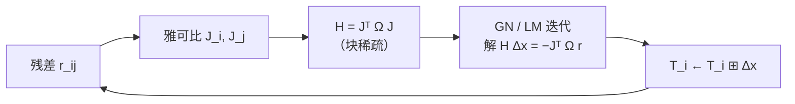

# 06 后端（一）：位姿图优化

> 前端给“相邻两帧的相对位姿”，后端把它们串成一张图，求一组**全局一致**的位姿。它是消除累积漂移的唯一手段。

## 问题形式

节点：关键帧位姿 `T_i ∈ SE(3)`；边：相对位姿观测 `T_ij`（带信息矩阵 `Ω_ij`）。

```
min_{T_i}  Σ_{(i,j)∈E}  ‖ Log( T_ij⁻¹ · T_i⁻¹ · T_j ) ‖²_Ω
```

含义：让“由全局位姿推算出的相对位姿”与“前端观测到的相对位姿”一致。残差定义在切空间（李代数）。

## 求解

### 线性化与迭代

残差对节点位的雅可比是稀疏的（每条边只涉及两个节点），整体 H 矩阵呈块稀疏结构：



- GN：二阶收敛快，但可能发散；
- LM：加阻尼 `(H + λI)`，更稳，常用；
- 稀疏性必须利用（稀疏 Cholesky / 舒尔补），否则大图无法求解。

### 关键帧

不是每一帧都进图。常用策略：位移 > 0.5 m 或旋转 > 5° 时建关键帧。太少 → 约束不足；太多 → 求解变慢。

### 信息矩阵

`Ω = Cov⁻¹`。它决定“这条边有多可信”。常见做法：

- 里程计边：协方差随距离增长；
- 回环边：按配准协方差，且要设下限（防止一次弱匹配被当成强约束）。

## 鲁棒核

错误回环会“把整张图拉歪”。标准做法是对回环边加鲁棒核：

```
ρ(‖r‖_Ω)，Huber/Cauchy/GNC
```

外点比例高时，GNC（渐进非凸）比固定核更可靠；工业系统还会叠加**回环验证**（第 07 章）。

## 边缘化与滑动窗口

当历史帧很多时，两种策略：

| 策略 | 做法 | 特点 |
|---|---|---|
| 全图优化 | 保留全部关键帧 | 精度最高，规模受限 |
| 滑动窗口 + 边缘化 | 只保留最近 N 帧，旧帧信息压缩成先验 | 实时性好，需处理一致性（填零/一阶修正） |

边缘化会引入线性化误差，处理不当会导致“过度自信”（协方差变小但实际不确定），表现为后续观测被不合理地拒绝。

## 位姿图 vs BA

| | 位姿图 | BA（Bundle Adjustment） |
|---|---|---|
| 节点 | 位姿 | 位姿 + 路标点 |
| 观测 | 相对位姿 | 像素/点对应 |
| 规模 | 只与关键帧数平方相关 | 与路标点数相关，更大 |
| 场景 | 激光/里程计系统 | 视觉系统 |

激光 SLAM 绝大多数用位姿图 + 点云配准构造的边，而非完整 BA。

## 增量求解

长时间运行时，每次重优化全图不可行。增量方案（如 iSAM2）只更新受影响的部分：

- 新边只影响局部子图 → 只重算相关块；
- 用贝叶斯树维护变量消元顺序。

工程上也可用“固定旧图 + 只优化最近 N 帧 + 偶尔全图”的折中。

## 实现要点

1. **残差定义一致**：`Log(T_ij⁻¹ T_i⁻¹ T_j)` 与雅可比的扰动约定必须匹配（左乘/右乘）；
2. **协方差要诚实**：所有边的 Ω 都设成常数，会让优化“平均分配误差”，掩盖真正不可信的部分；
3. **回环边必须验证**：错误回环的破坏力大于漂移本身；
4. **求解失败要有兜底**：迭代不收敛时保留上一版位姿，而不是输出半成品；
5. **可观测性**：纯里程计链只有一个全局自由度不可观（整体平移/旋转），必须至少一条绝对约束（先验或回环）来固定规范（gauge）。

## 常见坑（类型化）

| 坑 | 表现 |
|---|---|
| 忘记固定规范（gauge freedom） | 解不唯一、数值发散 |
| 雅可比与残差扰动约定不一致 | 不收敛或收敛到错解 |
| 所有边用同一信息矩阵 | 误差被平均，坏边拉歪好边 |
| 回环不验证 | 一次错回环毁掉整张图 |
| 边缘化不做一致性修正 | 过度自信，后续观测被拒 |
| 只在最后做一次全局优化 | 长任务中间状态不可用 |

## 自测题

1. 位姿图优化的残差为什么定义在切空间而不是直接相减？
2. 为什么说“纯里程计链有一个全局自由度不可观”？如何固定它？
3. 信息矩阵设成常数会带来什么问题？
4. 错误回环的破坏力为什么大于漂移？
5. 边缘化为什么可能造成“过度自信”？
