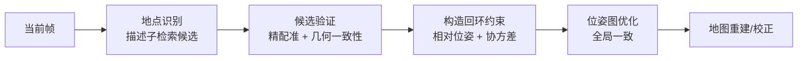

# 07 全局一致性：回环

> 漂移是必然的：任何相对观测都会累积误差。回环（loop closure）是唯一能把漂移“拉回来”的机制，也是唯一能一次毁掉整张图的机制。

## 漂移从哪里来

```
真实轨迹 ──► 里程计观测（每步都有小误差）──► 累积后回到原点时，估计位置已偏离
```

误差来源：配准残差、IMU 零偏、打滑、地图重影。漂移量与距离、转弯次数正相关，与“有没有绝对约束”负相关。

## 回环的三个阶段



### 1. 地点识别（place recognition）

| 方法 | 原理 | 特点 |
|---|---|---|
| Scan Context | 把点云按环/扇区编码成 2D 描述子，按列移位比较 | 对旋转鲁棒、快；对结构相似场景易混 |
| 特征描述子（FPFH 等） | 局部几何特征匹配 | 无需先验位姿；计算贵 |
| 直方图/签名 | 高度、密度分布 | 极快，区分度低 |
| 学习型（NetVLAD 等） | 神经网络嵌入 | 泛化好；需训练数据 |

### 2. 候选验证（最容易被跳过、也最不能跳过的一步）

至少三道检查：

1. **几何验证**：候选位姿下做精配准，覆盖率/残差达标；
2. **一致性验证**：与里程计推算的相对运动是否一致（差太多说明是错回环）；
3. **多帧确认**：连续若干帧都指向同一候选才接受。

### 3. 构造约束并优化

回环边：`T_ij`（当前帧到历史帧的相对位姿），协方差来自配准；再加鲁棒核。

## 错误回环的破坏力

一次错回环 = 给整张图加了一条“错误的强约束”。后果：

- 局部被拉歪 → 整段轨迹变形；
- 地图出现重影 → 后续定位在该区域“两个解之间跳”；
- 更隐蔽的是：**优化收敛、残差下降**，从指标上看不出来。

因此工业系统的原则是：**宁可少回环，不可错回环**。

## 回环与定位的关系

定位系统通常**不做在线回环**（地图已固定），但会遇到回环留下的后果：

| 现象 | 本质 |
|---|---|
| 同一区域位姿跳到另一处 | 地图里存在两个“解”（重影） |
| 匹配分数高但位置偏 | 局部子图里有相似结构 |
| 某片区域长期匹配差 | 建图时该区域漂移较大 |

所以定位算法的验收，必须包含**地图质量检查**，而不只是算法指标。

## 多回环与一致性

当一个区域有多个回环时：

- 相互一致的多个回环 → 可信度高，可提高权重；
- 相互矛盾的回环 → 至少有一个错，必须重新验证，不能“平均”。

## 实现要点

1. 描述子检索只做**候选生成**，永远不要直接采用；
2. 验证必须包含“与里程计一致性”，这是最便宜也最有效的错回环过滤器；
3. 回环边协方差要诚实（配准弱就大），并设上限；
4. 回环后要**同步修正地图与定位模块**（否则定位还在用旧位姿的局部子图）；
5. 保留回环日志（时间、位姿、分数、残差），便于事后审计。

## 常见坑（类型化）

| 坑 | 表现 |
|---|---|
| 只靠描述子分数接受回环 | 相似场景触发错回环 |
| 不做多帧确认 | 单帧噪声导致误闭环 |
| 回环后不刷新下游地图/定位 | 定位继续在旧图上工作 |
| 回环边权重给得过大 | 一次弱配准被当成强约束 |
| 没有回环日志 | 出问题无法追溯 |

## 自测题

1. 为什么“描述子相似”不能作为回环的充分条件？
2. 与里程计一致性检查能过滤掉哪类错回环？
3. 回环之后，为什么必须通知定位模块？
4. 多回环相互矛盾时应该怎么处理？
5. 一张地图出现重影，会让定位表现出什么现象？
