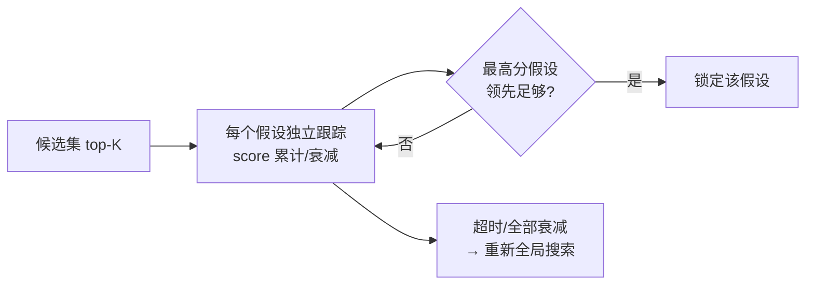

# 08 重定位与多假设

> 建图时“位姿大致已知”，定位时可能要“在整张图里凭空找到自己”。后者的难度高一个量级，难点不在搜索，而在**怎么知道自己搜对了**。

## 两种问题

| 场景 | 已知信息 | 典型手段 |
|---|---|---|
| 冷启动（开机/被搬动） | 只有先验地图 | 全局搜索 |
| 跟踪丢失（遮挡/打滑） | 丢失前的位姿 | 有界局部搜索 + 防漂 |

两者的判据完全不同：冷启动看“绝对分数够不够高”，跟踪恢复看“新解与预测是否一致”。

## 全局搜索的三种主流方法

| 方法 | 搜索空间 | 特点 | 代价 |
|---|---|---|---|
| 分支定界（BBS 类） | 2D (x,y,θ) 离散 | 有最优性保证，适合平面约束强的场景 | 需要 2D 投影，3D 场景受限 |
| 特征匹配 + RANSAC（FPFH 等） | 6DoF | 无需先验位姿，通用 | 特征构建慢，外点多 |
| 描述子检索（Scan Context 等） | 候选 + 精配 | 快，适合多候选 | 相似结构易混淆 |

工程上常见组合：**粗检索生成 top-K 候选 → 6DoF 精配准 → 打分排序 → 多假设跟踪**。

## 候选打分与接受判据

一次全局搜索会产出多个候选。**只按分数排序取 top1 是最危险的简化**，因为相似结构（走廊、对称房间、货架）会出现分数接近的多个解。

正确做法：

1. **top1–top2 间隔**：分差小于阈值 → 判定歧义，进入多假设跟踪，而不是强行选一个；
2. **几何验证**：候选位姿下的覆盖率、残差、内点数；
3. **可达性/一致性**：候选离“上一次可信位姿”过远（例如 > 5 m）时降权——除非确认是真正的冷启动；
4. **多帧确认**：连续若干帧支持同一候选才锁定。

## 多假设跟踪

要点：

- 每个假设要有“置信度随证据累加、随时长衰减”的机制；
- 只有领先幅度足够大时才锁定，避免在两个解之间反复跳；
- 假设池要有上限与淘汰策略。

## 跟踪期重定位（丢失恢复）

与冷启动不同，此时约束更强：

1. 用最后可信位姿 + 运动预测限定搜索半径（例如 3~5 m）；
2. 超半径的候选默认不采信；
3. 连续失败 N 次才升级为全局搜索；
4. 恢复后要作废“旧位姿下产生的规划/路径”，否则会按旧坐标系执行。

## 重定位的固有风险

| 风险 | 说明 |
|---|---|
| 相似结构误锁 | 分数高但在错位置 |
| 漂移后越搜越错 | 搜索半径过大引入错误候选 |
| 一次性跳变 | 新解与旧解差 1 m 以上，下游来不及反应 |
| 与地图重影耦合 | 地图有两个解，重定位随机选一个 |

对策：**限制单次修正的幅度**（把“跳变”变成“缓慢收敛”），并让下游能感知“定位刚重定位过”。

## 实现要点

1. 全局搜索/特征构建**不能放在实时回调里**（预建 + 后台线程）；
2. 候选检索与精配准分离，精配准用独立实例（线程安全）；
3. 记录每次重定位的输入、候选、最终选择、耗时——否则事后无法审计；
4. 重定位成功后通知规划层作废旧路径。

## 常见坑（类型化）

| 坑 | 表现 |
|---|---|
| 只取 top1 | 相似场景锁到错位置 |
| 无歧义处理 | 位姿在两个解之间跳 |
| 冷启动与跟踪恢复用同一套判据 | 要么过于保守，要么过于激进 |
| 全局搜索在回调线程同步执行 | 整个节点卡死 |
| 重定位后不作废旧规划 | 车按旧坐标系运动 |

## 自测题

1. 冷启动与跟踪恢复的判据为什么必须不同？
2. top1–top2 间隔过小意味着什么？应该怎么处理？
3. 为什么全局搜索不能放在实时回调里？
4. 重定位成功后，下游需要做哪些清理？
5. 如果地图本身有重影，重定位会出现什么现象？
