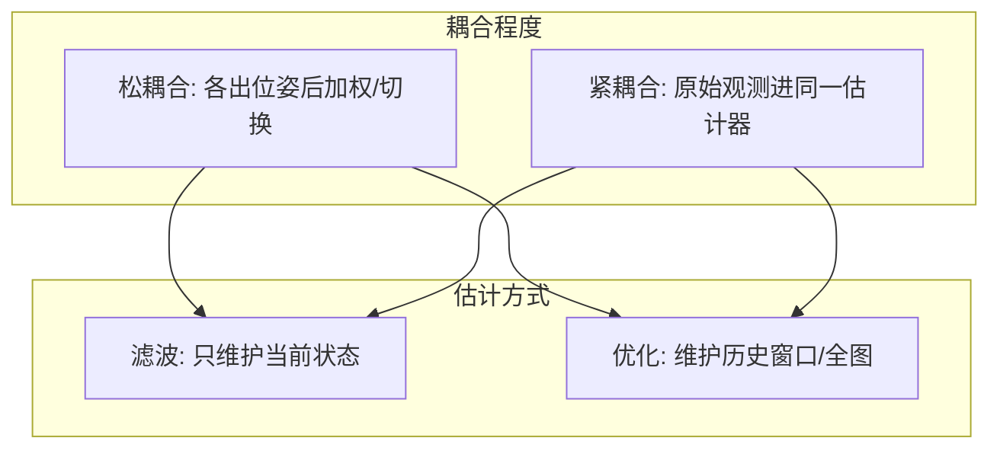
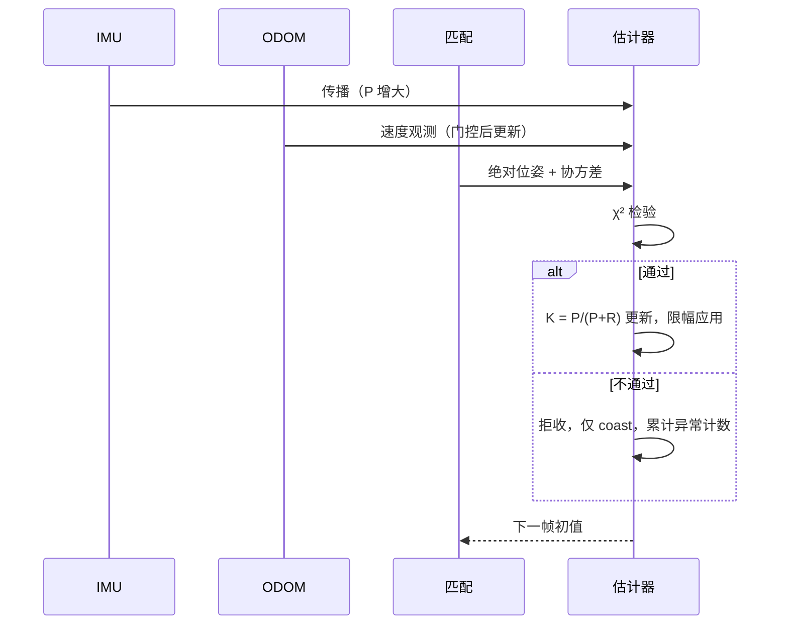

# 09 多传感器融合架构

> 融合不是“把数据加起来”，而是“用每个传感器能观的那部分，去约束别人不可观的那部分”。架构选错，融合会变成互相污染。

## 两个维度



四种组合都真实存在：松+滤（传统 EKF 融合）、松+优（位姿图）、紧+滤（FAST-LIO2）、紧+优（LIO-SAM、VINS-Mono）。

## 松耦合 vs 紧耦合

| | 松耦合 | 紧耦合 |
|---|---|---|
| 输入 | 各子系统的位姿输出 | 原始 IMU/点云/像素 |
| 优点 | 模块化、易替换、易调试 | 精度高、可估内参/零偏、退化时仍能用部分信息 |
| 缺点 | 丢失内部信息、无法估零偏、延迟叠加 | 实现复杂、耦合紧、单点故障影响大 |
| 适用 | 多源异构、快速集成 | 单一系统追求精度 |

**判断标准**：需要估零偏、需要处理退化、需要高精度时选紧耦合；否则松耦合的工程收益更高。

## 观测模型怎么写

融合的核心是“把每个观测写成对状态的约束”。三类常见形式：

| 观测 | 形式 | 噪声 |
|---|---|---|
| 绝对位姿 | `z = T_state`（或 `Log(T_obs⁻¹ T_state)`） | 来自配准协方差 |
| 相对位姿（帧间） | `z = T_i⁻¹ T_j` | 来自配准/预积分协方差 |
| 速度（轮速/IMU） | `z = R(θ)ᵀ v + b` | 与打滑、噪声相关 |

**最容易错的一点**：观测写成什么坐标系，雅可比就必须对什么坐标系求导。观测在体体系、状态在世界系时，中间那个旋转不能省。

## 协方差是融合的灵魂

```
K = P Hᵀ (H P Hᵀ + R)⁻¹
```

- `P` 大（久未修正）→ 更信观测；
- `R` 大（观测不可靠）→ 更信预测；
- 两者都大 → 协方差膨胀，意味着“谁都不信”，应触发降级而非硬融合。

**R 必须诚实**：常数 R 会让融合系统“永远同样自信”，在退化场景下拒绝正常观测、在错误观测上过度信任。

## 一致性检验

标准工具：

| 指标 | 定义 | 用途 |
|---|---|---|
| 新息（innovation） | `ν = z − h(x)` | 观测与预测的差 |
| 马氏距离 | `νᵀ S⁻¹ ν`（`S = H P Hᵀ + R`） | 判断观测是否离群 |
| χ² 检验 | 马氏距离与卡方阈值比较 | 拒收离群观测 |
| NEES | `eᵀ P⁻¹ e`（e 为真值误差） | 评估协方差是否诚实（需真值） |
| 滑窗 2σ | 本帧修正量 vs 历史均值/标准差 | 无需真值的替代方案 |

工程上常用“χ² 门控 + 滑窗 2σ”组合：前者处理单帧离群，后者捕捉缓慢漂移。

## 一个完整的融合流程



关键设计：**限幅应用**（单帧修正不超过某个物理上界），把“错配”变成“有界修正”，这是防止位姿瞬移的物理保证。

## 时间同步与延迟

- 各传感器时间戳必须同源；不同源时要做时间外参标定；
- 融合时按时间对齐，而不是“取最新”；
- 高延迟的观测（如全局重定位，可能几百毫秒）要用“延迟补偿”或“位姿历史”处理。

## 常见坑（类型化）

| 坑 | 表现 |
|---|---|
| 观测与状态的坐标系不一致 | 融合后位姿被持续拉偏 |
| R 用常数 | 退化/正常场景表现倒挂 |
| 无 χ² 门控 | 一次错观测污染状态 |
| 只有门控没有限幅 | 门限内的大修正仍会瞬移 |
| 不做延迟补偿 | 高速时系统滞后 |
| 融合层直接输出给下游、无置信度 | 下游无法分级响应 |

## 自测题

1. 什么情况下必须选紧耦合？松耦合会损失什么？
2. 为什么观测噪声 R 不能设成常数？
3. χ² 门控与滑窗 2σ 各抓什么类型的异常？
4. 为什么“门控通过”还需要“限幅”？
5. 融合层输出的置信度，下游应该怎么用？
