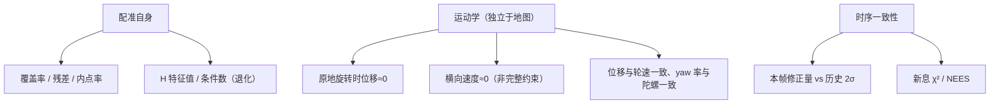
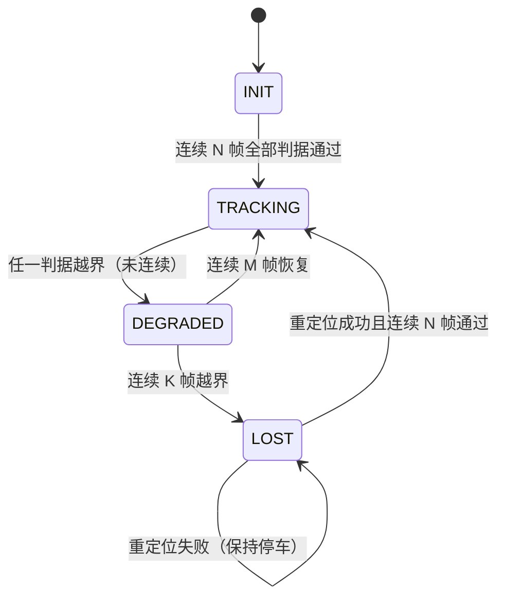

# 10 健康度与退化检测

> 这一章回答全书最核心的问题：**系统怎么知道自己错了？**

## 为什么“匹配分数”不够

配准的分数（覆盖率、内点率、fitness）衡量的是**自洽性**：点云与它认为的那片地图贴得多好。

反例（真实存在的现象）：位姿整体滑动 1 m，落在地图里另一片相似结构上，覆盖率依然 0.95+。原因：

1. 地图本身有重复结构（走廊、货架、对称房间）；
2. 局部子图随位姿一起偏，配准目标也跟着偏；
3. 配准器只优化局部残差，没有全局约束。

**结论：自洽性指标不能单独作为“位姿正确”的判据。**

## 三类互补判据



| 判据 | 抓什么 | 需要什么 | 盲区 |
|---|---|---|---|
| 匹配分数 | 配准是否收敛、覆盖是否足 | 配准结果 | 整体滑移 |
| 退化特征值 | 解是否唯一 | 雅可比 H | 非退化但错锁 |
| 运动学 | 位姿是否物理可能 | IMU、轮速 | 打滑时不可靠 |
| 修正量 2σ | 是否发生慢滑 | 自身历史 | 持续缓慢漂移会被“适应” |
| χ² 新息 | 单帧离群 | 协方差 | 协方差失真时失效 |

**没有任何单一判据是完备的**，必须组合，且要接受“组合同样可能失效”。

## 运动学约束的三种写法

1. **原地旋转零位移**：`|v|≈0 且 |ω|>阈值` 时，匹配给出的平移应为 0（超过几厘米即异常）。
2. **非完整约束**：差速轮车体系横向速度应≈0，可用于发现侧向滑动。
3. **与里程计一致性**：比较“位姿位移”与“轮速位移”的模长比与方向差。

这些约束的价值在于**完全独立于地图**：地图可以错、匹配可以错，物理约束不会。

## 退化检测

对信息矩阵 `H = Jᵀ W J` 做特征分解：

```
λ_min / λ_max < 阈值   →  该方向不可观
```

处理策略：

| 策略 | 做法 | 适用 |
|---|---|---|
| 部分更新 | 弱方向修正量按比例衰减/冻结 | 在线连续运行 |
| 降级 | 标记该帧不可信，交给状态机 | 保守系统 |
| 重定位 | 直接判丢，重新全局搜索 | 严重退化 |

**实现要能自证**：人为构造退化场景（长走廊），检查输出是否真的沿该方向冻结。很多系统“有参数、没生效”。

## 状态机设计



三个参数（N/M/K）决定“灵敏度 vs 稳定性”：

- K 太大 → 永不判丢，错误位姿一直广播；
- K 太小 → 频繁误判丢，任务中断；
- 建议先记录分布（每个判据的越界频率），再定 K，而不是拍脑袋。

## 下游必须消费状态

三态如果没有下游差异，等于没做：

| 状态 | 规划 | 控制 | 用户可见 |
|---|---|---|---|
| TRACKING | 正常 | 正常 | 正常 |
| DEGRADED | 不穿越未知、不做长距离规划 | 降速 | 提示定位质量下降 |
| LOST | 停止规划 | 停车 | 提示需重定位 |

## 常见坑（类型化）

| 坑 | 表现 |
|---|---|
| 只用匹配分数 | 整体滑移时不报警 |
| 判丢阈值设成“连续 100 帧” | 实际永不触发 |
| 有判据但只打日志不生效 | 现场看起来“正常” |
| 运动学判据用错坐标系 | 误报/漏报同时存在 |
| 没有记录各判据的越界率 | 无法调参，只能猜 |
| 三态没有下游差异 | 等于二值 |

## 自测题

1. 举一个“匹配分数很高但位姿错误”的场景，并说明为什么分数会高。
2. 运动学判据为什么必须独立于地图？打滑时它还有效吗？
3. 退化检测的阈值应该基于什么量？为什么不能只看绝对残差？
4. `K`（判丢连续帧数）设得过大和过小分别有什么后果？
5. 如果只能加一个判据，你会选运动学还是 2σ？理由是什么？
