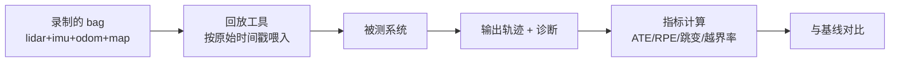

# 11 评估与调试

> 没有度量，就只能靠现场试；靠现场试，就会一直“出一个问题打一个补丁”。

## 两个基础指标

### ATE（Absolute Trajectory Error）

估计轨迹与真值轨迹逐点对齐后，位置误差的均方根：

```
ATE = sqrt( mean_i ‖ p_est(t_i) − p_gt(t_i) ‖² )
```

- 反映**全局一致性**；
- 通常先做一次最优刚体对齐（对齐后仍保留尺度/形状误差）。

### RPE（Relative Pose Error）

按固定间隔计算相对位姿误差：

```
RPE(Δ) = sqrt( mean_i ‖ Log( T_i⁻¹ T_{i+Δ} )⁻¹ ( T̂_i⁻¹ T̂_{i+Δ} ) ‖² )
```

- 反映**局部漂移率**，对定位系统更有意义（定位更关心“短时是否稳”）；
- 按间隔 Δ 画曲线，可以看出“漂移随距离/时间如何增长”。

### 两者要用对场景

| 场景 | 主指标 | 辅指标 |
|---|---|---|
| 建图 | ATE（闭合误差） | RPE |
| 定位 | RPE + 跳变次数 | ATE（相对先验地图） |
| 长期运行 | 漂移率（%/km） | 重定位次数 |

## 定位特有的指标

| 指标 | 定义 | 为什么重要 |
|---|---|---|
| 跳变次数 | 相邻采样位移 > 阈值（如 0.3 m）或角度 > 阈值 | 直接对应“位姿跳” |
| 置信度校准 | 置信度高时的真实误差分布 | 检验协方差是否诚实 |
| 恢复时间 | 丢失到重新定位成功的时间 | 影响可用性 |
| 任务成功率 | 端到端任务完成比例 | 最终验收 |
| 退化场景通过率 | 长走廊/空旷大厅等专项 | 暴露结构性弱点 |

## 离线回放的搭建



要点：

1. **录包要包含地图与参数**，否则不同版本无法对齐；
2. **可重复**：同一 bag 跑两次结果应一致（排除线程/时序抖动）；
3. **指标落盘**：每次改动的指标存档，形成趋势，而不是只看单次；
4. **失败样本保留**：出错的那段 bag 要单独留存，作为回归用例。

## 消融实验

改动同时改了三处时，无法判断哪一处有效。做法：

- 每次只改一个变量；
- 固定随机性（线程数、调度）；
- 至少跑 3 次，看均值与最差值（最差值往往决定现场体验）；
- 记录 CPU/内存/耗时，避免“精度换性能”被忽略。

## 日志设计原则

| 原则 | 做法 |
|---|---|
| 一行一事件 | 不要把多个量拼成难以解析的长句 |
| 带时间戳与坐标系 | 位姿日志必须注明 frame |
| 分级 | INFO 是状态，WARN 是降级，ERROR 是需要人介入 |
| 可机读 | 关键诊断用 JSON/固定格式，便于脚本统计 |
| 带上下文 | 失败时要能回答“当时位姿、协方差、匹配分数、判据各是什么” |

## 调试方法论

1. **先确定“哪一层错了”**：坐标系/配准/融合/规划，逐层加观测，不要一上来改参数；
2. **用数字描述现象**：“不顺”要变成“横向偏差 8 cm、速度方差 0.2”；
3. **一次只改一处**，改完用同一 bag 复测；
4. **保留反例**：把坏样本变成回归用例，比修好一次更有价值。

## 常见坑（类型化）

| 坑 | 表现 |
|---|---|
| 只看 ATE | 掩盖短时跳变 |
| 只有单次结果 | 无法区分“改好了”与“这次运气好” |
| bag 不含参数/地图 | 无法复现历史问题 |
| 指标不落盘 | 改动收益无法量化 |
| 日志没有 frame 标注 | 排查时靠猜 |

## 自测题

1. ATE 与 RPE 分别反映什么？定位系统为什么更看重 RPE？
2. 为什么“跳变次数”必须作为独立指标，而不是只看 ATE？
3. 离线回放为什么要固定线程数与调度？
4. 一次改动同时改三处，会带来什么评估问题？
5. 一条合格的位姿日志至少应包含哪些字段？
