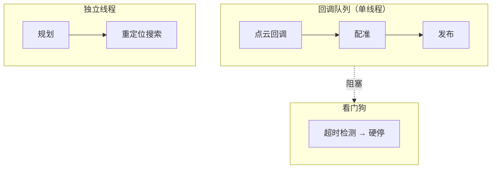

# 12 工程化

> 算法能在笔记本上跑通，和能在产品上跑稳，是两件事。这一章讲后者。

## 实时性预算

以 10 Hz 定位为例：每帧 100 ms。一次典型的预算分解：

| 环节 | 预算 | 说明 |
|---|---|---|
| 点云接收/解码 | 5 ms | 大点云解码不可忽略 |
| 预处理（抽稀/去畸变） | 10 ms | 抽稀策略直接影响精度 |
| 配准 | 30~50 ms | 子图规模决定 |
| 融合/健康判定 | < 2 ms | 通常可忽略 |
| 发布/日志 | 5 ms | 大点云发布可能是隐藏开销 |
| 余量 | ≥ 20% | 突发负载与 GC/调度抖动 |

**原则**：预算要留余量；超过 70% 占用时，系统在负载波动下就会出现“偶发卡顿”，而卡顿会直接变成安全风险。

## 线程模型

三条经验：

1. **看门狗必须在独立队列**：它要检测的正是“回调队列被卡住”，放在同一队列等于失效；
2. **重活（全局搜索、地图保存）不能进实时回调**：后台线程 + 结果交接；
3. **共享状态要么加锁，要么单线程**：混用且无锁，就是“偶发崩溃”。

## 时间与时钟

| 问题 | 后果 | 对策 |
|---|---|---|
| 传感器时间戳不同源 | 高速时系统偏差 | 统一时钟（PTP/PPS 或统一主机时间） |
| 用“最新 TF”配旧数据 | 抖动 | 按时间查询变换 |
| 高延迟观测直接融合 | 滞后/振荡 | 位姿历史 + 延迟补偿 |
| 回放与实时时间处理不一致 | 回放结果不可信 | 回放走同一时间路径 |

## 参数治理

| 原则 | 做法 |
|---|---|
| 单一来源 | 每个参数只在一个文件定义，其余引用 |
| 显式默认值 | 代码默认值与配置文件必须一致，且可打印 |
| 启动自检 | 关键话题频率、外参、地图可用性、起点可通行性 |
| 分组命名 | 按模块前缀，便于检索 |
| 变更留痕 | 参数改动与指标一起记录 |

**启动自检清单**（示例）：

1. 关键话题频率 > 0（雷达、IMU、里程计）；
2. 位姿与里程计的一致性（方向差、模长比）；
3. 地图加载成功、尺寸符合预期；
4. 机器人当前位置在地图中可通行（不是障碍/未知）；
5. 外参与安装角与配置文件一致。

任一项失败应在启动阶段就明确报错，而不是静默降级到“能跑但不对”。

## 部署与回滚

1. **二进制与配置一起版本化**（配置漂移是最常见的“换机器就不对”）；
2. **灰度**：先小范围设备验证，再全量；
3. **回滚方案**：保留上一版二进制与配置，一条命令可回退；
4. **可观测**：部署后自动上报关键指标（定位健康率、跳变次数、任务成功率）。

## 安全性设计

| 层级 | 手段 |
|---|---|
| 数据层 | 校验点云/IMU 时间戳连续性、异常值剔除 |
| 估计层 | χ² 门控、限幅、健康三态 |
| 控制层 | 速度/加速度上限、超时硬停 |
| 规划层 | 单一可行性判据、降级链（重试/截断/换规划器） |
| 系统层 | 看门狗、进程守护、崩溃日志 |

任何一层失效都不应导致“整车不可控”。

## 常见坑（类型化）

| 坑 | 表现 |
|---|---|
| 看门狗与业务同队列 | 卡死时看门狗也停 |
| 大点云在回调里发布 | 偶发超时 |
| 参数散落多处且不一致 | 换机器行为不同 |
| 无启动自检 | 话题缺失时静默运行 |
| 部署只更新二进制不更新配置 | 新旧配置混用 |
| 单线程 + 无锁共享状态，后来调大线程数 | 偶发崩溃 |

## 自测题

1. 为什么看门狗必须独立于业务回调队列？
2. 实时预算为什么要留 20% 余量？
3. 启动自检至少应覆盖哪几类检查？
4. 参数“单一来源”解决的是什么问题？
5. 安全性设计中，为什么每一层都要有独立保护？
