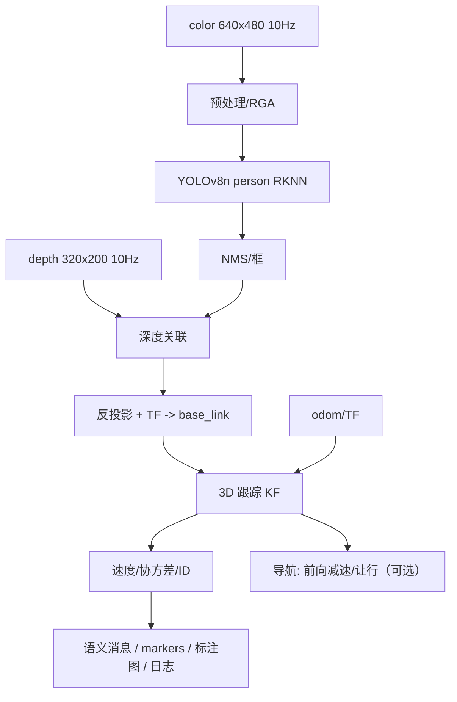

# 前置深度相机人员 3D 语义（位置 + 速度）实施方案

> 状态：**待实施**（2026-11-01 方案定稿）
> 适用平台：RK3588（XZ AIO-3588Q）+ 奥比中光 大白2 前视深度相机
> 范围：独立节点，**不依赖**既有 `object_detect`，不修改其代码/配置
> 目标读者：实现该功能的工程师（假设熟悉 C++/ROS1、了解相机模型与卡尔曼滤波）

---

## 1. 目标

在前视深度相机 10 Hz 数据上，输出每个人的：

- **3D 位置**（`base_link` 下的躯干中心 + 地面投影点）
- **速度**（相对机器人 / 世界系两套）
- **协方差、稳定 ID、置信度、距离、是否在视场、速度是否有效**
- 语义标注：RViz/Foxglove 标记、标注图（框/ID/距离/速度）、结构化消息、可回放日志

并可选地把“前向减速/让行”接入导航。

### 验收指标

| 类别 | 指标 |
|---|---|
| 检测 | person AP50 >0.9（1–3 m）、>0.8（3–5 m）；召回 >90%（1–5 m） |
| 位置 | 误差 <0.15 m（1–3 m）、<0.3 m（3–5 m） |
| 速度 | 误差 <0.15 m/s（1–3 m 步行） |
| 跟踪 | ID 切换 <5%/min；track 连续率 >95% |
| 实时 | 端到端 <100 ms；10 Hz 不掉帧 |
| 资源 | CPU <30% 单核；NPU <30%；RSS <150 MB |
| 稳定 | 8 h 长跑无内存增长、无崩溃；节点挂掉不影响导航 |

---

## 2. 范围与非目标

**做**
- 前向 ~68° 视野内的人员检测、3D 定位、跟踪、速度、语义输出。
- 单相机、单帧多人；短时跟踪（≤0.5 s 丢失）。

**不做**
- 不做 360°/侧后向覆盖；不做安全功能（不进急停/安全扫描仪链路）。
- 不做长期语义地图（后续单独一层）。
- 不做人脸识别/身份识别。
- 不依赖 `object_detect`，也不改它；两者可并存（话题不同）。

---

## 3. 实测输入与约束

| 项 | 实测值 |
|---|---|
| 板卡 | XZ AIO-3588Q（RK3588，NPU 6 TOPS，8 核） |
| 彩色 | 640×480 @10 Hz；`fx=478.118, fy=477.981, cx=324.378, cy=242.398`；`D=0`；HFOV≈67.7° |
| 深度 | 320×200 @10 Hz；`16UC1`（mm）；`fx=fy=153.504, cx=159.589, cy=99.437`；HFOV≈92.3° |
| 对齐 | `depth_align=false`；彩色/深度光心 TF 基本重合（base_link 前 0.525 m、高 0.713 m、俯仰 0°） |
| 深度质量 | 有效率 ~74%；实测 0.43–9.8 m；**设计范围 0.5–5 m** |
| NPU 运行时 | `/opt/ros/melodic/lib/librknnrt.so` 已存在；需与转换工具版本匹配 |

**关键约束**
- 彩色与深度 FOV/分辨率不同、未对齐：必须按内参映射，不能直接套像素。
- 深度 320×200：>5 m 人的深度点很少，速度会抖；指标按 0.5–5 m。
- 单前视：侧后方盲区；不能当安全功能。

---

## 4. 总体架构



数据流：**彩色检测 → 框内深度 → 反投影 → 跟踪 → 速度 → 语义输出**；机器人自身运动从 odom/TF 补偿，分别输出相对速度与世界速度。

---

## 5. 模块设计

### 5.1 采集与时间同步

- 订阅：
  - `/camera_01/color/image_raw`
  - `/camera_01/depth/image_raw`
  - `/camera_01/color/camera_info`
  - `/camera_01/depth/camera_info`
  - `/tf`、`/odom`
- 以**彩色帧时间**为主；深度取最近一帧（≤50 ms），超时则该帧 `depth_valid=false`。
- 启动时缓存 `base_link → camera_01_color_optical_frame` 静态外参；运行时按彩色时间戳查询（防外参更新）。
- 只处理最新帧；队列深度 1；禁止积压。

### 5.2 检测（独立模型，NPU）

- 模型：**YOLOv8n / YOLOv11n，person 单类**；输入 416×416（优先）或 640×640。
- 导出链：PyTorch → ONNX（opset 12）→ **RKNN Toolkit2**（x86 主机转换）→ INT8（300–500 张现场图校准）。
- 运行时：C++ 直接调用 `librknnrt`；RGA 做 resize/letterbox/颜色转换；避免 OpenCV 全图拷贝。
- 参数：`conf=0.35`、`NMS IoU=0.45`、最多 20 人。
- 预期耗时：640 INT8 ≈ 20–30 ms；416 ≈ 10–15 ms。
- 失败策略：NPU 初始化失败 → 节点不启动并告警；**不做 CPU 慢速降级**（避免拖累系统）。

### 5.3 深度关联

对每个 person 框：

1. **ROI**：框内水平中央 60%、垂直 15%–85%（躯干+腿，避开头部背景和地面）。
2. **彩色→深度坐标映射**（光心重合前提下）：
   ```
   u_d = (u_c - cx_c) * fx_d / fx_c + cx_d
   v_d = (v_c - cy_c) * fy_d / fy_c + cy_d
   ```
   **必须先用标定板验证**；偏差大时改用 Orbbec SDK 的 D2C 对齐（尝试 `depth_align=true`）或标定外参做完整投影。
3. **有效深度**：`100 < d < 8000 mm`；有效率 <30% → `depth_valid=false`，回退地面投影（低置信）。
4. **稳健深度**：ROI 有效像素的**中位数**；同时计算 10/90 分位用于“最近/最远距离”。
5. **多人同框**：深度直方图双峰（间隔 >0.5 m）→ 点云连通域拆分；MVP 可标记 `ambiguous`。
6. **参考点**：统一用**躯干中心**做位置（步态摆动小）；另给 `ground_position`（脚点投影到 z=0）。

### 5.4 3D 定位

```
Z = depth_median (m)
X = (u - cx_c) / fx_c * Z
Y = (v - cy_c) / fy_c * Z
p_base = T_base_cam * [X, Y, Z, 1]
```

- 输出 `base_link` 下 `position`（躯干）与 `ground_position`。
- **合理性校验**：人的高度 0.8–2.2 m；地面投影 z≈0；不满足 → 降置信/丢弃。
- **协方差**：深度噪声 `σ_z ≈ a·z² + b`（现场标定）+ 像素量化；变换到 base_link。
- **交叉校验**：地面平面 + 框底点的单目距离与深度差异 >30% → 降权。

### 5.5 3D 跟踪

- 状态：地面 2D `[x, y, vx, vy]` + 高度 `z` 低通（人不做垂直机动，2D KF 更稳）。
- 预测/更新：标准 KF；`dt` 用图像时间戳；`q=0.5 m/s²`；`R` 来自深度协方差。
- 关联：马氏距离门（d²<9）+ 匈牙利；最大关联距离 1.0 m。
- 生命周期：tentative（命中 2–3 帧）→ confirmed → coasting（≤0.5 s）→ deleted；ID 单调递增。
- 速度：KF 状态输出；**仅 track 年龄 ≥0.3 s 且深度有效时 `velocity_valid=true`**；限幅 2.5 m/s；带协方差。
- 去抖：KF 已是滤波，不再叠加低通；显示层可另做 1€ 滤波，不影响状态。

### 5.6 速度的两个坐标系（必须做）

相机随机器人运动，直接差分得到的是**相对速度**：

- `velocity_base`：相对机器人（避障/让行用，等于接近速度）。
- `velocity_world = R_base_world * velocity_base + v_robot_world`（语义/界面用）。
- `v_robot_world` 来自 odom/TF 在时间戳处的值；缺失时只输出相对速度并标记。

### 5.7 语义输出契约

```
# SemanticPerson.msg
std_msgs/Header header
uint32 id
string class_name            # "person"
geometry_msgs/PoseWithCovariance pose      # base_link, 躯干中心
geometry_msgs/Vector3 velocity_base        # m/s, 相对机器人
geometry_msgs/Vector3 velocity_world       # m/s, 世界系
geometry_msgs/Point ground_position        # z=0 投影
float32 distance                           # 最近距离
float32 confidence
bool depth_valid
bool velocity_valid
bool in_fov
float32 age
```

```
# SemanticPersonArray.msg
std_msgs/Header header
SemanticPerson[] persons
```

话题：

| 话题 | 类型 | 说明 |
|---|---|---|
| `/perception/persons` | `SemanticPersonArray` | 语义数组，10 Hz |
| `/perception/persons/markers` | `visualization_msgs/MarkerArray` | 球+速度箭头+文本 `ID 2 \| 2.4m \| 0.8m/s` |
| `/perception/persons/image` | `sensor_msgs/Image` | 标注图（框、ID、距离、速度，按速度着色） |
| `/perception/persons/status` | `std_msgs/String`（JSON） | FPS、耗时、深度有效率、track 数、错误码 |
| `/perception/persons/log` | `std_msgs/String`（JSONL） | 每帧每人一行；默认不存原图 |

### 5.8 导航接入（可选，第二期）

- 发布 0.5 s / 1.0 s 预测位置与 footprint（点云或 markers）。
- 策略：前向走廊内、预测距离 <2.0 m → 限速；<1.2 m → 停等；带滞回。
- 语义层掉线自动退回纯几何避障；**不改变安全链**。

---

## 6. 软件结构

```
src/rosiwit_perception/                 # ROS 无关核心
  person_detector/                      # RKNN 封装 + 前后处理
  depth_associator/                     # ROI/映射/稳健深度/反投影
  person_tracker/                       # KF + 关联 + 生命周期
  semantic_types/                       # 数据结构（无 ROS 依赖）
  test/                                 # 单测

ros1_ws/src/rosiwit_perception_ros1/    # ROS1 薄节点（生产）
  src/person_semantics_node.cpp
  msg/SemanticPerson.msg
  msg/SemanticPersonArray.msg
  config/person_semantics.yaml
  launch/person_semantics.launch
  test/                                 # 回放测试

（后续）ros2_ws/src/rosiwit_perception_ros2/  # 复用核心的 ROS2 薄节点
```

- C++ 实现（RKNN/RGA 均为 C/C++，10 Hz 实时更稳）。
- 核心不依赖 ROS；ROS1/ROS2 只做订阅/发布/TF。
- 节点名：`/person_semantics`；崩溃由 respawn 拉起，导航不受影响。

---

## 7. 配置与话题（默认值）

```yaml
model_path: /opt/ros/melodic/share/rosiwit_perception_ros1/model/person_yolov8n.rknn
input_size: 416
conf_threshold: 0.35
nms_iou: 0.45
max_persons: 20

color_topic: /camera_01/color/image_raw
depth_topic: /camera_01/depth/image_raw
color_info_topic: /camera_01/color/camera_info
depth_info_topic: /camera_01/depth/camera_info
odom_topic: /odom
base_frame: base_link

roi_w_ratio: 0.6          # 框内水平中央比例
roi_v_min: 0.15           # 框内起始高度比例
roi_v_max: 0.85
depth_min_mm: 100
depth_max_mm: 8000
min_valid_ratio: 0.30

# 跟踪
assoc_gate_chi2: 9.0
assoc_max_dist: 1.0
confirm_hits: 3
max_coast_s: 0.5
process_accel: 0.5
velocity_min_age_s: 0.3
velocity_max_mps: 2.5

publish_image: true
publish_markers: true
publish_log: true
```

---

## 8. 性能预算（RK3588）

| 环节 | 预算 |
|---|---|
| 图像接收/转换 | 5–10 ms |
| RGA resize/letterbox | 2–4 ms |
| RKNN 416 INT8 | 10–15 ms |
| NMS/后处理 | 2–4 ms |
| 深度 ROI + 反投影 | 2–5 ms |
| 跟踪 | <1 ms |
| **合计** | **~22–35 ms（416） / ~35–50 ms（640）** |

10 Hz 有充足余量；NPU <30%，单核 CPU <30%，RSS <150 MB。

---

## 9. 数据、训练与量化

**采集**
- 30–60 min 现场：正面接近、横向穿越、站立、多人、部分遮挡、低光、反光地面、坐/蹲。
- 5–10 名不同身高/衣着的人；记录距离标尺（1/2/3/4/5 m）。

**标注**
- 2D person 框 3–5k 帧（CVAT/Label Studio）；按场景/人划分训练/验证，不随机切帧。
- 若后续用分割模型，再标 500 帧 mask；本方案默认检测框即可。

**训练/量化**
- 在 COCO person 预训练上微调 person 单类；增强：亮度、模糊、噪声、裁剪、遮挡。
- INT8 校准 300–500 张现场图；验证 AP 掉点 <2%；否则用 FP16。

**3D/速度真值**
- 站位：1/2/3/4/5 m，测位置误差。
- 步行：5 m 直线，0.5/1.0/1.5 m/s，秒表计时，测速度误差。
- 多人交叉：测 ID 保持。

---

## 10. 测试与验收

### 10.1 单测（无需硬件）
- 彩色→深度像素映射（已知内参）。
- ROI 深度中位数与有效率。
- 反投影 + TF（合成数据）。
- KF 预测/更新、关联门、生命周期。
- 速度坐标系变换（含 ego-motion）。

### 10.2 回放测试
- 录制 rosbag（color/depth/odom/tf）。
- 回放 10 Hz 运行节点，输出 JSONL。
- 脚本计算：召回、位置误差、速度误差、ID 切换、延迟。
- 场景：接近、穿越、静止、多人、遮挡、低光。

### 10.3 现场测试
- 静态站位（1–5 m）→ 低速直线/横穿 → 多人混场 → 8 h 长跑。
- 记录误检/漏检/误停；对比关闭节点的基线。

### 10.4 验收门槛
见第 1 节指标；未达标不进入导航灰度。

---

## 11. 里程碑（6–8 周，1 人 + 标注支持）

### W1：验证与骨架
- [ ] 标定板验证彩色/深度光心与映射误差（附录 A）
- [ ] 采集 5 min 站位数据（1–5 m）
- [ ] YOLOv8n person ONNX → RKNN INT8（附录 B）
- [ ] 基准：416/640 推理耗时、NPU/CPU 占用
- [ ] 骨架节点：订阅图像，发布 2D 框 + 标注图

### W2：3D 位置
- [ ] 深度 ROI 与映射；稳健深度
- [ ] 反投影 + TF；位置误差表
- [ ] 回放评估脚本

### W3：跟踪与速度
- [ ] 3D KF + 关联 + 生命周期
- [ ] 速度（相对/绝对）+ 协方差 + valid
- [ ] 消息/markers/标注图/日志
- [ ] 单测

### W4：数据与模型
- [ ] 30–60 min 现场采集 + 标注 3–5k 帧
- [ ] 微调 + INT8 量化；AP 掉点 <2%
- [ ] 精度达标（位置/速度/召回）

### W5：导航接入（可选）
- [ ] 前向减速/让行
- [ ] 现场低速测试

### W6：鲁棒性与长跑
- [ ] 多人/遮挡/低光/反光
- [ ] 8 h 长跑
- [ ] 文档与交接

### W7–W8：产品化
- [ ] 配置、健康、灰度、回滚
- [ ] 诊断接入与告警

---

## 12. 风险与对策

| 风险 | 对策 |
|---|---|
| 彩色/深度未对齐、外参误差 | 标定板验证；必要时启用 D2C 或标定外参；位置误差现场回归 |
| 深度空洞（黑衣、玻璃、阳光） | 有效率阈值 + 地面投影回退 + `depth_valid` 标记 |
| 单前视盲区 | 明确只覆盖前向 ~68°；导航不依赖它做安全 |
| 速度受步态/机器人运动影响 | 躯干参考点 + KF + ego-motion 补偿；输出协方差 |
| RKNN 版本/量化掉点 | 锁定 toolkit/runtime 版本；FP16 回退；校准集覆盖现场 |
| NPU 被其他节点占用 | 只开前视；监控耗时；必要时错峰 |
| 隐私 | 默认只存结构化结果；存图需显式开关与保留策略 |

---

## 13. 部署、灰度、回滚

- 独立 launch + systemd respawn；`enable` 参数默认关闭，验证后开。
- 灰度：离线回放 → 静态站位 → 低速行驶 → 全速；每步看位置/速度误差与误停。
- 回滚：关节点即可，导航仍用现有激光避障；无耦合。
- 监控：`/perception/persons/status` 进现有诊断/告警。

---

## 14. 待确认项（含默认建议）

| # | 问题 | 默认建议 |
|---|---|---|
| 1 | 速度口径：相对机器人 / 世界系？ | **两套都输出** |
| 2 | 最远距离：3 m / 5 m？ | 指标按 5 m，重点保证 1–3 m |
| 3 | 输出主用途：界面标注 / 导航减速？ | 先标注，W5 再接导航 |
| 4 | 先 ROS1 还是等 ROS2？ | **先 ROS1 薄节点，核心保持 ROS 无关** |
| 5 | 是否允许存图？ | 默认只存 JSONL；存图需显式开关 |
| 6 | 模型类别：只 person / 加叉车托盘？ | 先 person 单类，后续扩类 |

---

## 附录 A：彩色/深度标定与验证步骤

1. 打印棋盘格（如 9×6，方格 25 mm），在 0.5/1/2/3/4/5 m 各拍 5 组彩色+深度。
2. 用彩色内参做棋盘格角点检测，确认 `fx/fy/cx/cy` 与 `camera_info` 一致（D=0）。
3. 用同一角点在深度图的坐标，检查映射公式误差（目标 <2 px）。
4. 在深度图上取棋盘格中心深度，与卷尺距离比较，拟合 `σ_z(z)`。
5. 若映射误差大：尝试驱动 `depth_align=true`，或标定彩色-深度外参（OpenCV `stereoCalibrate` / 手动平移）。
6. 记录表格：距离 / 深度中位数 / 误差 / 有效率；作为后续回归基线。

**通过标准**：1–3 m 位置误差 <0.1 m；3–5 m <0.25 m（标定阶段）。

## 附录 B：RKNN 转换流程（x86 主机）

1. 版本对齐：`rknn-toolkit2` 与板端 `librknnrt.so` 版本一致（`strings librknnrt.so | grep -i version`）。
2. 训练/微调 YOLOv8n person；导出 ONNX（opset 12，固定输入 1×3×416×416）。
3. `rknn.config(mean_values=[[0,0,0]], std_values=[[255,255,255]], target_platform='rk3588')`。
4. `rknn.load_onnx()` → `rknn.build(do_quantization=True, dataset='calib.txt')` → `rknn.export_rknn()`。
5. 板端 C++：`rknn_init` → `rknn_inputs_set` → `rknn_run` → `rknn_outputs_get`；RGA 做前处理。
6. 验证：同一批图在 PC（ONNX）与板端（RKNN）输出框差异；AP 掉点 <2%。
7. 校准集：300–500 张现场图，覆盖距离/光照/遮挡；不要用训练集原图。

## 附录 C：回放评估清单

- [ ] rosbag 含 color/depth/camera_info/odom/tf，时长 ≥10 min/场景
- [ ] 回放时钟与节点时间戳一致（`use_sim_time`）
- [ ] JSONL 字段：stamp, id, u/v/bbox, depth, position, velocity, valid flags, latency
- [ ] 脚本输出：召回、位置误差（按距离分桶）、速度误差、ID 切换、FPS、耗时
- [ ] 与人工标注/卷尺真值对比
- [ ] 失败案例归档（遮挡、反光、低光、多人）

## 附录 D：消息定义（ROS1）

见 5.7 节；ROS2 复用同一字段，包名改为 `rosiwit_perception_msgs`。
