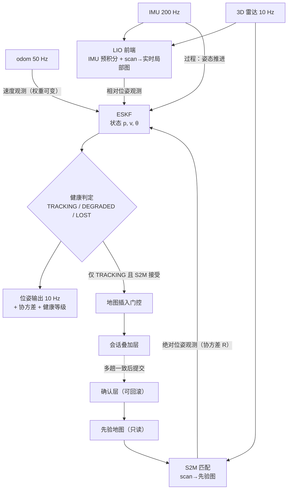
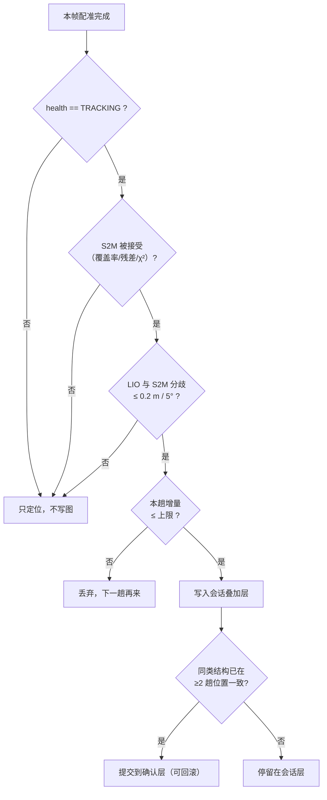
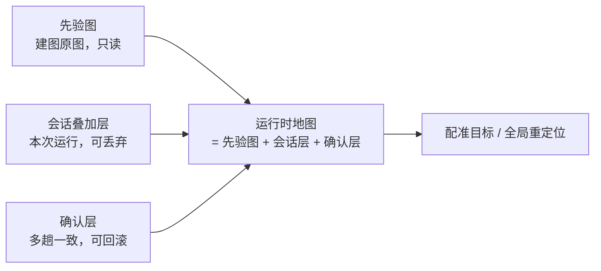

# 定位架构：LIO + S2M + ESKF 四路融合（含地图更新门控）

日期：2026-10-31
前置：`2026-10-31-localization-pose-fusion-design.md`（融合层 `pose_fusion` 的单层设计）

## 1. 目标与约束

- 场地常态存在**轮子打滑**（洗地/湿滑），odom 不能作为主平移预测；
- 场地环境**持续变化**（家具移动、货架调整），需要"低匹配时仍能维持定位，并把变化写回地图"；
- 嵌入式 8 核 ARM，CPU 预算紧（现状 load 8~11）；
- 先验地图**冻结**，任何运行期变化只能进叠加层，必须可回滚。

## 2. 总体架构

关键点：**ESKF 是唯一的位姿来源**，四路输入各司其职；LIO 与 S2M 同时存在，不是二选一。

## 3. 四路输入的角色

| 输入 | 在估计器中的类型 | 打滑常态下的权重 | 说明 |
|---|---|---|---|
| IMU | 过程模型（姿态推进） | 始终最高 | 不受轮子打滑影响；零偏需静止标定 |
| odom | 速度观测 | **动态**：检测到打滑 → 接近 0；未打滑 → 正常 | 保留的三个理由见下 |
| LIO | 相对位姿观测 | 中 | 几何量，不受打滑影响；退化方向与 S2M 同向失效 |
| S2M | 绝对位姿观测 | 高（受 χ² 与限幅约束） | 唯一的绝对基准；局部子图无全局约束力 |

### 为什么 odom 不能删除（即便常态打滑）

1. 未打滑的短时段它最便宜准确（干地直行、缓慢移动）；
2. **打滑检测本身需要它**：判据是 `|Δ位姿| / |Δodom|` 偏离 1 的程度；删掉 odom 就失去"独立于几何"的对照，LIO 与 S2M 同时错时无法发现；
3. 轮子抱死/悬空时"零位移"是强信息，LIO/S2M 都给不出这种确定性。

结论：odom 不是"用或不用"，而是**"不信任但保留，权重连续可变"**。

## 3.1 为什么需要 ESKF（收益与代价）

把"位姿"从"某一步算出来的结果"变成"一个带不确定度的状态"，换来五件事：

| # | 收益 | 现在（`direct`）的问题 |
|---|---|---|
| 1 | **单帧修正有界**（限幅 0.15 m / 3°） | 匹配偏 1 m 就发 1 m；实测 1.08 m / fitness 0.977 |
| 2 | **多源按可信度加权**，而非开关 | odom 只进先验；LIO 无法接入；S2M 是唯一来源 |
| 3 | **输出协方差**，下游可分级响应 | 下游只有位姿，不知道能不能信 |
| 4 | **让健康判据有基准**（新息 = 观测 − 预测） | 没有"预测"可比，只能看匹配分数 |
| 5 | **异步/多速率观测天然融合**（200/50/10/10 Hz） | 只能"谁最后来听谁的" |

它**不能**做到的事，必须写清楚，避免期待错位：

| 期望 | 现实 |
|---|---|
| 提高单次匹配精度 | 不能。配准错了，滤波器只限制影响 |
| 修复几何退化 | 不能。走廊沿墙方向仍不可观 |
| 替代 LIO / odom | 不能。ESKF 是容器，输入仍靠它们 |
| 免费获得平滑 | 不一定。Q/R 不当会引入 100~200 ms 滞后 |

代价：调参面变大（Q/R/门限）、调试更间接（要看预测/观测/新息三个量）、急加减速时有滞后。

## 3.2 一句话

## 4. 地图插入门控（五条规则）

| # | 规则 | 参数建议 | 目的 |
|---|---|---|---|
| 1 | 只在 `health == TRACKING` 时写 | — | 防止低置信位姿污染地图 |
| 2 | 本帧 S2M 必须被接受 | 现有 `accept.*` | 同上 |
| 3 | LIO 与 S2M 分歧过大不写 | 0.2 m / 5°（按现场分布定） | 防止"顶着 LIO 漂移"写图 |
| 4 | 单趟变化量上限 | 体素数 ≤ 总量 5% | 防止一趟把图改写 |
| 5 | 多趟确认才提交 | ≥2 趟、位置差 ≤0.15 m | 过滤瞬时变化与单趟漂移 |

**移除语义**：新增结构可以"加"；旧结构消失必须走自由空间雕刻/压制（`carve_stride`、`override_base`），否则会永久留在图里，形成重影。

## 5. 三层地图

| 层 | 生命周期 | 写入方 | 回滚 |
|---|---|---|---|
| 先验图 | 永久 | 离线 | 不需要 |
| 会话叠加层 | 本次运行 | 在线（受五条规则约束） | 直接丢弃 |
| 确认层 | 跨趟 | 离线/半自动批准 | 删除即回滚 |

## 6. 需要量化后再定阈值的三个数

| 指标 | 用途 | 采集方式 |
|---|---|---|
| `|Δpose| / |Δodom|` 分布 | 打滑检测阈值、odom 权重曲线 | 跑一趟洗地任务记录 |
| LIO 与 S2M 分歧分布 | 规则 3 的阈值 | 逐帧记录 Δpose |
| 低匹配持续时间与 LIO 累积漂移 | "能撑多久"与停车阈值 | 记录连续未匹配时长 + 位姿差 |

## 7. 验收标准

| 指标 | 目标 |
|---|---|
| 单帧位姿修正 | ≤ 0.15 m（限幅生效） |
| 湿滑地面位置抖动 | 不劣于干地 |
| 变化区域定位中断时间 | 显著下降（不再因匹配失败而丢失） |
| 地图重影 | 不增加（插入门控生效） |
| 单帧端到端耗时 | ≤ 100 ms（含 LIO 与 S2M） |

## 8. 落地顺序

1. **LIO 常开**（解除定位模式限制），先只作为相对位姿观测，不写图；
2. **接入四路输入**到 ESKF，odom 权重按打滑检测动态给；
3. **加五条插入规则**（重点 1、2、3 条）；
4. **多趟确认 + 移除语义**；
5. **CPU 优化**（前端降频、IMU 补帧），若超预算。

## 9. 不在本次范围

- 后端位姿图/回环（定位不需要）；
- 先验图的在线重建（只允许叠加与确认）；
- 用 2D 雷达做健康判据（该传感器为临时件，不进入架构）。
