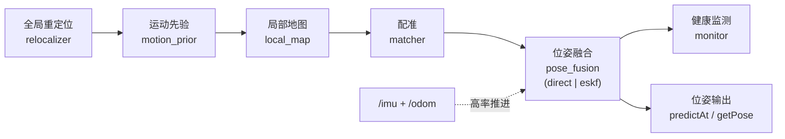
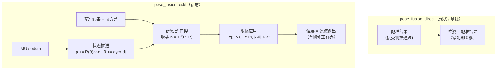
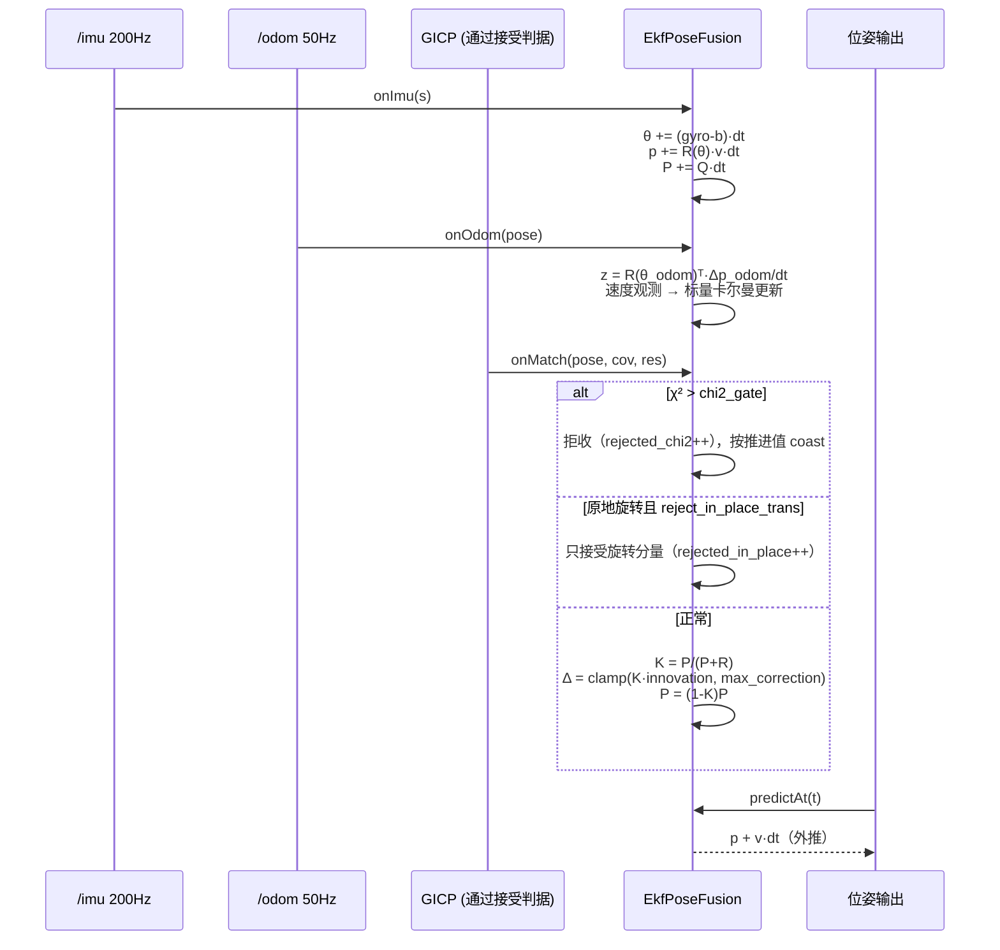

# 定位位姿融合层：direct / eskf 双方案可切换设计

日期：2026-10-31
状态：已实现（`pose_fusion: direct` 为默认，行为与改造前逐位一致）

> 本文只讲"融合层"这一级。**整体架构（LIO + S2M + 四路输入 + 地图插入门控）**见
> `2026-10-31-localization-architecture-lio-eskf.md`。

## 1. 问题（为什么需要这层）

现状：GICP 的配准结果（通过接受判据后）**直接作为位姿**，运动先验（`imu_ekf`）只用来
预测下一帧的匹配初值和高频补帧。于是：

- 一次错配 = 位姿瞬移。2026-10-31 实测：`(-0.63,-4.73) -> (-1.70,-4.84)`，
  位移 1.08 m，而 `matching` 仍是 0.977；
- 错误位姿以 `TRACKING` 状态广播，导航侧无从判断；
- 健康度只依赖 `fitness`（自洽性指标），对"整体滑移"不敏感（滑 1 m 仍 0.96~0.98）。

本质：**把"一次可能错的观测"当成了"位姿本身"**。标准做法是把配准结果当作
**带协方差的观测**，位姿由估计器输出，错配只造成有界的修正，而不是瞬移。

参考实现：FAST-LIO2（IEKF + 退化观测）、LIO-SAM（退化因子 + 因子图）、
Nav2（map→odom 是缓慢收敛的修正量，不是位姿本身）。

## 2. 两种方案

| 方案 | `pose_fusion` | 位姿来源 | 跳变性质 |
|---|---|---|---|
| A. 直接（现状） | `direct` | 配准结果（接受即采用） | 无界，一次错配即瞬移 |
| B. 融合（新增） | `eskf` | IMU/odom 推进 + 配准作为观测做增益修正 | 有界，单帧修正受 `max_correction_*` 限制 |

两者共用同一套上游（局部地图、配准、接受判据、重定位、健康监测），只是
**"观测 → 位姿"这一步**不同。因此可以逐字段对比，也可以随时回退。

## 3. 编排器接入

定位流水线（`LocalizationPipeline`）新增第 7 阶段：



两种方案在“观测 → 位姿”这一步分岔：




配置键（`localization:` 段内，与 `motion_prior` 同级）：

```yaml
localization:
  pose_fusion: direct        # direct | eskf
  fusion:
    gain_trans: 0.6          # 位置修正增益上限 (0~1)
    gain_rot: 0.8            # 旋转修正增益上限
    max_correction_trans: 0.15   # 单帧最大平移修正 (m)  ← 1 m 错配只会走 0.15 m
    max_correction_rot_deg: 3.0  # 单帧最大旋转修正 (deg)
    trans_cov_floor: 0.02    # 匹配协方差下限 (m²)
    rot_cov_floor: 0.001     # 匹配协方差下限 (rad²)
    process_trans: 0.05      # 每帧位置过程噪声 (m²)
    process_rot: 0.01        # 每帧旋转过程噪声 (rad²)
    chi2_gate: 20.0          # 新息卡方门控; 0=关
    max_odom_speed: 3.0      # odom 速度物理上限
    reject_in_place_trans: true  # 原地旋转时丢弃匹配的平移分量
```

`direct` 模式下上述参数全部不生效，输出与改造前逐位一致（可作 A/B 基线）。

## 4. 接口契约

```cpp
class IPoseFusion {
  virtual std::string name() const = 0;
  virtual void configure(const PoseFusionConfig&) {}
  virtual void reset(const PoseStamped& pose) = 0;      // 初始化/重定位锚定
  virtual void onImu(const IMUSample&) = 0;             // 高率推进
  virtual void onOdom(const PoseStamped& odom) = 0;     // 速度观测(体体系, 见下)
  virtual void onMatch(const PoseStamped& pose,
                       const Eigen::Matrix<double,6,6>& cov,
                       const MatchResult& res) = 0;     // 带协方差的观测
  virtual PoseStamped predict(double t) const = 0;
  virtual void getCov(Eigen::Matrix<double,6,6>&) const {}
  virtual FusionDiag diag() const { return {}; }         // 计数/χ²/实际增益
};
```

`FusionDiag`：`accepted / rejected_chi2 / rejected_in_place / last_gain /
last_chi2 / applied_trans / applied_rot`，供 `/nav_diagnostics` 与离线指标使用。

## 5. 实现要点

### 5.1 direct（`DirectPoseFusion`）
- `onMatch` → `m_pose = pose`；`predict(t)` → 返回 `m_pose`；
- 与改造前完全一致，用于回退与 A/B。

### 5.2 eskf（`EkfPoseFusion`，v1：9 状态）
状态：`p(3) / v_body(2) / θ(3 小角度)`；协方差按自由度独立维护（对角）。

单帧时序：




- **推进**：`onImu` 用陀螺积分 `θ`、用 `v` 推进 `p`（`p += R(θ)·v·dt`）；
  `P += Q·dt`。
- **odom**：`z = R(θ_odom)ᵀ·Δp_odom/dt`（**体体系**，与 `imu_ekf` 先验的写法一致，
  2026-10-31 已验证 `z-v` 夹角 ≈0.7°），作为速度观测做一次标量卡尔曼更新。
- **匹配**：`H = I(6)`，`R = MatchResult.cov + floor`，`K_i = P_i/(P_i+R_i)`；
  - 新息 `χ²` 超 `chi2_gate` → 拒收（计数），按推进值 coast；
  - `reject_in_place_trans`：若 `|v|≈0`（odom/先验）且本帧航向变化 >2°，
    则**只接受旋转分量**，平移分量丢弃（直接掐掉"原地转着横移 1 m"）；
  - 单帧修正按 `max_correction_trans/rot` 截断后再应用。
- **输出**：`predict(t)` 用当前 `p/θ` 外推；`getCov` 返回当前 `P`。

> v1 不含 IMU 零偏在线估计（沿用 `imu_ekf` 已有的静止标定）；v2 再接 15 状态 ESKF。

## 6. 验证计划

1. **离线回放**（与传感器无关的指标）：
   ATE/RPE、位姿跳变次数（>0.3 m / >15°）、`FusionDiag` 的 χ²/拒收分布、
   规划失败原因分布、任务成功率。
2. **现场 A/B**：同一路线跑 `direct` 与 `eskf` 各 3 次，对比上表。
3. **验收线**（本次定的最低标准）：
   - 位姿跳变 >0.3 m 的次数：`eskf` ≤ `direct` 的 1/3；
   - 任务成功率不下降；
   - `eskf` 模式下 `applied_trans` 的 99 分位 < 0.1 m（说明修正被有效限幅）。

## 7. 影响面与风险

- 只改"观测→位姿"一步，不改配准/重定位/健康监测/地图维护；
- `direct` 默认值保证零行为变化，出问题一条配置回退；
- 风险：`eskf` 在重定位瞬间会"慢慢收敛"而不是立刻到位（这正是期望行为，
  但首次定位会多花 0.5~1 s），由 `reset()` 在重定位时直接锚定，避免该问题。

## 8. 不在本次范围

- 规划侧的"单一可行性判据 / 降级链"（另一个独立结构问题）；
- 退化方向的部分更新（`degeneracy_partial_update`，已有开关但未接）；
- 15 状态 ESKF（含零偏）。
